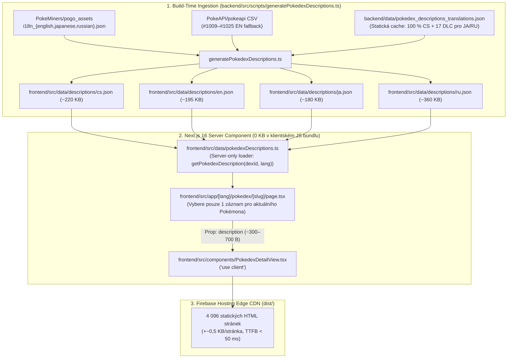

# Implementační plán: Oficiální Pokédex popisy (Flavor Text) pro všechny Pokémony a jejich formy

**Cílový dokument:** `docs/plans/pokedex-official-descriptions-plan.md`  
**Navazuje na výzkum:** [`docs/research/pokedex-flavor-text-and-motto-sources.md`](../research/pokedex-flavor-text-and-motto-sources.md)  
**Datum:** Listopad 2026  
**Status:** Připraveno ke schválení a realizaci  

---

## 1. Shoda na rozsahu (výstup z `/grill-me` & `/research`)

Na základě ověření primárních zdrojů a upřesnění požadavků platí tato závazná zadání:

1. **Čistý rozsah obsahu:** Přidat **pouze oficiální Pokédex popis** (bez dalších nadbytečných bloků jako výška/váha, audio pokřik či redakční slogany).
2. **Kanonický zdroj (1 popis na entitu):**
   - **Primární zdroj (98,3 % druhů + všechny GO formy):** Oficiální herní lokalizační JSON soubory Pokémon GO z `PokeMiners/pogo_assets` (`Texts/Latest APK/JSON/i18n_{english,japanese,russian}.json`).
     - *Kritické pravidlo z výzkumu:* **Nikdy** nepoužívat `Russian.txt` (v repozitáři je chybně španělsky) — vždy číst výhradně `Texts/Latest APK/JSON/i18n_russian.json` (autentická ruština v cyrilici).
     - *Zákaz scrapingu:* `pokemon.com` (chráněno WAF Imperva + zákaz v ToS) se nesmí scrapovat; slouží pouze jako UX inspirace.
   - **Sekundární fallback (17 DLC druhů `#1009–#1025`):** `PokeAPI/pokeapi` CSV (`pokemon_species_flavor_text.csv`, `language_id=9`) pro nejnovější hlavní hru (např. *Pokémon Scarlet* / *Pokémon Violet*).
3. **Dynamická podpora forem & variant:**
   - Při přepnutí varianty v `PokedexDetailView.tsx` (Mega, Primal, Gigantamax, Alola, Galar, Hisui, Paldea, Fúze, bojové/alternativní formy) se popis **automaticky přepne** na oficiální popis zvolené formy, pokud existuje (`pogo_assets` pokrývá 50/50 Mega/Primal, 34 G-Max pro všech 32 G-Max druhů a 95+ regionálních/fúzních forem v EN, JA i RU).
   - Pokud forma vlastní popis nemá (např. Shadow nebo základní Dynamax), čistě spadne na popis základního druhu.
4. **Vícejazyčnost (`cs`, `en`, `ja`, `ru`):**
   - **`en`**: 100 % oficiální texty (`pogo_assets` + 17 z PokéAPI).
   - **`ja`**: 98,3 % oficiální Niantic japonština (`pogo_assets`) + statický překlad pro zbývajících 17 Gen 9 DLC druhů `#1009–#1025` (PokéAPI u Gen 9 `ja` neobsahuje).
   - **`ru`**: 98,3 % oficiální Niantic ruština v cyrilici (`i18n_russian.json`) + statický překlad pro zbývajících 17 Gen 9 DLC druhů `#1009–#1025`.
   - **`cs`**: Kvalitní, terminologicky jednotný statický překlad z oficiálních EN textů uložený v repozitáři při build-time generování dat (oficiální český Pokédex neexistuje).
   - *Pravidlo jazykové čistoty:* Nikdy nemíchat nepřeloženou angličtinu do `/cs/`, `/ja/` nebo `/ru/` stránek (soulad s Google AdSense `answer/9727`).
5. **UI umístění & vizuální styl:**
   - Přímo v **Hero kartě** detailu Pokémona (`PokedexDetailView.tsx`) mezi pruhem typů / přepínačem forem a pruhem statistik.
   - Glassmorphic Pokédex `<blockquote>` box dle design systému z `AGENTS.md` (včetně kompletních `body.light-mode` override stylů) s jemným štítkem zdroje (např. `Pokédex • Pokémon GO` nebo `Pokédex • Scarlet` u nevydaných).
   - Katalogový přehled (`PokedexView.tsx`) zůstává čistý a beze změny.
6. **SEO & AdSense bezpečnost:**
   - Stávající unikátní `meta description` a `JSON-LD` v `frontend/src/app/[lang]/pokedex/[slug]/page.tsx` zůstávají **nedotčené**, aby nedošlo k penalizaci za duplicitní meta popisy vůči wiki webům.
   - Sémantické zabalení do `<blockquote className="pokedex-detail-lore-quote">` + `<cite>` (oficiální citace tvoří < 5 % textu stránky vedle vlastní redakční analýzy `generatePokedexEditorialAnalysis`).

---

## 2. Architektura & nulový dopad na klientský JS bundle

Stávající `frontend/src/data/pokedexCatalog.json` má **1,61 MB** a je importován klientskými komponentami (`PokedexView.tsx` i `PokedexDetailView.tsx`). Přidání 4jazyčných popisů přímo do katalogu by zvětšilo JS bundle o ~1,06 MB pro každého uživatele katalogu.

Proto data **striktně oddělíme** do per-locale JSON souborů načítaných **výhradně na serveru při SSG buildu**:



### Výkonnostní bilance
- **Klientský JS bundle (`PokedexView` i `PokedexDetailView`):** **+0 KB**
- **Velikost 1 statické HTML stránky:** **+300 až +700 B** (základní popis + případné popisy variant daného jednoho Pokémona)
- **Kompletní `dist/` (4 096 stránek):** ~2,0 MB navíc na disku, < 0,4 KB po gzip/brotli přenosu k uživateli.

---

## 3. Datové schéma (TypeScript)

Nový lehký soubor typů `frontend/src/types/pokedexDescription.ts` (sdílený mezi serverovým loaderem a klientskou komponentou `PokedexDetailView.tsx`):

```typescript
export interface PokedexDescriptionVariantEntry {
  /** Oficiální Pokédex popis dané formy */
  text: string;
  /** Zdroj popisu pro štítek <cite>, např. "Pokémon GO", "Pokémon Scarlet" */
  source: string;
}

export interface PokedexDescriptionEntry {
  /** Kanonický popis základního druhu */
  text: string;
  /** Zdroj popisu pro štítek <cite>, např. "Pokémon GO" nebo "Pokémon Scarlet" */
  source: string;
  /**
   * Popisy specifické pro varianty (klíč odpovídá PokedexVariant.id z pokedexCatalog.ts,
   * např. "CHARIZARD_MEGA_X", "CHARIZARD_GMAX", "RAICHU_ALOLA", "NECROZMA_DUSK_MANE").
   */
  variants?: Record<string, PokedexDescriptionVariantEntry>;
}

/** Mapa dexId (string) -> PokedexDescriptionEntry v každém souboru descriptions/{lang}.json */
export type PokedexDescriptionsMap = Record<string, PokedexDescriptionEntry>;
```

---

## 4. Krok za krokem — detailní implementační fáze

### Fáze 1: Datový generátor a mapování (`backend/`)

1. **Nový skript `backend/src/scripts/generatePokedexDescriptions.ts`** (spouštěný přes `npm.cmd run generate:pokedex-descriptions` v `backend/package.json`):
   - **Krok 1.1 — Načtení a cache primárních zdrojů (do `backend/.cache/pokedex_i18n/`):**
     - Stáhnout `https://raw.githubusercontent.com/PokeMiners/pogo_assets/master/Texts/Latest%20APK/JSON/i18n_english.json`
     - Stáhnout `https://raw.githubusercontent.com/PokeMiners/pogo_assets/master/Texts/Latest%20APK/JSON/i18n_japanese.json`
     - Stáhnout `https://raw.githubusercontent.com/PokeMiners/pogo_assets/master/Texts/Latest%20APK/JSON/i18n_russian.json` *(striktně JSON, ověřit přítomnost cyrilice jako runtime sanity check!)*
     - Volitelně doplnit 5 novějších záznamů z `Texts/Latest Remote/English.txt` & `Japanese.txt` (Eternamax Eternatus `#0890_2581`, Sinistea/Polteageist — nikdy `Russian.txt`).
     - Stáhnout `https://raw.githubusercontent.com/PokeAPI/pokeapi/master/data/v2/csv/pokemon_species_flavor_text.csv` a `versions.csv` pro fallback `#1009–#1025` (priorita verzí: `scarlet` → `violet` → `legends-arceus` → `sword` → `shield`).
   - **Krok 1.2 — Normalizace textu:**
     - Odstranit herní řídicí znaky (`\f`, `\r`, vícenásobné `\n` a dvojité mezery; u japonštiny zachovat přirozené mezery bez zbytečných zalomení).
     - Ořezat úvodní/koncové bílé znaky, normalizovat typografické uvozovky a pomlčky.
   - **Krok 1.3 — Přesné mapování klíčů `pogo_assets` → `pokedexCatalog.json`:**
     - Načíst `frontend/src/data/pokedexCatalog.json` jako zdroj pravdy pro seznam všech 1 024 `dexId` a všech `variant.id`.
     - **Základní druh:** `pokemon_desc_${pad4(dexId)}`. Pro 7 druhů bez základního klíče (`#905` Enamorus, `#916` Oinkologne, `#925` Maushold, `#931` Squawkabilly, `#964` Palafin, `#978` Tatsugiri, `#982` Dudunsparce) použít jejich výchozí formový klíč (`pokemon_desc_0905_2802`, `pokemon_desc_0916_2981` atd.).
     - **Mega & Primal evoluce (50/50):**
       - `*_MEGA_X` → `pokemon_desc_tmpevo_${pad4(dexId)}_0002`
       - `*_MEGA_Y` → `pokemon_desc_tmpevo_${pad4(dexId)}_0003`
       - ostatní `*_MEGA` / `*_PRIMAL` → `pokemon_desc_tmpevo_${pad4(dexId)}_0001`
     - **Gigantamax (32/32 druhů):**
       - `*_GMAX` → `pokemon_desc_${pad4(dexId)}_*_2` (a `_3` pro `URSHIFU_RAPID_STRIKE_GMAX` pokud existuje jako samostatná varianta).
     - **Regionální, fúzní a bojové formy:**
       - Deterministická mapovací tabulka pro `pokemon_desc_XXXX_YYYY` a `pokemon_desc_XXXX_<name>` → přesné `PokedexVariant.id` (Alola, Galar, Hisui, Paldea, Dusk Mane / Dawn Wings Necrozma, Black / White Kyurem, Zacian Crowned Sword, Zamazenta Crowned Shield, Deoxys, Giratina, Shaymin, Lycanroc, Urshifu, Calyrex atd.) + logování všech případně nenamapovaných variant při spuštění skriptu.
     - **Deduplikace variant:** Pokud je text varianty identický s textem základního druhu, neukládat jej do `variants` (úspora místa, UI přirozeně použije základní popis).
   - **Krok 1.4 — Validace pokrytí & kontrola kvality:**
     - Skript na konci vypíše přesný report pokrytí pro `en`, `ja`, `ru`, `cs` (počet base druhů, počet variant s vlastním popisem, počet fallbacků na PokéAPI, případné chybějící překlady).
     - Ověří, že žádný `ru` záznam neobsahuje španělštinu a že žádný `cs` záznam nepadá tiše do angličtiny.

### Fáze 2: Statická překladová vrstva (`cs` + 17 DLC druhů pro `ja` a `ru`)

1. **Struktura překladového zdroje `backend/data/pokedex_descriptions_translations.json`:**
   - Oddělený verzovaný soubor obsahující:
     - Kompletní české (`cs`) překlady všech ~1 024 základních druhů + ~170–220 unikátních formových popisů (celkem cca ~1 200 krátkých 1–2větých popisů).
     - Doplněné `ja` a `ru` překlady pro 17 DLC druhů `#1009–#1025` (pokud některé z nich chybí v `i18n_japanese.json` / `i18n_russian.json`).
2. **Terminologický glosář pro češtinu (`cs`):**
   - Ponechat originální anglické názvy Pokémonů (Ivysaur, Charizard, Pikachu — soulad se zbytkem aplikace a `pokemonTranslator.ts`).
   - Jednotné české herní pojmy: *Poké Ball*, *Mega Evoluce*, *Gigantamax*, *Dynamax*, *Alola / Galar / Hisui / Paldea* (přídavná jména *alolský*, *galarský*, *hisuiský*, *paldejský* nebo ustálené formulace), přirozená čtivá čeština bez strojových kalků.
   - Zkontrolovat a ručně doladit minimálně **Top ~200 indexovaných meta Pokémonů** (dle `isTopMetaPokedexEntry()`).
3. **Vygenerování finálních produkčních souborů:**
   - `frontend/src/data/descriptions/cs.json`
   - `frontend/src/data/descriptions/en.json`
   - `frontend/src/data/descriptions/ja.json`
   - `frontend/src/data/descriptions/ru.json`
   - *(Volitelný bonus, pokud budeš chtít v rámci samostatného kroku: oprava `names.ru` v `generatePokedexCatalog.ts` pomocí `pokemon_name_XXXX` z `i18n_russian.json` — dnes má katalog u mnoha druhů anglické jméno v `names.ru`.)*

### Fáze 3: Server-Only datový loader & napojení na Next.js SSG (`frontend/`)

1. **Nový soubor `frontend/src/types/pokedexDescription.ts`** — export rozhraní `PokedexDescriptionEntry`, `PokedexDescriptionVariantEntry`, `PokedexDescriptionsMap`.
2. **Nový serverový helper `frontend/src/data/pokedexDescriptions.ts`:**
   - Importuje `descriptions/{cs,en,ja,ru}.json`.
   - Exportuje funkci `getPokedexDescription(dexId: number, lang: Language): PokedexDescriptionEntry | null`.
   - Helper **nesmí** být importován žádnou `'use client'` komponentou (vynutitelné i v testu / komentářem).
3. **Úprava `frontend/src/app/[lang]/pokedex/[slug]/page.tsx`:**
   - Načíst `const description = getPokedexDescription(entry.dexId, validLang);`.
   - Předat jako prop do `<PokedexDetailView entry={entry} lang={validLang} description={description} />`.
   - `generateMetadata()` a `JSON-LD` zůstávají **beze změny** (zachování unikátních SEO meta popisů).

### Fáze 4: UI komponenta & styly (`PokedexDetailView.tsx`, `PokedexDetailView.css`, `translations.ts`)

1. **Překlady UI popisků v `frontend/src/data/translations.ts` (všechny 4 jazyky):**
   - `pokedex_detail_lore_label`:
     - `cs`: `"Pokédex záznam"`
     - `en`: `"Pokédex Entry"`
     - `ja`: `"ポケモン図鑑"`
     - `ru`: `"Запись Покедекса"`
2. **Úprava `frontend/src/components/PokedexDetailView.tsx`:**
   - Přidat volitelnou prop `description?: PokedexDescriptionEntry | null`.
   - Vypočítat aktivní popis v `useMemo`:
     ```tsx
     const activeDescription = useMemo(() => {
       if (!description) return null;
       if (activeVariant && description.variants?.[activeVariant.id]) {
         return description.variants[activeVariant.id];
       }
       return { text: description.text, source: description.source };
     }, [description, activeVariant]);
     ```
   - Vložit čistý glassmorphic Pokédex quote box do `.pokedex-detail-hero-info` **hned pod `.pokedex-detail-types-strip`** (nad přepínačem forem a statistikami — případně hned pod přepínačem forem, aby změna popisu při kliknutí na formu byla okamžitě zřejmá přímo pod prstem):
     - Sémantický element `<figure className="pokedex-detail-lore-box">` s `<blockquote className="pokedex-detail-lore-text">„{activeDescription.text}“</blockquote>` a `<figcaption className="pokedex-detail-lore-meta">` s ikonkou `BookOpen` z `lucide-react` a jemným štítkem `{t.pokedex_detail_lore_label} • {activeDescription.source}`.
     - Pokud `activeDescription` neexistuje, box se vůbec nevykreslí (žádné prázdné rámečky).
3. **Styly v `frontend/src/components/PokedexDetailView.css`:**
   - Tmavý režim (dle `AGENTS.md`):
     - Jemný glassmorphic povrch (`background: rgba(168, 85, 247, 0.06)` / `rgba(255, 255, 255, 0.03)`), levý akcentní pruh (`border-left: 3px solid var(--accent-color)`), `border: 1px solid var(--border-color)`, `border-radius: 12px`, `padding: 12px 14px`.
     - Čitelná typografie (`font-size: 0.88rem`, `line-height: 1.55`, `color: var(--text-secondary)`), jemná animace při přepnutí formy.
     - Malý nenápadný štítek zdroje (`font-size: 0.72rem`, `color: var(--text-muted)`, `font-weight: 700`).
   - **Světlý režim (`body.light-mode`):**
     - Explicitní override dle `AGENTS.md`: `background-color: #f8fafc !important;`, `border-color: rgba(15, 23, 42, 0.14) !important;`, `border-left-color: #7e22ce !important;`, text `#1e293b !important;`, meta `#475569 !important;`.
   - Mobilní responzivita (`< 768px`): čisté zalomení bez přetékání.

---

## 5. Verifikační a testovací plán

Před dokončením a nasazením ověřit všechny vrstvy:

1. **Jednotkové testy datové integrity (`frontend/src/data/pokedexDescriptions.test.ts`):**
   - Každý z 1 024 Pokémonů v `POKEDEX_CATALOG` má neprázdný `text` a `source` ve všech 4 jazycích (`cs`, `en`, `ja`, `ru`).
   - Žádný text neobsahuje řídicí znaky (`\f`, `\r`, `\n`) ani prázdné placeholdery.
   - Ověření jazykové čistoty:
     - `ru.json` obsahuje cyrilici (kontrola proti chybnému španělskému `Russian.txt`!).
     - `ja.json` obsahuje japonské znaky (hiragana/katakana/kanji).
     - `cs.json` není identický s `en.json`.
   - Ověření formových popisů pro referenční druhy:
     - `#2` Ivysaur (základní popis)
     - `#6` Charizard (`CHARIZARD_MEGA_X`, `CHARIZARD_MEGA_Y`, `CHARIZARD_GMAX`)
     - `#26` Raichu (`RAICHU_ALOLA`)
     - `#144` Articuno (`ARTICUNO_GALARIAN`)
     - `#800` Necrozma (`NECROZMA_DUSK_MANE`, `NECROZMA_DAWN_WINGS`)
     - `#1024` Terapagos / `#1009–#1025` (PokéAPI fallback).
2. **Testy backendu (`backend/src/scripts/__tests__` nebo `npm.cmd test`):**
   - Otestovat normalizační a mapovací logiku skriptu (`normalizeFlavorText`, mapování Mega/Primal/G-Max/Regional klíčů).
3. **Povinné ověřovací příkazy dle `AGENTS.md`:**
   ```powershell
   # 1. Frontend testy
   cd frontend
   npm.cmd test

   # 2. Backend testy & TypeScript build
   cd ../backend
   npm.cmd test
   npm.cmd run build

   # 3. Produkční Next.js SSG build (4 096+ statických stránek)
   cd ../frontend
   npm.cmd run build:deploy
   ```
4. **Vizuální a bundle kontrola po `build:deploy`:**
   - Ověřit, že soubory `descriptions/{cs,en,ja,ru}.json` nejsou obsaženy v žádném klientském JS chunku v `frontend/out/_next/static/chunks/`.
   - Zkontrolovat vygenerované HTML např. pro `/cs/pokedex/ivysaur`, `/en/pokedex/charizard`, `/ja/pokedex/raichu`, `/ru/pokedex/articuno` (správný text, správný štítek zdroje, nedotčený `<meta name="description">`).
   - Ověřit zobrazení v dark mode i light mode na desktopu i mobilu.

---

## 6. Přehled souborů k vytvoření / úpravě

| Soubor | Akce | Účel |
|---|---|---|
| `backend/src/scripts/generatePokedexDescriptions.ts` | Nový | Stažení `pogo_assets` JSON + PokéAPI CSV fallback, mapování druhů & forem, generování 4 JSON souborů |
| `backend/package.json` | Úprava | Přidat skript `"generate:pokedex-descriptions"` |
| `backend/data/pokedex_descriptions_translations.json` | Nový | Verzovaný překladový zdroj (`cs` + 17 Gen 9 DLC pro `ja`/`ru`) |
| `frontend/src/types/pokedexDescription.ts` | Nový | TypeScript rozhraní pro Pokédex popis |
| `frontend/src/data/descriptions/{cs,en,ja,ru}.json` | Nové (generované) | Oddělené per-locale statické datasety |
| `frontend/src/data/pokedexDescriptions.ts` | Nový | Server-only loader `getPokedexDescription(dexId, lang)` |
| `frontend/src/data/pokedexDescriptions.test.ts` | Nový | Testy 100% pokrytí, formových mapování a jazykové čistoty |
| `frontend/src/app/[lang]/pokedex/[slug]/page.tsx` | Úprava | Načtení popisu na serveru a předání prop `description` |
| `frontend/src/components/PokedexDetailView.tsx` | Úprava | Vykreslení Pokédex quote boxu v Hero kartě s přepínáním podle `activeVariant` |
| `frontend/src/components/PokedexDetailView.css` | Úprava | Glassmorphic dark & light mode styly quote boxu + kompletní styly `.pokedex-variant-chip` |
| `frontend/src/data/translations.ts` | Úprava | Přidat `pokedex_detail_lore_label` pro `cs`, `en`, `ja`, `ru` |

---

## 7. Přidané opravy chyb (součást stejného nasazení)

1. **Prokliky z Rankings do Pokédexu (`frontend/src/components/PokemonRankingsView.tsx` & `.css`, `PokedexDetailView.tsx`):**
   - Nativní `<a href>` odkazy na názvu, obrázku i counters v rozbaleném panelu + spolehlivý klik na řádek (`window.location.assign` s ignorováním vnitřních tlačítek/odkazů/označení textu) bez rizika selhání Next.js 16 static-export RSC prefetchingu.
   - Odstraněn mrtvý 404 fetch `/api/rankings`; rozšířen fallback `?variant=` v `PokedexDetailView.tsx` (např. `PALKIA_ORIGIN_SHADOW` → `PALKIA_ORIGIN`).
2. **Oprava 35 špatně namapovaných PokeAPI sprite ID (včetně Mega Rayquaza → Primal Kyogre):**
   - Opraveno všech 24 posunutých ID v `CANONICAL_MEGA_POKEAPI_IDS` + `EISCUE_NOICE` (`10186` → `10185`) v `backend/src/scripts/generatePokedexCatalog.ts` a přegenerován `pokedexCatalog.json` (**0 nesouladů** proti PokeAPI `pokemon.csv`).
   - Opraveno 10 nesouladů v `SPECIAL_FORM_ARTWORK_MAP` v `frontend/src/utils/imageResolver.ts` (Mega Latios/Latias, Mega Camerupt/Slowbro/Steelix, Mega Greninja, Hisuian Typhlosion/Arcanine/Electrode/Goodra).
3. **Ztráta stylů tlačítek forem/variant (`.pokedex-variant-chip`):**
   - Kompletní dark + `body.light-mode` styly pro `.pokedex-variant-chip` přidány přímo do `frontend/src/components/PokedexDetailView.css` (dříve existovaly pouze v `PokedexView.css`, takže při přímém vstupu na detail chyběly).
