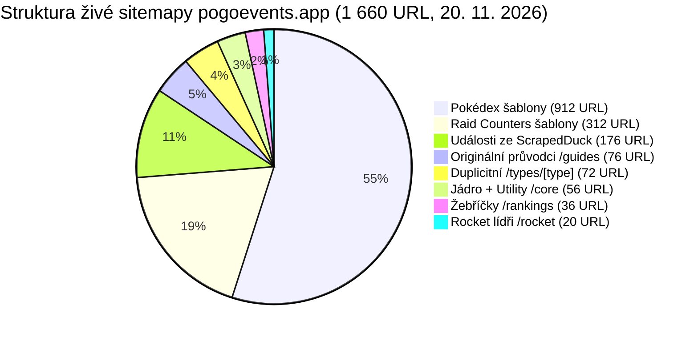
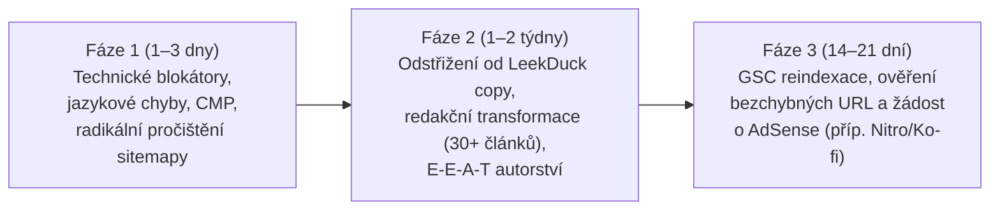

# Hloubkový forenzní výzkum: Proč Google AdSense opakovaně zamítá `pogoevents.app` za „Obsah nízké hodnoty“, zatímco `leekduck.com` zobrazuje reklamy (Listopad 2026)

**Datum výzkumu:** 20. listopadu 2026  
**Zkoumané domény:** `https://pogoevents.app` vs. `https://leekduck.com`  
**Analyzovaný stav repozitáře:** `HEAD` (`4d550c3`, po commitech `bc1d63b`, `8678e73`, `b189eb3`, `90cee76`, `4d550c3`)  
**Google Publisher ID (`pogoevents.app`):** `ca-pub-8800056915088711`  
**Typ dokumentu:** Primárně-zdrojový technický, obsahový a strategický audit

---

## Stručné shrnutí (Executive Summary)

Otázka *„Proč Google AdSense opakovaně zamítá `pogoevents.app` za Obsah nízké hodnoty, když velmi podobný web `leekduck.com` normálně zobrazuje reklamy?“* má **dvě zásadní, živým měřením doložené odpovědi** — jednu **strategickou („plot twist“)** a druhou **technicko-obsahovou**:

### 1. Zásadní odhalení: `leekduck.com` vůbec nepoužívá Google AdSense!
Přímou kontrolou živého souboru `https://leekduck.com/ads.txt` (346 řádků, 42 reklamních sítí/SSP) a zdrojového HTML kódu stránek `https://leekduck.com/`, `/events/`, `/research/`, `/raid-bosses/` a `/about/` bylo zjištěno, že:
- Na celém webu `leekduck.com` se nachází **0 výskytů** skriptu Google AdSense (`adsbygoogle.js` / `pagead2.googlesyndication.com`).
- LeekDuck místo AdSense běží na **specializované herní header-biddingové síti Nitro (dříve NitroPay, dnes součást Overwolfu)** — přes skript `https://s.nitropay.com/ads-642.js` a deklaraci `MANAGERDOMAIN=nitropay.com` / `nitropay.com, 574, DIRECT` v `ads.txt`.
- Přístup k poptávce Googlu získává LeekDuck prostřednictvím **Google Ad Manageru / Google AdX přes MCM (Multiple Customer Management)** vedeného NitroPayem (`google.com, pub-7439041255533808, RESELLER` a `pub-9872233689689746, DIRECT`) vedle dalších 40+ SSP (Amazon TAM, PubMatic, OpenX, Magnite/Rubicon, Index Exchange, Blockthrough adblock recovery).
- **Co to znamená:** Srovnávat schvalovací proces otevřeného samoobslužného **Google AdSense** (extrémně citlivého na agregátory a programatické databáze) s kurátorovanou herní sítí **Nitro / Google AdX MCM** (která je přímo postavena pro herní trackery, databáze a nástroje se 100k+ zobrazení měsíčně) znamená srovnávat dva rozdílné ekosystémy s odlišnými schvalovacími mechanismy.

### 2. Proč i v přímém srovnání obsahu a technické kvality `pogoevents.app` u AdSense selhává
I po velké přestavbě v commitu `bc1d63b` (9. listopadu 2026) — která vyřešila část dřívějších chyb z předchozích auditů — **živá produkční verze `https://pogoevents.app/` stále vykazuje 8 tvrdých blokátorů**, které u automatizovaného klasifikátoru Google (`Mediapartners-Google` / `Googlebot`) i lidského kontrolora vyvolávají zamítnutí *Obsah nízké hodnoty (Low Value Content)*:

1. **Upstream vs. Downstream (Scraped Content + vlastní doznání v postranním panelu na každé stránce):** `leekduck.com` je od roku 2016 *primárním zdrojem* (autorem vlastních infografik, zpráv a tabulek). `pogoevents.app` je *downstream odběratel* dat ze **ScrapedDuck** (který scrapuje přímo LeekDuck) — na živé domovské stránce `pogoevents.app/` bylo naměřeno **109 odkazů/referencí na `leekduck`**, na stránce události `/en/events/season-24-twilight-trails` bylo zjištěno **30 doslovně shodných 6slovných frází** z `leekduck.com`, a v levém postranním panelu **každé jednotlivé stránky** navíc trvale svítí text **„Event data powered by Leek Duck“** s přímým odkazem na `leekduck.com` ([AppShell.tsx](file:///C:/PROJEKTY/OSOBN%C3%8D/Pokemon-GO-event-tracker/frontend/src/components/AppShell.tsx#L420-L432)).
2. **Nafouknutý poměr programatických „Mad-Libs“ šablon vůči originálním článkům (81,4 % vs. 4,6 %):** Zatímco `leekduck.com/sitemap.xml` indexuje pouhých **371 čistých anglických URL** (0 Pokédex stránek), `pogoevents.app` má v živé sitemapě stále **1 660 URL** (a v `frontend/dist/` nasazeno **5 127 HTML souborů**!). Z 1 660 URL tvoří **912 URL (54,9 %)** šablonové karty Pokédexu, **312 URL (18,8 %)** šablonové raid countery, **72 URL (4,3 %)** duplicitní `/types/[type]` a **36 URL (2,2 %)** žebříčky — celkem **81,4 % programatických šablon** (s Jaccardovou slovní shodou **57 %–76 %** mezi sousedními stránkami) oproti pouhým **76 URL (4,6 %)** skutečných redakčních článků (`19 průvodců × 4 jazyky`).
3. **Závažné jazykové chyby a smíšené jazyky napříč CS/EN/JA/RU na živé produkci:**
   - Všech **176 URL událostí** (včetně `/en/events/*`, `/ja/events/*`, `/ru/events/*`) má natvrdo **český `<title>` tag** (`– Průvodce, Bonusy & Counters | Pokémon GO`, [events/\[slug\]/page.tsx](file:///C:/PROJEKTY/OSOBN%C3%8D/Pokemon-GO-event-tracker/frontend/src/app/%5Blang%5D/events/%5Bslug%5D/page.tsx#L197)).
   - Všech **912 indexovaných Pokédex stránek** (včetně `/en/`, `/ja/`, `/ru/`) vkládá do cizojazyčného textu **české slovo `skóre`** (např. `Great League (1500 CP): #389 (skóre 77.9)` v [pokedexSeoHelper.ts](file:///C:/PROJEKTY/OSOBN%C3%8D/Pokemon-GO-event-tracker/frontend/src/utils/pokedexSeoHelper.ts#L209-L211)), anglické názvy typů a na české verzi dokonce polský/slovenský překlep *„Ze zadań Field Research“* (ř. 243).
   - Na `/ja/` a `/ru/` stránkách se v postranním panelu vypisuje anglický disclaimer ([AppShell.tsx](file:///C:/PROJEKTY/OSOBN%C3%8D/Pokemon-GO-event-tracker/frontend/src/components/AppShell.tsx#L415-L421)) a na událostech se vypisují nepřeložené anglické bonusy ze ScrapedDucku.
4. **Důkaz přímo z Google Search Console (`Crawled – currently not indexed`):** Export [pogoevents.app-Coverage-Validation-2026-08-20.xlsx](file:///C:/PROJEKTY/OSOBN%C3%8D/Pokemon-GO-event-tracker/pogoevents.app-Coverage-Validation-2026-08-20.xlsx) potvrzuje, že Googlebot procházel vícejazyčné `/pokemon/*` a `/events/*` stránky a opakovaně je odmítal zařadit do indexu (stav validace: *Nezdařilo se*).
5. **Chyby v technické implementaci AdSense, CMP a strukturovaných dat:**
   - [AdSenseScript.tsx](file:///C:/PROJEKTY/OSOBN%C3%8D/Pokemon-GO-event-tracker/frontend/src/components/AdSenseScript.tsx#L18-L35) spouští `adsbygoogle.js` i na čistě herní stránce `/pokedle` (314 slov, přidané 19. 11. 2026), nástrojích `/filter` a `/friends` a na všech **3 180 `noindex` Pokédex stránkách**.
   - Stránka `/privacy` v [legalData.ts](file:///C:/PROJEKTY/OSOBN%C3%8D/Pokemon-GO-event-tracker/frontend/src/data/legalData.ts#L125-L128) deklaruje aktivní certifikovanou lištu souhlasu **CMP (IAB TCF v2.2)**, ta však v HTML/kódu vůbec neběží (ani Consent Mode v2 pro GA4).
   - Domovská stránka [page.tsx](file:///C:/PROJEKTY/OSOBN%C3%8D/Pokemon-GO-event-tracker/frontend/src/app/%5Blang%5D/page.tsx#L131-L135) publikuje **fiktivní `AggregateRating` (`4.9` z `1250` hodnocení)** bez reálného systému uživatelských recenzí na stránce.
   - Zrušené události (`[Canceled] Max Monday`) jsou indexovány v `sitemap-events.xml`; `/[lang]/types/[type]` stále vykresluje duplicitní `<PokemonRankingsView />` se dvěma `<h1>`; `/cs/raids/kyurem-counters` míchá název `Black Kyurem` s CP základního Kyurema.
   - **Časová prodleva po commitu `bc1d63b`:** Velké pročištění sitemapy proběhlo teprve 9. listopadu 2026 — v mezipaměti Googlu (Search Index) stále přetrvávají tisíce starých tenkých URL a v `guidesData.ts` je stále jen 19 článků bez pojmenovaného lidského autora (chybí silné E-E-A-T signály).

---

## 1. Co přesně znamená zamítnutí AdSense „Obsah nízké hodnoty“ (Primární zdroje Google)

Zamítnutí s důvodem **„Obsah nízké hodnoty“ (Low value content)** v rozhraní Google AdSense není izolovaný bug, ale zastřešující verdikt propojující **Google Publisher Policies**, **AdSense Program Policies** a **Google Search Spam Policies** (včetně aktualizací z března 2024 pro *Scaled Content Abuse*).

### A. Google AdSense — Minimální požadavky na obsah a připravenost webu
- **Zdroj:** [Ensure your site is ready for AdSense (answer/10015918)](https://support.google.com/adsense/answer/10015918) & [Sites that need attention / Low value content (answer/10502938)](https://support.google.com/adsense/answer/10502938)
- **Klíčová kritéria Google:**
  1. **Dostatečný objem unikátního redakčního obsahu:** Web musí obsahovat dostatek původního, souvislého textu, aby robot i hodnotitel dokázali jednoznačně určit tematické zaměření a originální přínos webu. U webových nástrojů, kalkulaček a databází automatický klasifikátor vyhodnocuje poměr originálního textu vůči skriptům a šablonovým tabulkám.
  2. **Žádný replikovaný/převzatý obsah:** Stránky, které pouze přebírají data nebo texty z jiných webů (včetně automatizovaných feedů a komunitních JSON API), porušují zásady, pokud k nim nepřidají podstatný autorský vhled a analýzu.
  3. **Indexace v Google Search a čistá navigace:** AdSense neposuzuje jen URL, kterou pošlete v žádosti, ale **celý indexovaný profil domény v Google Search**. Pokud většina indexovaných URL trpí tenkým obsahem, chybami šablon nebo smíšenými jazyky, dojde k zamítnutí celé domény (*site-level quality classifier*).
  4. **Důvěryhodnost a povinné stránky (E-E-A-T):** Transparentní *About Us* (kdo web tvoří a jakou má zkušenost), *Contact*, *Privacy Policy* (včetně doložky o cookies Google AdSense/DoubleClick dle [answer/48182](https://support.google.com/adsense/answer/48182)) a pro EHP/UK/CH certifikovaná **CMP integrovaná s IAB TCF v2.2** ([answer/13554116](https://support.google.com/adsense/answer/13554116)).

### B. Google Publisher Policies — Hodnota inventáře (*Inventory Value*)
- **Zdroj:** [Google Publisher Policies — Obrazovky bez obsahu majitele stránek (answer/11112688)](https://support.google.com/publisherpolicies/answer/11112688) & [Replikovaný obsah (answer/11190248)](https://support.google.com/publisherpolicies/answer/11190248)
- **Zákaz reklam na obrazovkách bez redakčního obsahu (`answer/11112688`):** Zakazuje zobrazovat reklamy Google (resp. spouštět `adsbygoogle.js` s Auto Ads) na obrazovkách:
  - bez dostatečného obsahu majitele stránek,
  - ve výstavbě nebo s rozbitou lokalizací/šablonami,
  - sloužících převážně k navigaci, filtrování, upozorněním nebo interaktivnímu chování bez redakční prózy (např. čistá hádací minihra, generátor řetězců, nástěnka kódů přátel, stránky s `noindex`).
- **Zákaz replikovaného obsahu (`answer/11190248`):** Výslovně zakazuje monetizovat obsah zkopírovaný z cizích zdrojů bez podstatné vlastní hodnoty, a to **i tehdy, když uvedete odkaz na původní zdroj** nebo máte povolení data sdílet.

### C. Google Search Essentials & Spam Policies (přímo provázané s kontrolou AdSense)
- **Zdroj:** [Spam Policies for Google Web Search](https://developers.google.com/search/docs/essentials/spam-policies) & [Creating helpful, reliable, people-first content](https://developers.google.com/search/docs/fundamentals/creating-helpful-content)
- Čtyři přesné definice, které přímo zasahují `pogoevents.app`:
  1. **Scraped content (Převzatý obsah):** Stahování a znovupublikování obsahu z jiných webů (automatizovaně či ručně) — včetně reprodukce cizích datových feedů nebo mírného přepisování/překládání — bez poskytnutí výrazné vlastní redakční přidané hodnoty.
  2. **Scaled content abuse (Zneužívání škálovaného obsahu — zpřísněno březen 2024):** Masové generování velkého množství stránek za účelem pokrytí vyhledávacích dotazů (ať už programatickou šablonou z JSON databáze, AI nebo kombinací), kde se mění pouze čísla, názvy entit a předpřipravené věty (*Mad-Libs templating*).
  3. **Doorway abuse (Vstupní stránky):** Vytváření desítek či stovek téměř totožných podstránek cílících na varianty dotazů (např. `/types/fire` vs. `/rankings/attackers-fire` vs. `/rankings/great-league`), které všechny zobrazují téměř identický výstup stejného nástroje.
  4. **People-first content & E-E-A-T:** Google hodnotí rámec *Who, How, Why* — zda obsah vznikl z reálné první zkušenosti konkrétního autora (*Experience*), nikoli automatickým sléváním cizích JSON feedů do šablon ve 4 jazycích bez jazykové korektury.

---

## 2. Forenzní srovnání: `LeekDuck.com` vs. `PogoEvents.app`

Všechny hodnoty v následující tabulce byly naměřeny **přímo ze živých veřejných endpointů obou domén dne 20. listopadu 2026** (bez JavaScriptu — tedy přesně to, co vidí prvotní HTML crawler Googlebota / AdSense).

| Dimenze / Metrika | `https://leekduck.com/` | `https://pogoevents.app/` | Dopad na schválení AdSense |
|---|---|---|---|
| **Použitá reklamní síť (doloženo z `ads.txt` a HTML)** | **Nitro (NitroPay / Overwolf)** (`s.nitropay.com/ads-642.js`, `MANAGERDOMAIN=nitropay.com`, 346 řádků v `ads.txt`, 42 SSP vč. Google AdX MCM, Amazon TAM, Blockthrough). **0× `adsbygoogle.js`!** | **Google AdSense** (`ca-pub-8800056915088711`, 1 řádek v `ads.txt`, klientský `AdSenseScript.tsx`, `ENABLE_ADS = false` v `AdContainer.tsx`). | **ZÁSADNÍ ROZDÍL:** LeekDuck vůbec neprochází samoobslužným filtrem Google AdSense pro malé/nové weby — je v kurátorované herní síti Nitro (AdX MCM). |
| **Role v datovém řetězci** | **Primární upstream zdroj (od 2016):** Vlastní redakční tvorba událostí, ručně dělané infografiky, vlastní novinky `/posts/`, originální grafické assety (`cdn.leekduck.com`). | **Downstream konzument (2026):** Stahuje data ze **ScrapedDuck** (který scrapuje LeekDuck) a z `leekduck.com` / `pokemongohub.net` ([scraper.ts](file:///C:/PROJEKTY/OSOBN%C3%8D/Pokemon-GO-event-tracker/backend/src/scraper.ts)). Na HP je **109 referencí na `leekduck`**, na každé stránce text *„Event data powered by Leek Duck“*. | **KRITICKÁ NEVÝHODA:** Google jednoznačně rozpozná původce obsahu vs. agregátor ([answer/11190248](https://support.google.com/publisherpolicies/answer/11190248)). |
| **Počet URL v `sitemap.xml`** | **371 URL celkem** (`253` events, `49` editorial `/posts/`, `43` Go Fest/Wild Area hubů, `26` sekcí/hubů). **0 Pokédex stránek.** | **1 660 URL celkem** v 5 sub-sitemapách (v `dist/` nasazeno **5 127 HTML souborů**; ještě před 11 dny bylo v sitemapě **4 944 URL**). | **KRITICKÁ NEVÝHODA:** 4,5× více indexovaných URL (a donedávna 13× více), z toho 81,4 % programatických šablon. |
| **Jazyková struktura** | **1 jazyk (`en`)** — 100% rodilá, ručně psaná angličtina bez jediného jazykového úniku. | **4 jazyky (`cs`, `en`, `ja`, `ru`)** — programaticky multiplikováno ×4, se závažnými chybami: české `<title>` na EN/JA/RU událostech, české slovo `skóre` na EN/JA/RU Pokédexu, anglický sidebar na JA/RU, nepřeložené EN bonusy na CS/JA/RU. | **KRITICKÁ NEVÝHODA:** Rozbitá vícejazyčnost spouští flag *neúplný / strojově generovaný web* ([answer/11112688](https://support.google.com/publisherpolicies/answer/11112688)). |
| **Měřený SSR obsah (živé HTML bez JS)** | `/` = 249 slov (hub), `/events/` = **1 858 slov**, `/research/` = **3 202 slov**, `/events/pokemon-go-fest-2026-chicago/` = **3 250 slov** + 292 obrázků, `/posts/pokemon-go-level-80-update-details/` = **943 slov**, `/privacy-policy/` = **2 202 slov**. | `/cs` = 961 slov, `/cs/guides/galarian-birds...` = **1 822 slov**, `/cs/pokedle` = **314 slov**, `/cs/pokedex/venusaur` = 1 023 slov (**75,1 % slovní shoda** s `charizard`), `/cs/raids/kyurem-counters` = 793 slov (**76,2 % shoda** s `zekrom`), `/cs/events/max-mondays-2026-11-16` = 732 slov (zrušený event!). | Nejde jen o počet slov, ale o **unikátnost textu**: `pogoevents.app` má sice 700–1 000 slov na podstránce, ale 57–76 % z nich tvoří opakující se šablonový boilerplate. |
| **Identita tvůrce & E-E-A-T** | Jmenovitý tvůrce (*„Hey, I'm LeekDuck“*, NYC, působí od 2016), miliony sledujících na X/Instagram/Twitch/YouTube, Patreon, statisíce zpětných odkazů z Redditu a herních médií. | Anonymní „PoGo Events Team“ bez lidského jména autora/šéfredaktora v `/about` i v `Article` JSON-LD; fiktivní `AggregateRating` (`4.9 / 1250`) na homepage; mladá doména (2026) s minimálním organickým profilem. | **VYSOKÁ NEVÝHODA:** Nízká autorita domény + slabé E-E-A-T znamená, že AdSense kontrola je u nového webu řádově přísnější. |
| **CMP / Souhlas s cookies** | Integrovaná CMP vrstva přímo v rámci NitroPay (`cmp` + `googletag` + `nitroAds` v HTML) + 2 202slovná `/privacy-policy/`. | `/privacy` (594 slov) tvrdí, že web má certifikovanou **IAB TCF v2.2 CMP**, ale v produkčním HTML žádná CMP lišta ani Google Consent Mode v2 neexistuje. | **VYSOKÁ NEVÝHODA:** Přímý nesoulad s EU User Consent Policy ([answer/13554116](https://support.google.com/adsense/answer/13554116)). |

### Rozpad živé sitemapy `pogoevents.app` (stav 20. 11. 2026 — 1 660 URL) vs. `leekduck.com` (371 URL)



> [!IMPORTANT]
> Zatímco **originální redakční průvodci (`/guides/*`)** představují jedinou skutečně vysoce hodnotnou, ručně psanou část webu (1 300–2 700 slov unikátního textu na článek), v živé sitemapě tvoří pouhých **4,6 % všech URL (76 z 1 660)**! Zbývajících **81,4 % sitemapy (1 352 URL)** stále připadá na programaticky skládané „Mad-Libs“ karty a tabulky a **10,6 % (176 URL)** na události syntetizované ze ScrapedDucku.

---

## 3. Konkrétní příčiny zamítnutí na `pogoevents.app` (seřazeno podle závažnosti)

Níže jsou seřazeny všechny aktuálně přítomné (živě ověřené) příčiny na `https://pogoevents.app/` s přesnými odkazy do kódu a naměřenými důkazy.

---

### KRITICKÉ PŘÍČINY (Okamžité spouštěče automatického i lidského zamítnutí)

#### K1. Přímá obsahová a vizuální závislost na LeekDuck / ScrapedDuck + přiznání v sidebaru každé stránky
- **Důkaz v kódu:**
  - [AppShell.tsx](file:///C:/PROJEKTY/OSOBN%C3%8D/Pokemon-GO-event-tracker/frontend/src/components/AppShell.tsx#L420-L432): Na **každé stránce celého webu** se v levém postranním panelu natvrdo vypisuje:
    ```tsx
    {lang === 'cs' ? 'Data událostí poskytuje ' : 'Event data powered by '}
    <a href="https://leekduck.com" ...>Leek Duck</a>.
    ```
  - [layout.tsx](file:///C:/PROJEKTY/OSOBN%C3%8D/Pokemon-GO-event-tracker/frontend/src/app/layout.tsx#L22): Globální `<meta name="keywords">` obsahuje přímo klíčové slovo konkurenta `'leek duck'`.
  - [legalData.ts](file:///C:/PROJEKTY/OSOBN%C3%8D/Pokemon-GO-event-tracker/frontend/src/data/legalData.ts#L205-L208): Stránka `/about` výslovně popisuje web jako agregátor dat ze ScrapedDuck a LeekDuck.
  - [backend/src/ingest/scrapedDuckIngest.ts](file:///C:/PROJEKTY/OSOBN%C3%8D/Pokemon-GO-event-tracker/backend/src/ingest/scrapedDuckIngest.ts) a [backend/src/scraper.ts](file:///C:/PROJEKTY/OSOBN%C3%8D/Pokemon-GO-event-tracker/backend/src/scraper.ts): Backend obsahuje 26 referencí na `scrapedduck`, 19 na `leekduck`, 3 na `pokemongohub` a při scrapingu používá falešné `Googlebot`/`Bingbot` User-Agent hlavičky (14 výskytů v `scraper.ts`).
- **Důkaz na živé produkci (20. 11. 2026):**
  - Na živé homepage `https://pogoevents.app/cs` bylo v HTML naměřeno **109 výskytů řetězce `leekduck`** (primárně obrázky `cdn.leekduck.com` a odkazy na události).
  - Přímé porovnání živé stránky `https://pogoevents.app/en/events/season-24-twilight-trails` oproti `https://leekduck.com/events/season-24-twilight-trails/` odhalilo **30 doslovně shodných 6slovných frází** (např. *„one guaranteed candy xl when trading pokémon for trainers level 31 and above“*, *„increased limits on opening gifts receiving gifts from pokéstop and gym photo discs and storing gifts“*).
- **Proč to blokuje AdSense:** Z pohledu Google Publisher Policy [answer/11190248](https://support.google.com/publisherpolicies/answer/11190248) (*Replicated / Scraped Content*) vidí hodnotitel hned v prvních 2 sekundách na každé stránce nápis *„Event data powered by Leek Duck“*, desítky obrázků z `cdn.leekduck.com` a doslovně převzaté texty bonusů. To web okamžitě zařadí jako *aggregator / wrapper nad cizím webem*.

#### K2. Masové šablonové stránky (*Scaled Content Abuse*): 912 Pokédex + 312 Raid + 176 Event URL s 57–76 % slovní duplicitou
- **Důkaz v kódu:**
  - [sitemapGenerator.ts](file:///C:/PROJEKTY/OSOBN%C3%8D/Pokemon-GO-event-tracker/frontend/src/utils/sitemapGenerator.ts#L151-L169) & [pokedexSeoHelper.ts](file:///C:/PROJEKTY/OSOBN%C3%8D/Pokemon-GO-event-tracker/frontend/src/utils/pokedexSeoHelper.ts#L24-L56,L179-L325): Ačkoliv commit `bc1d63b` snížil `sitemap-pokedex.xml` z 4 096 na **912 URL** (228 meta Pokémonů × 4 jazyky), vygenerované „redakční odstavce“ v `generatePokedexEditorialAnalysis()` jsou **čistý programatický Mad-Libs text**, kde se do 3 pevně daných vět dosazují pouze čísla statistik a názvy útoků (u `ja` a `ru` dokonce jen 3 holé věty o ~100 slovech).
  - [frontend/dist/](file:///C:/PROJEKTY/OSOBN%C3%8D/Pokemon-GO-event-tracker/frontend/dist): Fyzicky je na Firebase Hosting stále nasazeno **5 127 HTML souborů** (z toho 4 092 Pokédex stránek).
- **Živá měření Jaccardovy slovní podobnosti (20. 11. 2026):**
  - `/cs/raids/kyurem-counters` vs. `/cs/raids/zekrom-counters`: **76,2 % shody celého HTML / 66,6 % shody `<main>`** (312 URL v `sitemap-raids-rocket.xml`).
  - `/cs/pokedex/venusaur` vs. `/cs/pokedex/charizard`: **75,1 % shody celého HTML / 68,4 % shody `<main>`** (912 URL v `sitemap-pokedex.xml`).
  - `/cs/events/max-mondays-2026-11-16` vs. `/cs/events/go-pass-november-2026`: **67,7 % shody celého HTML / 57,4 % shody `<main>`** (176 URL v `sitemap-events.xml`).
  - `/cs/rankings/great-league` vs. `/cs/rankings/ultra-league`: **64,7 % shody celého HTML / 55,6 % shody `<main>`**.
- **Důkaz z Google Search Console:** Soubor [pogoevents.app-Coverage-Validation-2026-08-20.xlsx](file:///C:/PROJEKTY/OSOBN%C3%8D/Pokemon-GO-event-tracker/pogoevents.app-Coverage-Validation-2026-08-20.xlsx) ukazuje selhání validace problému **„Procházeno – momentálně neindexováno“** právě na programatických URL (`/ja/pokemon/1000`, `/ru/pokemon/785`, `/en/pokemon/232`, `/ja/pokemon/612`, `/ru/pokemon/485`, `/ru/events/max-mondays-2026-08-03`). Google tedy historicky vyhodnotil tento šablonový vzor jako nehodný indexace — a z pohledu AdSense stále tvoří 81,4 % sitemapy!

#### K3. Závažná kontaminace jazyků (Mixed-Language Bugs) na živé produkci napříč všemi 4 jazyky
Automatizovaný kontrolor AdSense považuje cizí jazyky uprostřed přeložených stránek za přímý signál **nekvalitního automatického překladu a nedokončeného webu** ([answer/11112688](https://support.google.com/publisherpolicies/answer/11112688), [answer/9727](https://support.google.com/adsense/answer/9727)). Na živé produkci 20. 11. 2026 byly nalezeny **4 systematické jazykové chyby**:
1. **Český `<title>` tag na všech anglických, japonských a ruských událostech (132 ze 176 URL):**  
   V [events/\[slug\]/page.tsx](file:///C:/PROJEKTY/OSOBN%C3%8D/Pokemon-GO-event-tracker/frontend/src/app/%5Blang%5D/events/%5Bslug%5D/page.tsx#L197) je natvrdo:
   ```tsx
   title: `${title} – Průvodce, Bonusy & Counters | Pokémon GO`,
   ```
   Živě ověřeno na `/en/events/season-24-twilight-trails`, `/ja/events/season-24-twilight-trails` i `/ru/events/season-24-twilight-trails` — všechny mají v `<title>` česká slova *„Průvodce, Bonusy“*!
2. **České slovo `skóre` na všech 912 Pokédex stránkách v EN, JA a RU + anglické typy + polský překlep:**  
   V [pokedexSeoHelper.ts](file:///C:/PROJEKTY/OSOBN%C3%8D/Pokemon-GO-event-tracker/frontend/src/utils/pokedexSeoHelper.ts#L209-L211) je natvrdo `skóre` bez větvení podle `lang`:
   - Živě na `/en/pokedex/venusaur`: `Great League (1500 CP): #389 (skóre 77.9), Ultra League (2500 CP): #216 (skóre 81.7)`
   - Živě na `/ja/pokedex/venusaur`: `・Grass・Electric・Fighting・Fairyタイプに耐性があります。PvPではスーパーリーグ#389 (skóre 77.9)` + anglický štítek `starter`
   - Živě na `/ru/pokedex/venusaur`: `Великая лига #389 (skóre 77.9), Ультра лига #216 (skóre 81.7)` + anglický štítek `starter`
   - Živě v [pokedexSeoHelper.ts](file:///C:/PROJEKTY/OSOBN%C3%8D/Pokemon-GO-event-tracker/frontend/src/utils/pokedexSeoHelper.ts#L243) (česká verze): `Ze zadań Field Research` (překlep z polštiny místo *„Z úkolů Field Research“*).
3. **Nepřeložené anglické ScrapedDuck bonusy na `/cs/`, `/ja/` a `/ru/` stránkách událostí:**  
   Živě na `/ja/events/season-24-twilight-trails`: hned pod japonským nadpisem `🎁 イベントボーナス` následuje surová anglická věta `One guaranteed Candy XL when trading Pokémon...`.
4. **Anglický sidebar disclaimer na japonské a ruské verzi:**  
   [AppShell.tsx](file:///C:/PROJEKTY/OSOBN%C3%8D/Pokemon-GO-event-tracker/frontend/src/components/AppShell.tsx#L415-L421) větví pouze `lang === 'cs' ? ... : ...`, takže všech ~830 japonských a ruských stránek má v postranním panelu anglický odstavec.

---

### VYSOKÉ PŘÍČINY (Významné porušení zásad AdSense, GDPR/CMP a kvality dat)

#### V1. `AdSenseScript.tsx` spouští `adsbygoogle.js` na zakázaných nástrojových/herních a `noindex` obrazovkách + chybí Google CMP (TCF v2.2)
- **Důkaz v kódu:**
  - [AdSenseScript.tsx](file:///C:/PROJEKTY/OSOBN%C3%8D/Pokemon-GO-event-tracker/frontend/src/components/AdSenseScript.tsx#L18-L35): Pole `disallowedSegments` obsahuje pouze `['/admin', '/settings', '/download', '/404', '/pokemon/', '/eggs', '/research']`.
  - **Neblokuje tedy:**
    - `/[lang]/pokedle` — nová denní hádací minihra přidaná 19. 11. 2026 ([pokedle/page.tsx](file:///C:/PROJEKTY/OSOBN%C3%8D/Pokemon-GO-event-tracker/frontend/src/app/%5Blang%5D/pokedle/page.tsx)), která má v živém HTML jen **314 slov** (z toho ~220 slov je navigace/patička a jen ~90 slov herní UI) — klasická *obrazovka bez obsahu majitele stránek* ([answer/11112688](https://support.google.com/publisherpolicies/answer/11112688))!
    - `/[lang]/filter` a `/[lang]/friends` — čisté interaktivní utility.
    - **Všech 3 180 `noindex` Pokédex stránek** (např. `/cs/pokedex/phione`, který má `robots: noindex, follow`, ale `AdSenseScript` na něm přesto načte `adsbygoogle.js`!).
  - Navíc `AdSenseScript` vkládá skript až v klientském `useEffect` (po hydrataci), zatímco [AdContainer.tsx](file:///C:/PROJEKTY/OSOBN%C3%8D/Pokemon-GO-event-tracker/frontend/src/components/AdContainer.tsx#L10) má stále `ENABLE_ADS = false`.
- **Chybějící CMP a Consent Mode v2:** Stránka `/privacy` ([legalData.ts](file:///C:/PROJEKTY/OSOBN%C3%8D/Pokemon-GO-event-tracker/frontend/src/data/legalData.ts#L125-L128)) uživatelům tvrdí, že mohou spravovat souhlas přes *„certifikovanou lištu pro správu souhlasu (CMP) podle standardu IAB TCF v2.2“*. V živém HTML ani v [layout.tsx](file:///C:/PROJEKTY/OSOBN%C3%8D/Pokemon-GO-event-tracker/frontend/src/app/layout.tsx#L80-L93) ale **žádná CMP lišta ani Consent Mode v2 neexistuje**, přičemž oba GA4 kódy (`G-17PT93VMXQ`, `G-MKGYZSS7GK`) se spouštějí bez souhlasu uživatele z EHP/CZ.

#### V2. Zrušené události v sitemapě, faktické chyby v datech raid bossů a duplicitní `/types/[type]` se dvěma `<h1>`
- **Zrušené události v `sitemap-events.xml`:** Živá stránka `https://pogoevents.app/cs/events/max-mondays-2026-11-16` (indexovaná v `sitemap-events.xml`) má nadpis `<h1>[Canceled] Max Monday</h1>` — indexovat zrušenou hodinovou událost s šablonovým textem je učebnicový *low value content*.
- **Nekonzistentní data na raid stránkách:** V [raids/\[slug\]/page.tsx](file:///C:/PROJEKTY/OSOBN%C3%8D/Pokemon-GO-event-tracker/frontend/src/app/%5Blang%5D/raids/%5Bslug%5D/page.tsx#L69,L117) vrací `getPokemonByIdOrSlug('kyurem')` variantu `Black Kyurem` (ATK 310), ale tabulka CP ukazuje **4 041 CP** (což je základní Kyurem, nikoli Black Kyurem s 5 206 CP!), zatímco `/en/raids/kyurem-counters` zobrazuje nadpis `Kyurem` se stejným `ATK 310`. Obdobně `/cs/raids/zekrom-counters` má nadpis `Shadow Zekrom` místo `Zekrom`.
- **Duplicitní `/[lang]/types/[type]` (72 URL) se 2× `<h1>`:** [types/\[type\]/page.tsx](file:///C:/PROJEKTY/OSOBN%C3%8D/Pokemon-GO-event-tracker/frontend/src/app/%5Blang%5D/types/%5Btype%5D/page.tsx#L425) pod `<article>` stále vykresluje `<PokemonRankingsView lang={lang} initialSelectedType={capitalizedType} />`, což na všech 72 URL vytváří **dva `<h1>` nadpisy** (`Ohnivý Typ (Fire)...` + `PvE Žebříčky Pokémonů`) a obsahově dubluje `/[lang]/rankings/*`.

#### V3. Fiktivní `AggregateRating` JSON-LD a slabé E-E-A-T signály (anonymní autorství)
- **Fiktivní hodnocení ve strukturovaných datech:** [page.tsx](file:///C:/PROJEKTY/OSOBN%C3%8D/Pokemon-GO-event-tracker/frontend/src/app/%5Blang%5D/page.tsx#L131-L135) vkládá na všechny 4 domovské stránky:
  ```json
  "aggregateRating": { "@type": "AggregateRating", "ratingValue": "4.9", "ratingCount": "1250" }
  ```
  Web však žádný veřejný systém hodnocení ani 1 250 ověřených recenzí nemá — porušuje tím [Google Review Snippet / Structured Data Spam Policies](https://developers.google.com/search/docs/appearance/structured-data/review-snippet).
- **Chybějící lidské autorství a redakční transparentnost:**
  - V [guidesData.ts](file:///C:/PROJEKTY/OSOBN%C3%8D/Pokemon-GO-event-tracker/frontend/src/data/guidesData.ts#L61) je autorem všech 19 článků pouze anonymní `"PoGo Events Team"`, v [guides/\[guideId\]/page.tsx](file:///C:/PROJEKTY/OSOBN%C3%8D/Pokemon-GO-event-tracker/frontend/src/app/%5Blang%5D/guides/%5BguideId%5D/page.tsx#L147-L151) jen `@type: "Organization"`.
  - Stránka `/about` ([legalData.ts](file:///C:/PROJEKTY/OSOBN%C3%8D/Pokemon-GO-event-tracker/frontend/src/data/legalData.ts#L148-L212)) neuvádí jméno provozovatele/tvůrce, trenérskou historii (E-E-A-T *Experience*), redakční metodiku testování raidů/PvP ani aktuálního vlastníka Pokémon GO (po akvizici v roce 2025 stále uvádí jen `Niantic, Inc.`).

---

### STŘEDNÍ PŘÍČINY (Technické a časové brzdy schválení)

#### S1. Příliš krátký odstup od masivní redukce sitemapy (Indexační setrvačnost Googlu)
- Ještě 9. listopadu 2026 (před 11 dny!) měla doména v sitemapě **4 944 URL** (z toho 4 096 tenkých Pokédex karet) a před 17. říjnem 2026 dokonce 412 prázdných stránek s textem *„Žádní Pokémoni nebyli nalezeni.“*
- Při opakovaných žádostech o AdSense bez vyčkání na úplné přeindexování (typicky 14–28 dní po vyčištění sitemapy v Google Search Console) hodnotí Google AdSense doménu částečně na základě **starého stavu v indexu Google Search**.

#### S2. Malý počet skutečných originálních článků (19 průvodců) a jejich obalení v `<App />`
- V [guidesData.ts](file:///C:/PROJEKTY/OSOBN%C3%8D/Pokemon-GO-event-tracker/frontend/src/data/guidesData.ts) je **19 kvalitních, originálních článků** (1 300–2 700 slov v CS/EN, vč. interaktivních widgetů jako *Galarian Birds Catch Simulator*), avšak:
  1. Na domovské stránce ([page.tsx](file:///C:/PROJEKTY/OSOBN%C3%8D/Pokemon-GO-event-tracker/frontend/src/app/%5Blang%5D/page.tsx#L172,L177)) odkaz hlásí zastaralý počet *„Zobrazit všech 17 průvodců →“* a celý redakční blok je až **úplně dole pod kalendářem událostí**.
  2. Detail článku ([guides/\[guideId\]/page.tsx](file:///C:/PROJEKTY/OSOBN%C3%8D/Pokemon-GO-event-tracker/frontend/src/app/%5Blang%5D/guides/%5BguideId%5D/page.tsx#L198)) se stále vykresluje přes těžký wrapper `<App initialTab="guides" />` místo samostatného `<AppShell>` + `<GuidesView />`.
  3. U japonské verze (`/ja/guides/galarian-birds-encounter-catch-guide`) je text výrazně stručnější (411 „slov“ / krátké odstavce) než u CS/EN.

---

## 4. Delta oproti předchozím 3 auditům (Co bylo vyřešeno vs. co přetrvává či se zhoršilo)

V repozitáři existují 3 dřívější výzkumné dokumenty. Následující matice přesně zachycuje reálný posun k 20. listopadu 2026, aby nedocházelo k opakování již vyřešených bodů:

| Oblast / Doporučení z předchozích auditů | Zdrojový audit | Aktuální stav v kódu a na produkci (20. 11. 2026) |
|---|---|---|
| Statické právní stránky (`/privacy`, `/about`, `/terms`, `/disclaimer`, `/contact`) místo modálů + `<Link>` v patičce | [27. 9. 2026](file:///C:/PROJEKTY/OSOBN%C3%8D/Pokemon-GO-event-tracker/docs/research/adsense-rejection-analysis-and-monetization.md) | **VYŘEŠENO.** Všech 5 stránek existuje jako statické SSG URL ve 4 jazycích a [Footer.tsx](file:///C:/PROJEKTY/OSOBN%C3%8D/Pokemon-GO-event-tracker/frontend/src/components/Footer.tsx#L203-L207) používá `<Link>`. |
| Oprava `[object Object]` na `/types/[type]` a 404 v přepínači jazyků | [17. 10. 2026](file:///C:/PROJEKTY/OSOBN%C3%8D/Pokemon-GO-event-tracker/docs/research/adsense-low-value-content-audit-2026.md) | **VYŘEŠENO.** `localizeTypeName()` odstranilo `[object Object]`; `getLanguageSwitchPath()` v [AppShell.tsx](file:///C:/PROJEKTY/OSOBN%C3%8D/Pokemon-GO-event-tracker/frontend/src/components/AppShell.tsx#L114-L122) zachovává podstránku bez 404. |
| Čištění starých HTML v `dist/` (`post-build.js`), lokalizace `<html lang="...">` a smazání 4 100 `/pokemon/[id]` redirectů | [9. 11. 2026](file:///C:/PROJEKTY/OSOBN%C3%8D/Pokemon-GO-event-tracker/docs/research/adsense-complete-overhaul-strategy-2026.md) | **VYŘEŠENO** v `bc1d63b`: [post-build.js](file:///C:/PROJEKTY/OSOBN%C3%8D/Pokemon-GO-event-tracker/frontend/post-build.js#L58-L71) maže `dist/` a patchuje `<html lang="cs/ja/ru">`; [pokemon/\[id\]/page.tsx](file:///C:/PROJEKTY/OSOBN%C3%8D/Pokemon-GO-event-tracker/frontend/src/app/%5Blang%5D/pokemon/%5Bid%5D/page.tsx#L10-L13) generuje jen 4 stuby. |
| Odstranění plného `<App />` / `<RaidView />` / `<RocketGuide />` dumpu na detailních stránkách + překlad českých vět v `RocketGuide` | [9. 11. 2026](file:///C:/PROJEKTY/OSOBN%C3%8D/Pokemon-GO-event-tracker/docs/research/adsense-complete-overhaul-strategy-2026.md) | **ČÁSTEČNĚ VYŘEŠENO:** `/events/[slug]`, `/raids/[slug]` a `/rocket/[leader]` byly přestavěny na samostatné stránky (`bc1d63b`), **ALE** přestavba zavedla nové chyby: český `<title>` na EN/JA/RU událostech, nepřeložené EN bonusy ze ScrapedDucku, zrušené události v sitemapě, špatný match `Black Kyurem` / `Shadow Zekrom` a `/types/[type]` stále obsahuje `<PokemonRankingsView />` se 2× `<h1>`. |
| Pročištění `sitemap-pokedex.xml` (4 096 URL → `noindex`) | [9. 11. 2026](file:///C:/PROJEKTY/OSOBN%C3%8D/Pokemon-GO-event-tracker/docs/research/adsense-complete-overhaul-strategy-2026.md) | **ČÁSTEČNĚ / NEDOSTATEČNĚ:** Staženo ze 4 096 na **912 URL**, ale 912 Mad-Libs šablon stále tvoří **54,9 % celé sitemapy**, má 75,1 % shodu textu a obsahuje chybu `skóre` na všech EN/JA/RU stránkách. |
| Bezpečné nasazení `AdSenseScript` (vyloučení utilit/her) + Google CMP (IAB TCF v2.2) | [9. 11. 2026](file:///C:/PROJEKTY/OSOBN%C3%8D/Pokemon-GO-event-tracker/docs/research/adsense-complete-overhaul-strategy-2026.md) | **NEVYŘEŠENO / ZHORŠENO:** Přidán `<meta name="google-adsense-account">` a `AdSenseScript.tsx`, ale `AdSenseScript` **nevylučuje** `/pokedle` (přidané 19. 11. 2026!), `/filter`, `/friends` ani 3 180 `noindex` Pokédex stránek. **CMP (IAB TCF v2.2) stále chybí.** |
| Redakční hloubka (25–30 článků), E-E-A-T autorství a odstranění závislosti na LeekDuck branding/copy | [17. 10.](file:///C:/PROJEKTY/OSOBN%C3%8D/Pokemon-GO-event-tracker/docs/research/adsense-low-value-content-audit-2026.md) & [9. 11. 2026](file:///C:/PROJEKTY/OSOBN%C3%8D/Pokemon-GO-event-tracker/docs/research/adsense-complete-overhaul-strategy-2026.md) | **NEVYŘEŠENO:** Počet průvodců zůstal na **19** (4,6 % sitemapy), autor je stále anonymní, fiktivní `AggregateRating` zůstal v `page.tsx`, a na každé stránce stále svítí *„Event data powered by Leek Duck“*. |

---

## 5. Konkrétní akční plán úprav před další žádostí o AdSense (Fáze 1–3)

Pokud je cílem **získat schválení Google AdSense**, nestačí drobné kosmetické korekce. Je nutné změnit **poměr signálu ku šumu** v indexu Google z *„81 % programatický ScrapedDuck/Pokédex agregátor“* na *„kompaktní, bezchybně lokalizovaný redakční magazín + prémiové nástroje“* — tedy přiblížit disciplínu sitemapy modelu `leekduck.com` (~200–350 vysoce hodnotných URL místo 1 660).



---

### Fáze 1: Okamžité odstranění kritických blokátorů a indexační hygiena (1–3 dny)

1. **Opravit všechny 4 živé jazykové chyby (okamžitá priorita):**
   - **[events/\[slug\]/page.tsx](file:///C:/PROJEKTY/OSOBN%C3%8D/Pokemon-GO-event-tracker/frontend/src/app/%5Blang%5D/events/%5Bslug%5D/page.tsx#L197):** Nahradit hardcoded český `title` lokalizovaným objektem `titleByLang[validLang]` (CS / EN / JA / RU).
   - **[pokedexSeoHelper.ts](file:///C:/PROJEKTY/OSOBN%C3%8D/Pokemon-GO-event-tracker/frontend/src/utils/pokedexSeoHelper.ts#L184-L282):**
     - Odstranit české slovo `skóre` z řádků 209–211 a nahradit jej lokalizovaným popiskem (`skóre` / `score` / `スコア` / `очков`).
     - Přeložit `typesStr`, `weakList` a `resistList` funkcí `localizeTypeName()` do CS/JA/RU.
     - Opravit překlep *„Ze zadań Field Research“* na řádku 243 na *„Z úkolů Field Research“*.
   - **[AppShell.tsx](file:///C:/PROJEKTY/OSOBN%C3%8D/Pokemon-GO-event-tracker/frontend/src/components/AppShell.tsx#L415-L432):** Lokalizovat sidebar disclaimer do všech 4 jazyků (`cs`, `en`, `ja`, `ru`) a **odstranit globální text „Data událostí poskytuje Leek Duck“ ze sidebaru** (korektní komunitní poděkování patří jednorázově na stránku `/disclaimer` a `/about`, nikoli jako banner na každou ze 1 660 stránek!). Odstranit `'leek duck'` z `keywords` v [layout.tsx](file:///C:/PROJEKTY/OSOBN%C3%8D/Pokemon-GO-event-tracker/frontend/src/app/layout.tsx#L22).
   - **Překlad eventových bonusů ze ScrapedDucku:** V [events/\[slug\]/page.tsx](file:///C:/PROJEKTY/OSOBN%C3%8D/Pokemon-GO-event-tracker/frontend/src/app/%5Blang%5D/events/%5Bslug%5D/page.tsx#L233-L241) a backendovém překladači zajistit, aby se na CS/JA/RU stránky nikdy nerenderovaly nepřeložené anglické stringy ze ScrapedDucku (a zároveň přepisovat popisy bonusů vlastním redakčním jazykem, nikoli 1:1 copy-paste z LeekDucku).

2. **Radikální zeštíhlení sitemapy pro schválení AdSense (z 1 660 URL na ~220–320 vysoce hodnotných URL):**
   - **Vyřadit `sitemap-pokedex.xml` (912 URL) dočasně ze `sitemap.xml` a nastavit `robots: { index: false, follow: true }` v [pokedex/\[slug\]/page.tsx](file:///C:/PROJEKTY/OSOBN%C3%8D/Pokemon-GO-event-tracker/frontend/src/app/%5Blang%5D/pokedex/%5Bslug%5D/page.tsx#L79):** Pokédex zůstane 100 % funkční pro uživatele (včetně vyhledávání, filtrů, fúzí i prokliků z událostí a raidů), ale přestane znehodnocovat doménu jako 55 % šablonového „Mad-Libs“ obsahu! *(Po schválení AdSense lze postupně vracet ručně dopsané profily Top 30–50 legend/Mega Pokémonů.)*
   - **Vyřadit duplicitní `/[lang]/types/[type]` (72 URL) ze `sitemap-raids-rocket.xml`** a odstranit `<PokemonRankingsView />` z [types/\[type\]/page.tsx](file:///C:/PROJEKTY/OSOBN%C3%8D/Pokemon-GO-event-tracker/frontend/src/app/%5Blang%5D/types/%5Btype%5D/page.tsx#L425) (nebo nastavit `noindex, follow` s kanonickým směrováním na `/[lang]/rankings`).
   - **Vyfiltrovat zrušené a prázdné události z `sitemap-events.xml`:** V [sitemapGenerator.ts](file:///C:/PROJEKTY/OSOBN%C3%8D/Pokemon-GO-event-tracker/frontend/src/utils/sitemapGenerator.ts#L220-L225) vyloučit vše s `[Canceled]` / `Canceled` v názvu a všechny mikro-události bez detailů (např. obecné `gbl-*` rotace nebo prošlé hodinové události bez vlastního rozboru).
   - **Nastavit `noindex, follow` na čistě interaktivní nástroje/hry v `sitemap-core.xml`:** Vyřadit ze sitemapy `/[lang]/pokedle`, `/[lang]/filter`, `/[lang]/friends` (případně na `/pokedle` nejprve doplnit 600+ slov originálního textu „Jak hrát PoGoDle + statistiky a strategie“ — jinak jednoznačně `noindex` a bez AdSense skriptu!).
   - **Zvážit dočasné zaměření sitemapy na 2 primární jazyky (`cs` + `en`) nebo kompletní korekturu `ja`/`ru`:** Pokud `ja` a `ru` verze zůstávají výrazně kratší (např. `/ja/rocket/giovanni` má jen 121 slov v `<main>`, `/ja/guides/galarian-birds...` jen 294 slov) a trpí anglickými fallbacky, 2× až 4× zbytečně násobí tenké URL. Bezchybné `cs` + `en` má u AdSense dramaticky vyšší šanci než polopřeložené 4 jazyky.

3. **Opravit `AdSenseScript.tsx`, odstranit fiktivní `AggregateRating` a zapnout Google CMP (IAB TCF v2.2):**
   - V [AdSenseScript.tsx](file:///C:/PROJEKTY/OSOBN%C3%8D/Pokemon-GO-event-tracker/frontend/src/components/AdSenseScript.tsx#L14-L35) přepnout logiku z *blacklistu* na **přísný whitelist (`allowedPatterns`)**: spouštět `adsbygoogle.js` **výhradně** na redakčních stránkách (`/guides`, `/guides/*`, `/events/*` s vlastním obsahem, `/raids/*`, `/rocket/*`, `/cs`, `/en`) a **nikdy** na `/pokedle`, `/filter`, `/friends`, `/pokedex/*`, `/settings`, `/download`, `/privacy`, `/terms`, `/disclaimer`, `/contact`, `/admin`.
   - Odstranit fiktivní `aggregateRating` (`4.9 / 1250`) z [page.tsx](file:///C:/PROJEKTY/OSOBN%C3%8D/Pokemon-GO-event-tracker/frontend/src/app/%5Blang%5D/page.tsx#L131-L135).
   - Opravit chybný lookup `getPokemonByIdOrSlug()` v [raids/\[slug\]/page.tsx](file:///C:/PROJEKTY/OSOBN%C3%8D/Pokemon-GO-event-tracker/frontend/src/app/%5Blang%5D/raids/%5Bslug%5D/page.tsx#L69,L117), aby `kyurem-counters` vždy spároval přesnou formu `Kyurem` (nikoli `Black Kyurem` s CP základního Kyurema) a `zekrom-counters` základní `Zekrom`.
   - V administraci Google AdSense (*Ochrana soukromí a zprávy → Evropská nařízení / GDPR*) **publikovat bezplatnou Google-certified CMP (IAB TCF v2.2)** a v [layout.tsx](file:///C:/PROJEKTY/OSOBN%C3%8D/Pokemon-GO-event-tracker/frontend/src/app/layout.tsx#L80-L93) doplnit výchozí **Google Consent Mode v2** (`gtag('consent', 'default', { ad_storage: 'denied', analytics_storage: 'denied', ... })` pro EHP), aby realita odpovídala slibu v `/privacy`.

---

### Fáze 2: Redakční transformace, E-E-A-T a odstřižení od „ScrapedDuck“ dojmu (1–2 týdny)

1. **Rozšířit originální redakční průvodce z 19 na 30–35 hloubkových článků (1 200–2 500 slov) a vyzdvihnout je jako páteř webu:**
   - Po vyřazení Pokédexu ze sitemapy bude 30+ článků v `guidesData.ts` tvořit **35–50 % všech indexovaných stránek domény** (místo dnešních 4,6 %!).
   - Témata s vysokou originální přidanou hodnotou (která LeekDuck nepokrývá do hloubky):
     - Hloubkové sezónní meta analýzy (PvE DPS/ER, nejlepší budget týmy pro vracející se hráče, analýza nových Adventure Effects — Origin Dialga/Palkia, Dusk Mane/Dawn Wings Necrozma, Black/White Kyurem).
     - Kompletní návody na Max Battles / Dynamax & Gigantamax mechaniky (tanking, Max Guard/Spirit, energetické cykly).
     - Samostatné sezónní rozbory pro jednotlivé lídry Team GO Rocket + Giovanniho a PvP rozbory populárních Cupů.
     - Analytický článek o fungování vyhledávacích řetězců (*Search Strings*) propojený s nástrojem `/filter`.
   - Přesunout redakční blok průvodců v [page.tsx](file:///C:/PROJEKTY/OSOBN%C3%8D/Pokemon-GO-event-tracker/frontend/src/app/%5Blang%5D/page.tsx#L147-L223) na prominentnější pozici (případně přidat nahoře na homepage redakční sekci *„Aktuální týdenní strategický přehled & Doporučené průvodce“*), opravit text *„17 průvodců“* na dynamické `{GUIDES_DATA.length}` a v [guides/\[guideId\]/page.tsx](file:///C:/PROJEKTY/OSOBN%C3%8D/Pokemon-GO-event-tracker/frontend/src/app/%5Blang%5D/guides/%5BguideId%5D/page.tsx#L198) vykreslovat `<GuidesView>` přímo bez `<App />` wrapperu.

2. **Odstřihnout vizuální i textovou závislost na `cdn.leekduck.com`:**
   - Na homepage a na stránkách událostí nahradit obrázky hotlinkované z `cdn.leekduck.com` (dnes **109 výskytů na HP!**) vlastními generovanými kartami/bannery (např. vlastní PNG/WebP nebo SVG infografiky generované při buildu a servírované z vlastní domény `https://pogoevents.app/images/...`) a oficiálními otevřenými sprity.
   - Přestat v backendu ([scraper.ts](file:///C:/PROJEKTY/OSOBN%C3%8D/Pokemon-GO-event-tracker/backend/src/scraper.ts)) vydávat scraper za `Googlebot`/`Bingbot` a pro texty událostí zavést vlastní redakční shrnutí (místo doslovného kopírování odrážek z LeekDucku).

3. **Posílit E-E-A-T (Lidské autorství, redakční metodika, aktuální právní doložka):**
   - Na `/about` ([legalData.ts](file:///C:/PROJEKTY/OSOBN%C3%8D/Pokemon-GO-event-tracker/frontend/src/data/legalData.ts#L148-L212)) přidat **reálnou sekci „Kdo stojí za PoGo Events“** (jméno tvůrce/redaktora, herní zkušenost v Pokémon GO, odkaz na GitHub/sociální sítě, jasně popsaná metodika výpočtu DPS/ER a ověřování herních mechanik — místo věty *„agregujeme data ze ScrapedDuck a LeekDuck“*).
   - V `guidesData.ts` a v `Article` JSON-LD ([guides/\[guideId\]/page.tsx](file:///C:/PROJEKTY/OSOBN%C3%8D/Pokemon-GO-event-tracker/frontend/src/app/%5Blang%5D/guides/%5BguideId%5D/page.tsx#L147-L151)) uvést skutečného lidského autora (`@type: "Person"`) s odkazem na `/about` a reálným datem poslední revize.
   - Aktualizovat právní doložku v `/disclaimer` a `Footer.tsx` (zohlednit vlastnické změny Pokémon GO / Niantic / Scopely, The Pokémon Company, Nintendo).

---

### Fáze 3: Správná strategie reindexace, podání žádosti a paralelní monetizace (14–28 dní)

1. **Nežádat o AdSense okamžitě po nasazení!**
   - Po nasazení Fáze 1 a Fáze 2 nahrát novou, kompaktní `sitemap.xml` (~220–320 URL) do **Google Search Console**.
   - V GSC zkontrolovat pomocí *URL Inspection* alespoň 5 klíčových šablon (`/cs`, `/en`, `/cs/guides/...`, `/cs/events/...`, `/cs/raids/...`), že Googlebot vidí opravený HTML bez jazykových chyb.
   - **Vyčkat 14 až 21 dní**, než Google zpracuje `noindex` na starých Pokédex stránkách a vyčistí frontu *„Procházeno – momentálně neindexováno“*.
   - Teprve poté podat žádost o kontrolu v Google AdSense (s vypnutými Auto Ads pro nástrojové routy a aktivní Google GDPR CMP).

2. **Realistický odhad šance na schválení AdSense & Alternativní monetizace podle modelu LeekDuck:**

| Fáze / Strategie | Odhad šance na schválení AdSense | Strategická poznámka |
|---|---:|---|
| **Současný stav (`4d550c3`, 20. 11. 2026)** | **< 10 %** | 81,4 % sitemapy tvoří šablony, aktivní jazykové bugy (`Průvodce` v EN/JA/RU `<title>`, `skóre` na EN/JA/RU Pokédexu), 109 referencí na `leekduck` + banner v sidebaru, chybějící CMP, fiktivní `AggregateRating`, `adsbygoogle.js` na `/pokedle` a `noindex` URL. |
| **Po Fázi 1 (technické opravy + zeštíhlení sitemapy + CMP)** | **45–55 %** | Odstraní všechny automatické zamítací signály a jazykové chyby. Stále však hrozí zamítnutí lidským kontrolorem kvůli nízkému počtu originálních článků (19) a malému organickému trafficu. |
| **Po Fázi 1 + Fázi 2 + 14–21 dní GSC reindexace** | **75–85 %** | Web působí jako důvěryhodný, originální strategický portál (30–35 hloubkových článků s lidským autorem + unikátní interaktivní nástroje), bez ScrapedDuck duplicit a bez 4 000+ tenkých stránek. |
| **Paralelní / dlouhodobá cesta „jako LeekDuck“ (Nitro + Komunita + Affiliate)** | **Nezávislé na AdSense** | Přesně tak monetizuje `leekduck.com` i `pvpoke.com`: **Ko-fi / Patreon** (od 0 návštěv, možnost VIP/Ad-Free režimu a odznaku v PoGoDle/Friend Finderu) + **Affiliate** (Pokémon GO Plus+, Brook auto-catchery, powerbanky v průvodcích) → po dosažení **~100 000 zobrazení/měsíc** přechod přímo na **Nitro (NitroPay by Overwolf)** s Google AdX MCM, která má u herních trackerů 2–4× vyšší RPM než AdSense a nepenalizuje herní nástroje. |

### Před-odesílací kontrolní seznam (Pre-Submission Checklist)

- [ ] Žádná stránka na `/en/`, `/ja/`, `/ru/` neobsahuje české `<title>` (`Průvodce, Bonusy`), slovo `skóre` ani nepřeložené anglické ScrapedDuck bonusy či sidebar disclaimer.
- [ ] V levém postranním panelu ([AppShell.tsx](file:///C:/PROJEKTY/OSOBN%C3%8D/Pokemon-GO-event-tracker/frontend/src/components/AppShell.tsx#L420-L432)) není text *„Event data powered by Leek Duck“* a v [layout.tsx](file:///C:/PROJEKTY/OSOBN%C3%8D/Pokemon-GO-event-tracker/frontend/src/app/layout.tsx#L22) není klíčové slovo `'leek duck'`.
- [ ] `sitemap-pokedex.xml` a duplicitní `/types/[type]` jsou vyřazeny ze sitemapy (`noindex, follow`), stejně jako zrušené (`[Canceled]`) události a čisté utility (`/pokedle`, `/filter`, `/friends`).
- [ ] [AdSenseScript.tsx](file:///C:/PROJEKTY/OSOBN%C3%8D/Pokemon-GO-event-tracker/frontend/src/components/AdSenseScript.tsx) používá přísný whitelist a nespouští `adsbygoogle.js` na `/pokedle`, `/filter`, `/friends` ani na žádné `noindex` URL.
- [ ] V Google AdSense je aktivní a živě se zobrazující **Google-certified CMP (IAB TCF v2.2)** a v `layout.tsx` je nasazen **Consent Mode v2**.
- [ ] Fiktivní `AggregateRating` (`4.9 / 1250`) je odstraněn z [page.tsx](file:///C:/PROJEKTY/OSOBN%C3%8D/Pokemon-GO-event-tracker/frontend/src/app/%5Blang%5D/page.tsx#L131-L135).
- [ ] `/cs/raids/kyurem-counters` a `/cs/raids/zekrom-counters` zobrazují přesné názvy a statistiky odpovídající slugu.
- [ ] Web má 30+ originálních hloubkových průvodců (tvořících >35 % sitemapy) s uvedeným reálným lidským autorem (`@type: "Person"`) a rozšířenou sekcí `/about`.
- [ ] Od odeslání pročištěné `sitemap.xml` do Google Search Console uplynulo alespoň **14–21 dní** a v GSC klesl počet URL ve stavu *„Procházeno – momentálně neindexováno“*.

---

## 6. Seznam primárních zdrojů

### Oficiální dokumentace Google
1. **Google AdSense Help — Ensure your site is ready for AdSense (Minimum content & navigation):**  
   `https://support.google.com/adsense/answer/10015918`
2. **Google AdSense Help — Sites that need attention / Low value content & Publisher Policies overview:**  
   `https://support.google.com/adsense/answer/10502938`
3. **Google Publisher Policies — Google-served ads on screens without publisher-content / under construction:**  
   `https://support.google.com/publisherpolicies/answer/11112688`
4. **Google Publisher Policies — Google-served ads on screens with replicated / scraped content:**  
   `https://support.google.com/publisherpolicies/answer/11190248`
5. **Google AdSense Help — Privacy policy requirements (Third-party ad cookies & opt-out):**  
   `https://support.google.com/adsense/answer/48182`
6. **Google AdSense Help — Google-certified CMP requirements (IAB TCF v2.2 for EEA, UK & Switzerland):**  
   `https://support.google.com/adsense/answer/13554116`
7. **Google AdSense Help — Supported languages & site connection (`ads.txt`, meta tag, `adsbygoogle.js`):**  
   `https://support.google.com/adsense/answer/9727`, `https://support.google.com/adsense/answer/7584263`, `https://support.google.com/adsense/answer/9261309`
8. **Google Search Central — Spam Policies for Google Web Search (Scraped content, Scaled content abuse, Doorway abuse):**  
   `https://developers.google.com/search/docs/essentials/spam-policies`
9. **Google Search Central — Creating helpful, reliable, people-first content (E-E-A-T):**  
   `https://developers.google.com/search/docs/fundamentals/creating-helpful-content`
10. **Google Search Central — Review Snippet / AggregateRating Structured Data Guidelines:**  
    `https://developers.google.com/search/docs/appearance/structured-data/review-snippet`

### Živé veřejné endpointy přímo analyzované 20. listopadu 2026
- **LeekDuck.com:** `https://leekduck.com/ads.txt`, `https://leekduck.com/robots.txt`, `https://leekduck.com/sitemap.xml`, `https://leekduck.com/`, `https://leekduck.com/events/`, `https://leekduck.com/events/season-24-twilight-trails/`, `https://leekduck.com/events/pokemon-go-fest-2026-chicago/`, `https://leekduck.com/raid-bosses/`, `https://leekduck.com/research/`, `https://leekduck.com/posts/pokemon-go-level-80-update-details/`, `https://leekduck.com/about/`, `https://leekduck.com/privacy-policy/`
- **PogoEvents.app:** `https://pogoevents.app/ads.txt`, `https://pogoevents.app/robots.txt`, `https://pogoevents.app/sitemap.xml`, `https://pogoevents.app/sitemap-core.xml`, `https://pogoevents.app/sitemap-pokedex.xml`, `https://pogoevents.app/sitemap-guides.xml`, `https://pogoevents.app/sitemap-events.xml`, `https://pogoevents.app/sitemap-raids-rocket.xml` + 27 živých HTML stránek napříč `cs`, `en`, `ja`, `ru` (`/`, `/events/*`, `/raids/*`, `/rocket/*`, `/pokedex/*`, `/types/*`, `/rankings/*`, `/guides/*`, `/pokedle`, `/filter`, `/friends`, `/privacy`, `/about`, `/contact`).
- **Nitro (NitroPay by Overwolf) Documentation:** `https://nitropay.com` (Google MCM / AdX header-bidding požadavky pro herní weby).

### Analyzované soubory a exporty v repozitáři
- Předchozí audity: [adsense-rejection-analysis-and-monetization.md](file:///C:/PROJEKTY/OSOBN%C3%8D/Pokemon-GO-event-tracker/docs/research/adsense-rejection-analysis-and-monetization.md), [adsense-low-value-content-audit-2026.md](file:///C:/PROJEKTY/OSOBN%C3%8D/Pokemon-GO-event-tracker/docs/research/adsense-low-value-content-audit-2026.md), [adsense-complete-overhaul-strategy-2026.md](file:///C:/PROJEKTY/OSOBN%C3%8D/Pokemon-GO-event-tracker/docs/research/adsense-complete-overhaul-strategy-2026.md)
- Google Search Console exporty: [pogoevents.app-Coverage-Drilldown-2026-08-20.xlsx](file:///C:/PROJEKTY/OSOBN%C3%8D/Pokemon-GO-event-tracker/pogoevents.app-Coverage-Drilldown-2026-08-20.xlsx), [pogoevents.app-Coverage-Validation-2026-08-20.xlsx](file:///C:/PROJEKTY/OSOBN%C3%8D/Pokemon-GO-event-tracker/pogoevents.app-Coverage-Validation-2026-08-20.xlsx)
- Frontend & Backend zdrojové soubory: [layout.tsx](file:///C:/PROJEKTY/OSOBN%C3%8D/Pokemon-GO-event-tracker/frontend/src/app/layout.tsx), [AdSenseScript.tsx](file:///C:/PROJEKTY/OSOBN%C3%8D/Pokemon-GO-event-tracker/frontend/src/components/AdSenseScript.tsx), [AdContainer.tsx](file:///C:/PROJEKTY/OSOBN%C3%8D/Pokemon-GO-event-tracker/frontend/src/components/AdContainer.tsx), [AppShell.tsx](file:///C:/PROJEKTY/OSOBN%C3%8D/Pokemon-GO-event-tracker/frontend/src/components/AppShell.tsx), [Footer.tsx](file:///C:/PROJEKTY/OSOBN%C3%8D/Pokemon-GO-event-tracker/frontend/src/components/Footer.tsx), [legalData.ts](file:///C:/PROJEKTY/OSOBN%C3%8D/Pokemon-GO-event-tracker/frontend/src/data/legalData.ts), [guidesData.ts](file:///C:/PROJEKTY/OSOBN%C3%8D/Pokemon-GO-event-tracker/frontend/src/data/guidesData.ts), [sitemapGenerator.ts](file:///C:/PROJEKTY/OSOBN%C3%8D/Pokemon-GO-event-tracker/frontend/src/utils/sitemapGenerator.ts), [pokedexSeoHelper.ts](file:///C:/PROJEKTY/OSOBN%C3%8D/Pokemon-GO-event-tracker/frontend/src/utils/pokedexSeoHelper.ts), [page.tsx](file:///C:/PROJEKTY/OSOBN%C3%8D/Pokemon-GO-event-tracker/frontend/src/app/%5Blang%5D/page.tsx), [events/\[slug\]/page.tsx](file:///C:/PROJEKTY/OSOBN%C3%8D/Pokemon-GO-event-tracker/frontend/src/app/%5Blang%5D/events/%5Bslug%5D/page.tsx), [raids/\[slug\]/page.tsx](file:///C:/PROJEKTY/OSOBN%C3%8D/Pokemon-GO-event-tracker/frontend/src/app/%5Blang%5D/raids/%5Bslug%5D/page.tsx), [types/\[type\]/page.tsx](file:///C:/PROJEKTY/OSOBN%C3%8D/Pokemon-GO-event-tracker/frontend/src/app/%5Blang%5D/types/%5Btype%5D/page.tsx), [pokedex/\[slug\]/page.tsx](file:///C:/PROJEKTY/OSOBN%C3%8D/Pokemon-GO-event-tracker/frontend/src/app/%5Blang%5D/pokedex/%5Bslug%5D/page.tsx), [guides/\[guideId\]/page.tsx](file:///C:/PROJEKTY/OSOBN%C3%8D/Pokemon-GO-event-tracker/frontend/src/app/%5Blang%5D/guides/%5BguideId%5D/page.tsx), [pokedle/page.tsx](file:///C:/PROJEKTY/OSOBN%C3%8D/Pokemon-GO-event-tracker/frontend/src/app/%5Blang%5D/pokedle/page.tsx), [post-build.js](file:///C:/PROJEKTY/OSOBN%C3%8D/Pokemon-GO-event-tracker/frontend/post-build.js), [scraper.ts](file:///C:/PROJEKTY/OSOBN%C3%8D/Pokemon-GO-event-tracker/backend/src/scraper.ts), [scrapedDuckIngest.ts](file:///C:/PROJEKTY/OSOBN%C3%8D/Pokemon-GO-event-tracker/backend/src/ingest/scrapedDuckIngest.ts).
