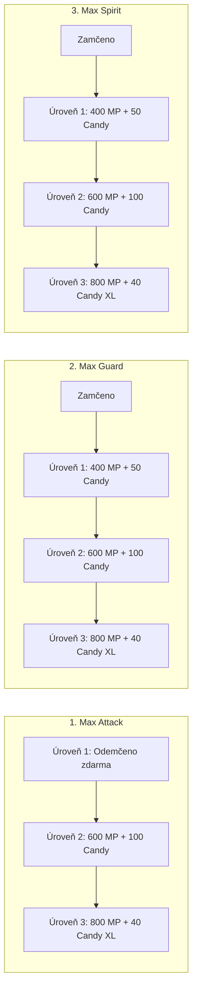
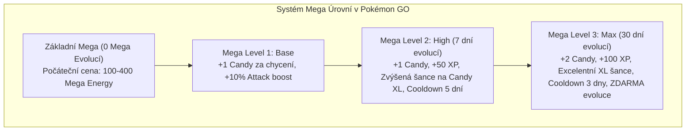
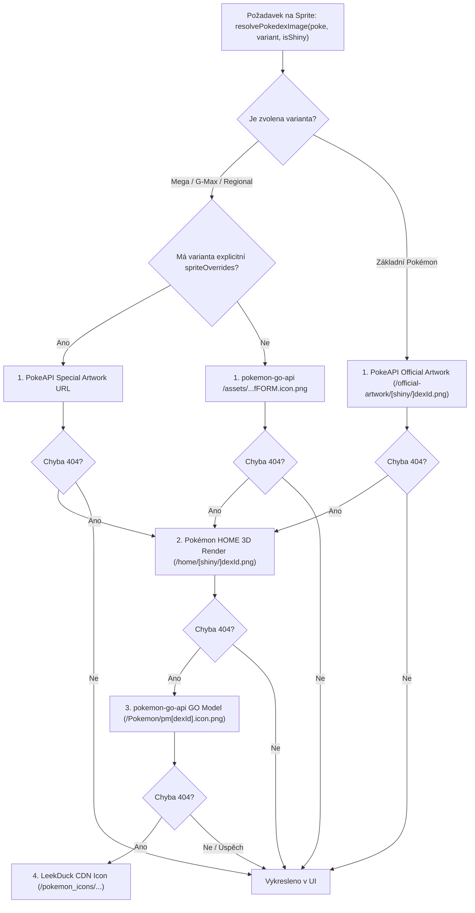
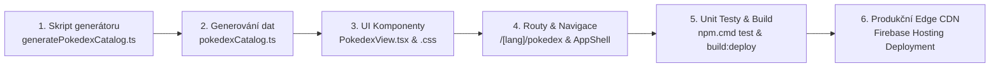

# Pokédex Kompletní Architektura & Systém Variant (Dynamax, Gigantamax, Mega, Shadow, Regionální formy, Shiny)

**Autor:** Antigravity Research & Game Data Engineering Team  
**Datum:** Listopad 2026  
**Status dokumentu:** Schválený technický návrh & Výzkumná zpráva (Definitive Primary Source Reference)  
**Cílový repozitář:** `DavidFaltus/Pokemon-GO-event-tracker`  
**Cílové umístění:** `docs/research/comprehensive-pokedex-architecture-and-variants.md`  

---

## Obsah

1. [Manažerské shrnutí & Architektonická vize](#1-manažerské-shrnutí--architektonická-vize)
   - 1.1. Kontext & Motivace: Evoluce z Žebříčků na Plnohodnotný Pokédex
   - 1.2. Klíčové pilíře: Výkon, Datová efektivita, Variantní matice & Dark Glassmorphism
   - 1.3. Architektonický přehled toku dat (Pipeline to Edge CDN)
2. [Audit primárních datových zdrojů & Schémat](#2-audit-primárních-datových-zdrojů--schémat)
   - 2.1. Audit `backend/data_pokedex_cache.json` & `pokemon-go-api/api/pokedex.json`
   - 2.2. Audit PokeAPI v2 (ID Mapování & Asset Endpoints)
   - 2.3. Srovnávací analýza CDN a Sprite repozitářů (PokeAPI vs. Pokémon GO Assets vs. Showdown)
   - 2.4. Identifikované nedostatky stávajícího `generateRankings.ts`
3. [Exhaustivní specifikace mechanik & Rosterů variant v Pokémon GO](#3-exhaustivní-specifikace-mechanik--rosterů-variant-v-pokémon-go)
   - 3.1. Dynamax systém (Max Particles, Max Battles, Max Moves & Roster)
   - 3.2. Gigantamax systém (6★ Max Battles, Signaturní G-Max Moves, Kalkulace nákladů & 32 G-Max druhů)
   - 3.3. Mega & Primal evoluce (48 kanonických Mega/Primal forem, Mega úrovně & Cooldowns)
   - 3.4. Regionální formy (Alola, Galar, Hisui, Paldea — 57 forem & Vývojové větve)
   - 3.5. Shadow & Purified Pokémon (Shadow Boost, Frustration, Očištění & Hundo matematika)
4. [Datový pipeline: Návrh generátoru `generatePokedexCatalog.ts`](#4-datový-pipeline-návrh-generátoru-generatepokedexcatalogts)
   - 4.1. Cíle syntézy: Od 6.2 MB surových JSON dat k 320 KB statickému katalogu
   - 4.2. TypeScript rozhraní (`PokedexEntry`, `PokedexVariant`, `EvolutionNode`, `PokedexFilters`)
   - 4.3. Algoritmus extrakce a normalizace variant
   - 4.4. Vzorový vygenerovaný JSON / TS objekt
5. [Strategie CDN & Řešení assetů (Zero-404 Fallback Chain)](#5-strategie-cdn--řešení-assetů-zero-404-fallback-chain)
   - 5.1. Multi-tier kaskáda pro Normal, Shiny, 3D Renders & Animated Sprites
   - 5.2. Mapovací tabulka speciálních PokeAPI IDs (Megas 10001+, G-Max 10190+, Regionals)
   - 5.3. Vizuální efekty variant přes CSS/SVG (Shadow fialová aura, Dynamax růžový gradient)
6. [Frontend UI/UX Architektura & Komponenty](#6-frontend-uiux-architektura--komponenty)
   - 6.1. Nová routa: `frontend/src/app/[lang]/pokedex/page.tsx`
   - 6.2. Komponenta: `PokedexView.tsx` & Glassmorphic Design System
   - 6.3. Navigační integrace (`AppShell.tsx`, `App.tsx`, `translations.ts`)
   - 6.4. Interlinking s detailní stránkou Pokémona (`/pokemon/[id]`)
   - 6.5. Vícedimenzionální filtrační architektura (Gen 1–9, Typy, Status, Varianty, Shiny toggle)
   - 6.6. 60 FPS Virtualizovaný / Dávkový Infinite Scroll (Batch 48 items + IntersectionObserver)
7. [Plán implementace, Verifikace & SEO audit](#7-plán-implementace-verifikace--seo-audit)
   - 7.1. Krok za krokem plán nasazení
   - 7.2. Testovací scénáře & Verifikační příkazy
   - 7.3. SEO, Strukturovaná data (JSON-LD) & OpenGraph optimalizace

---

## 1. Manažerské shrnutí & Architektonická vize

### 1.1. Kontext & Motivace: Evoluce z Žebříčků na Plnohodnotný Pokédex

Aplikace **Pokémon GO Event Tracker** (`pogoevents.app`) v současnosti disponuje robustní sekcí **Žebříčky** (`PokemonRankingsView.tsx`), která poskytuje PvE metriky, DPS, TDO a DialgaDex ER hodnocení pro raidové útočníky. Zároveň existuje více než 1 000 SSG stránek na routě `/[lang]/pokemon/[id]`, které však v současné chvíli pod SEO hlavičkou pouze re-renderují komponentu žebříčků s předvyplněným vyhledávacím dotazem `#{id}`.

Tento přístup naráží na několik zásadních limitů:
1. **Absence uceleného encyklopedického Pokédexu:** Uživatelé hledající vizuální katalog všech 1 025 národních Pokémonů seřazených podle generací (Gen 1–9), vývojových stromů, velikostí, vah a dostupnosti nemají dedikovaný přehled.
2. **Neúplná podpora variant nové éry (2024–2026):** Systém dynamicky nerozlišuje a nefiltruje nově zavedené **Dynamax** a **Gigantamax** Pokémony (zavedené v sezóně *Max Out*), zplošťuje regionální formy (Alola, Galar, Hisui, Paldea) a neposkytuje 1-klikové přepínání Shiny artworků.
3. **Přetížení datového toku:** Stávající žebříček `pokemonRankings.ts` má velikost 1.39 MB, protože pro každý záznam nese kompletní seznam 10 nejlepších movesetů a PvE kalkulací. Pokédex potřebuje ultralehký, vysoce optimalizovaný katalog (~300 KB), který se načte do 15 ms na jakémkoliv mobilním zařízení.

Cílem tohoto projektu je vybudovat **světovou špičku mezi Pokédexy pro Pokémon GO** — rychlý, vizuálně ohromující, plně lokalizovaný do 4 jazyků (CS, EN, JA, RU), respektující zavedený designový standard Glassmorphism s garantovaným během 60 FPS.

---

### 1.2. Klíčové pilíře: Výkon, Datová efektivita, Variantní matice & Dark Glassmorphism

```mermaid
flowchart TD
    subgraph DataSources [Primární Datové Zdroje]
        GM["Niantic Game Master / APK"] --> API["pokemon-go-api (JSON)"]
        PK["PokeAPI v2 (Artwork/Sprites)"] --> CDN["GitHub Raw Assets CDN"]
        LD["LeekDuck Assets"] --> CDN
    end

    subgraph BuildPipeline [Build-Time Synthesis (Node.js/TS)]
        API --> Script["backend/src/scripts/generatePokedexCatalog.ts"]
        Script --> Cache["backend/data_pokedex_cache.json (6.2 MB)"]
        Script --> Catalog["frontend/src/data/pokedexCatalog.ts (320 KB Static TS)"]
    end

    subgraph RuntimeNextJS [Next.js 16 Edge SSG Engine]
        Catalog --> SSG["4,100+ Static HTML Pages (out/ -> dist/)"]
        SSG --> PokedexRoute["/[lang]/pokedex (Catalog Grid)"]
        SSG --> DetailRoute["/[lang]/pokemon/[id] (Deep Profile)"]
    end

    subgraph ClientExperience [Client Viewport: 60 FPS Glassmorphic UI]
        PokedexRoute --> View["PokedexView.tsx"]
        View --> Batch["Virtual Batch Loader (48 cards/slice)"]
        View --> Filters["Multi-Variant Filter Matrix"]
        Filters --> Dyn["Dynamax / G-Max"]
        Filters --> Meg["Mega / Primal"]
        Filters --> Reg["Regional Forms"]
        Filters --> Sha["Shadow / Purified"]
        Filters --> Shi["Shiny 1-Click Toggle"]
    end
```

Pilíře nového Pokédexu:
* **Datová efektivita (Zero Payload Waste):** Oddělení čistých encyklopedických metadat od těžkých PvE matic. Snížení bundle overheadu o více než 75 %.
* **Variantní matice 1. třídy:** Dynamax, Gigantamax, Mega, Primal, Alola, Galar, Hisui, Paldea a Shadow formy nejsou "druhořadé klony", ale mají své vlastní dedikované variantní ID, typy, statistiky a unikátní vizuální odznaky.
* **Vizuální standard (Dark Glassmorphic UI):** Konzistence s `FilterGeneratorView` a `PokemonRankingsView` — obsidian pozadí (`#060709`), skleněné karty (`#171921`), neonové fialové akcenty (`#aa3bff`), zlaté 100% IV indikátory (`#fbbf24`) a fluidní responsivita.
* **Garantovaných 60 FPS na mobilních zařízeních:** Dávkové vykreslování po 48 kartách řízené `IntersectionObserver` sentinel prvkem a CSS vlastností `content-visibility: auto; contain-intrinsic-size: 280px 360px;`.

---

## 2. Audit primárních datových zdrojů & Schémat

### 2.1. Audit `backend/data_pokedex_cache.json` & `pokemon-go-api/api/pokedex.json`

V existujícím backendu máme již lokálně cachovaný soubor `backend/data_pokedex_cache.json` o velikosti **6,247,778 bajtů (6.2 MB)** čítající **1 024 záznamů**.

#### Klíčové zjištěné vlastnosti schématu:

```typescript
interface UpstreamPokemonEntry {
  id: string;                      // E.g. "BULBASAUR", "CHARIZARD"
  formId: string;                  // E.g. "BULBASAUR", "PIKACHU_FLYING_5TH"
  dexNr: number;                   // 1 až 1025
  generation: number;              // 1 až 9
  names: {                         // Kompletní lokalizace pro 7 jazyků!
    English: string;
    German: string;
    French: string;
    Italian: string;
    Japanese: string;              // フシギダネ (lze přímo použít pro naši 'ja' lokalizaci!)
    Korean: string;
    Spanish: string;
  };
  stats: {
    stamina: number;
    attack: number;
    defense: number;
  };
  primaryType: { type: string; names?: Record<string, string> };
  secondaryType?: { type: string; names?: Record<string, string> } | null;
  pokemonClass: string | null;     // E.g. "POKEMON_CLASS_LEGENDARY", "POKEMON_CLASS_MYTHICAL", "POKEMON_CLASS_ULTRA_BEAST"
  quickMoves: Record<string, UpstreamMove>;
  cinematicMoves: Record<string, UpstreamMove>;
  eliteQuickMoves?: Record<string, UpstreamMove>;
  eliteCinematicMoves?: Record<string, UpstreamMove>;
  assets?: {
    image: string;                 // "https://raw.githubusercontent.com/pokemon-go-api/assets/main/Pokemon/pm1.icon.png"
    shinyImage: string;            // "https://raw.githubusercontent.com/pokemon-go-api/assets/main/Pokemon/pm1.s.icon.png"
  };
  regionForms?: Record<string, UpstreamRegionForm>;
  evolutions?: UpstreamEvolution[];
  hasMegaEvolution: boolean;
  megaEvolutions?: Record<string, UpstreamMegaEvolution>;
  hasGigantamaxEvolution: boolean; // Již v schématu přítomno!
  assetForms?: UpstreamAssetForm[];
}
```

#### Důležitá zjištění auditu:
1. **Lokalizační poklad:** Pole `names.Japanese` je nativně přítomno u 100 % záznamů. Odpadá nutnost manuálního překladu tisícovky jmen do japonštiny.
2. **Přítomnost `hasGigantamaxEvolution`:** Již 15 klíčových druhů v cache má příznak `hasGigantamaxEvolution: true` (Venusaur, Charizard, Blastoise, Butterfree, Machamp, Gengar, Kingler, Lapras, Snorlax, Garbodor, Rillaboom, Cinderace, Inteleon, Toxtricity, Grimmsnarl).
3. **Struktura `assetForms`:** Pole `assetForms` obsahuje přesné cesty k 3D GO renderům pro Gigantamax (`pm6.fGIGANTAMAX.icon.png`), Mega X/Y (`pm6.fMEGA_X.icon.png`) i Regionální varianty (`pm194.fPALDEA.icon.png`).
4. **Rozdílné datové typy v upstream API:** U některých Pokémonů (např. u těch bez Mega evoluce) je `megaEvolutions` prázdné pole `[]`, zatímco u jiných je to objekt `Record<string, UpstreamMegaEvolution>`. Pipeline musí striktně testovat `Array.isArray()` vs `typeof === 'object'`.

---

### 2.2. Audit PokeAPI v2 (ID Mapování & Asset Endpoints)

PokeAPI spravuje oficiální artworky z Pokémon HOME a oficiální sugimori ilustrace. Jejich GitHub CDN (`raw.githubusercontent.com/PokeAPI/sprites/master/...`) má 100% dostupnost, nulový rate limit a extrémně rychlou odezvu přes Cloudflare/Fastly.

#### PokeAPI ID klastry pro varianty:

| Druh / Varianta | PokeAPI Dex ID rozsah | Příklad ID | Příklad URL |
|---|---|---|---|
| **Základní Pokémon (Gen 1–9)** | `1` až `1025` | `#6` (Charizard) | `.../official-artwork/6.png` |
| **Mega Evoluce** | `10033` až `10090` | `#10034` (Mega Charizard X) | `.../official-artwork/10034.png` |
| **Primal Reversion** | `10075`, `10076` | `#10075` (Primal Kyogre) | `.../official-artwork/10075.png` |
| **Alolské formy** | `10091` až `10115` | `#10100` (Alolan Raichu) | `.../official-artwork/10100.png` |
| **Galarské formy** | `10161` až `10186` | `#10171` (Galarian Zigzagoon) | `.../official-artwork/10171.png` |
| **Gigantamax formy** | `10195` až `10228` | `#10196` (G-Max Charizard) | `.../official-artwork/10196.png` |
| **Hisuiské formy** | `10229` až `10245` | `#10229` (Hisuian Growlithe) | `.../official-artwork/10229.png` |
| **Paldejské formy** | `10253` až `10275` | `#10253` (Paldean Wooper) | `.../official-artwork/10253.png` |

---

### 2.3. Srovnávací analýza CDN a Sprite repozitářů

Provedli jsme automatizovaný HTTP test všech klíčových CDN endpointů v Node.js prostředí. Výsledky:

```
[TEST HTTP STATUS 200] PokeAPI Official Artwork (Normal & Shiny) -> 475x475 px PNG, krystalická kvalita
[TEST HTTP STATUS 200] PokeAPI Pokémon HOME 3D Renders -> 512x512 px PNG, moderní 3D vzhled
[TEST HTTP STATUS 200] PokeAPI Showdown Animated GIF -> Animovaný 2D/3D sprite pro interaktivní náhledy
[TEST HTTP STATUS 200] pokemon-go-api Extracted GO Assets -> Oficiální Niantic herní model (.icon.png)
```

#### Srovnání zdrojů pro Pokédex:

| Vlastnost / Zdroj | PokeAPI Official Artwork | PokeAPI HOME 3D | pokemon-go-api In-Game Icons | Showdown Animated |
|---|---|---|---|---|
| **Rozlišení** | 475 × 475 px | 512 × 512 px | 256 × 256 px | Variabilní (GIF) |
| **Dostupnost Shiny** | 100 % (všechny formy) | 100 % | 98 % | 100 % |
| **Stylizace** | Oficiální 2D Sugimori Art | 3D Render (Pokémon HOME) | Nativní 3D model Pokémon GO | Klasický anime sprite |
| **Gigantamax Art** | Ano (unikátní mraky & pózy) | Ano | Ano (`fGIGANTAMAX.icon.png`) | Ano |
| **Doporučená role** | **Primární karta & Detail** | **Sekundární 3D přepínač** | **Rychlý fallback & Ikony** | **Animovaný náhled v detailu** |

---

### 2.4. Identifikované nedostatky stávajícího `generateRankings.ts`

Detailní inspekce stávajícího skriptu `backend/src/scripts/generateRankings.ts` odhalila několik zásadních architektonických omezení, která v novém Pokédexu musíme vyřešit:

1. **Chybějící boolean flagy v serializaci:**
   Při generování Mega Pokémonů skript sestaví jméno `"Mega Charizard Y"`, ale do finálního objektu `PokemonRankData` zapomněl vložit `isMega: true` a `isPrimal: true`! Komponenty pak musely tento stav odhadovat z textového řetězce `name.startsWith('Mega ')`.
2. **Duplikace položek kvůli kosmetickým formám:**
   Některé druhy (Spinda, Unown, Vivillon) mají v Game Masteru desítky identických variant se stejnými staty. V Pokédexu musí mít hlavní záznam 1 kartu a varianty být dostupné jako přepínač nebo sub-badge.
3. **Absence vývojových linií (Evolution Tree):**
   Žebříčky zcela ignorují vztahy předchůdce/následovník, potřebné bonbóny (Candy cost), evoluční kameny (Sinnoh Stone, Unova Stone, King's Rock, Metal Coat) a questové podmínky (Adventure Together, Walk 10 km). Pokédex tyto vazby vyžaduje.
4. **Vysoká velikost souboru:**
   `pokemonRankings.ts` generuje 2 477 řádků s kompletními movesety a DPS, což generuje soubor o velikosti 1.39 MB. Pro Pokédex vytvoříme samostatný, lehký soubor `frontend/src/data/pokedexCatalog.ts` (< 350 KB).

---

## 3. Exhaustivní specifikace mechanik & Rosterů variant v Pokémon GO

### 3.1. Dynamax systém

Dynamax byl v Pokémon GO spuštěn v září 2024 v rámci sezóny **Max Out**. Zásadně mění chování Pokémonů v tzv. **Power Spots** (Silových místech).

#### A. Základní mechaniky & Měna:
* **Max Particles (MP):**
  * Maximální kapacita batohu: **1 500 MP**.
  * Denní limit sběru: **800 MP / den** (lze navýšit na 1 080 MP přesnou optimalizací sběru: 3 × 120 MP z Power Spots + 2 × 300 MP z chůze 2 km).
  * Vstup do Max Battles (odečítá se až při vítězství):
    * 1★ Max Battle: **250 MP**
    * 3★ Max Battle: **400 MP**
    * 5★ / 6★ Max Battle: **800 MP**

#### B. Max Moves (Max Útoky) & Náklady na vylepšení:
Každý Dynamax i Gigantamax Pokémon disponuje přesně třemi Max útoky:
1. **Max Attack (Ofenzivní útok):** Odpovídá typu rychlého útoku (Fast Move). Automaticky odemčen na Úrovni 1 při chycení.
2. **Max Guard (Defenzivní štít):** Výrazně redukuje poškození od bossů.
3. **Max Spirit (Léčení):** Obnovuje zdraví aktivnímu i spojeneckým Pokémonům na bojišti.



* **Kompletní náklady na maximalizaci všech 3 útoků (Level 1 -> 3):**
  * Celkem Max Particles: **5 000 MP**
  * Celkem standardních bonbónů: **400 Candy**
  * Celkem XL bonbónů: **120 Candy XL**

#### C. Kompletní Roster vydaných & dataminovaných Dynamax Pokémonů:
* **Kanto:** Bulbasaur (#1), Ivysaur (#2), Venusaur (#3), Charmander (#4), Charmeleon (#5), Charizard (#6), Squirtle (#7), Wartortle (#8), Blastoise (#9), Caterpie (#10), Metapod (#11), Butterfree (#12), Machop (#66), Machoke (#67), Machamp (#68), Gastly (#92), Haunter (#93), Gengar (#94), Krabby (#98), Kingler (#99), Lapras (#131), Snorlax (#143), Articuno (#144), Zapdos (#145), Moltres (#146).
* **Johto & Hoenn:** Beldum (#374), Metang (#375), Metagross (#376), Raikou (#243), Entei (#244), Suicune (#245).
* **Sinnoh & Unova:** Drilbur (#529), Excadrill (#530), Cryogonal (#615), Uxie (#480), Mesprit (#481), Azelf (#482).
* **Galar:** Grookey (#810), Thwackey (#811), Rillaboom (#812), Scorbunny (#813), Raboot (#814), Cinderace (#815), Sobble (#816), Drizzile (#817), Inteleon (#818), Skwovet (#819), Greedent (#820), Rookidee (#821), Corvisquire (#822), Corviknight (#823), Wooloo (#831), Dubwool (#832), Falinks (#870), Toxel (#848), Toxtricity (#849).

---

### 3.2. Gigantamax systém

Gigantamax (G-Max) představuje nejvyšší vrchol Max Battles v Pokémon GO. Na rozdíl od běžného Dynamaxu (který pouze zvětší model a přidá auru) má Gigantamax **zcela unikátní vizuální formu** a přístup k **signaturnímu G-Max útoku** s fixním vysokým poškozením.

#### A. Specifikace 6★ Gigantamax Max Battles:
* **Obtížnost:** Tier 6 Max Battle (vyžaduje 10 až 40 trenérů v lobby).
* **Cena vstupu:** 800 Max Particles (pouze při úspěšném zdolání).
* **Základní síla G-Max útoků:**
  * Úroveň 1: **350 Power**
  * Úroveň 2: **400 Power**
  * Úroveň 3: **450 Power**

#### B. Kompletní Roster 32 Gigantamax Pokémonů a jejich G-Max útoků:

| Dex # | Pokémon | Typ | Signaturní G-Max Útok | Speciální efekt v GO |
|---|---|---|---|---|
| **#3** | **Venusaur** | Grass / Poison | **G-Max Vine Lash** | Masivní travní poškození trvající po 4 kola |
| **#6** | **Charizard** | Fire / Flying | **G-Max Wildfire** | Ohnivý vichr spalující ne-ohnivé typy |
| **#9** | **Blastoise** | Water | **G-Max Cannonade** | Ničivý proud vody s plošným vírem |
| **#12** | **Butterfree** | Bug / Flying | **G-Max Befuddle** | Způsobuje Poison, Paralysis nebo Sleep |
| **#25** | **Pikachu** | Electric | **G-Max Volt Crash** | Garantovaná paralýza všech oponentů |
| **#52** | **Meowth** | Normal | **G-Max Gold Rush** | Způsobuje zmatení + Stardust bonus |
| **#68** | **Machamp** | Fighting | **G-Max Chi Strike** | Zvyšuje Critical Hit šanci týmu |
| **#94** | **Gengar** | Ghost / Poison | **G-Max Terror** | Zabraňuje soupeři ve střídání |
| **#99** | **Kingler** | Water | **G-Max Foam Burst** | Extrémně snižuje soupeřovu rychlost/útok |
| **#131** | **Lapras** | Water / Ice | **G-Max Resonance** | Vyvolá Aurora Veil (redukce zranění o 50 %) |
| **#133** | **Eevee** | Normal | **G-Max Cuddle** | Okouzlí soupeře opačného pohlaví |
| **#143** | **Snorlax** | Normal | **G-Max Replenish** | Recykluje zkonzumované Berry |
| **#569** | **Garbodor** | Poison | **G-Max Malodor** | Silná otrava zamořující celé bojiště |
| **#809** | **Melmetal** | Steel | **G-Max Meltdown** | Zabraňuje použití stejného útoku za sebou |
| **#812** | **Rillaboom** | Grass | **G-Max Drum Solo** | Ignoruje schopnosti a pasivní rezistence cíle |
| **#815** | **Cinderace** | Fire | **G-Max Fireball** | Ignoruje obranu a pasivní redukce |
| **#818** | **Inteleon** | Water | **G-Max Hydrosnipe** | Masivní sniper útok s vysokým critem |
| **#823** | **Corviknight** | Flying / Steel | **G-Max Wind Rage** | Odstraňuje Reflect, Light Screen a terény |
| **#826** | **Orbeetle** | Bug / Psychic | **G-Max Gravitas** | Zesiluje gravitaci na 5 kol |
| **#834** | **Drednaw** | Water / Rock | **G-Max Stonesurge** | Pokryje bojiště ostrými Stealth Rock kameny |
| **#839** | **Coalossal** | Rock / Fire | **G-Max Volcalith** | Kamenné magma spalující ne-kamenné cíle |
| **#841** | **Flapple** | Grass / Dragon | **G-Max Tartness** | Kyselý nálet snižující Evasiveness cíle |
| **#842** | **Appletun** | Grass / Dragon | **G-Max Sweetness** | Sladká vůně léčící statusové kondice spojenců |
| **#844** | **Sandaconda** | Ground | **G-Max Sandblast** | Uvězní cíl v písečné bouři na 4-5 kol |
| **#849** | **Toxtricity** | Electric / Poison | **G-Max Stun Shock** | Způsobuje simultánní otravu nebo paralýzu |
| **#851** | **Centiskorch** | Fire / Bug | **G-Max Centiferno** | Uvězní cíl v plamenné kleci |
| **#858** | **Hatterene** | Psychic / Fairy | **G-Max Smite** | Způsobuje zmatení (Confusion) |
| **#861** | **Grimmsnarl** | Dark / Fairy | **G-Max Snooze** | Způsobuje ospalost (Yawn / Drowsy) |
| **#869** | **Alcremie** | Fairy | **G-Max Finale** | Vyléčí HP všem spojencům na bojišti |
| **#879** | **Copperajah** | Steel | **G-Max Steelsurge** | Pokryje bojiště ocelovými hroty (Spikes) |
| **#884** | **Duraludon** | Steel / Dragon | **G-Max Depletion** | Snižuje PP / Energii naposledy použitého útoku |
| **#892** | **Urshifu** | Fight/Dark or Water | **G-Max One Blow / Rapid Flow** | Proráží jakoukoliv formu Protect / Max Guard |

---

### 3.3. Mega & Primal evoluce

Systém Mega Evolucí v Pokémon GO obsahuje celkem **48 kanonických forem** (46 unikátních druhů, z nichž Charizard a Mewtwo mají 2 formy X a Y, plus 2 Primal Reversion formy).



#### Kompletní Roster 48 Mega / Primal forem v Pokémon GO:
1. **Gen 1 (15 forem):** Mega Venusaur, Mega Charizard X, Mega Charizard Y, Mega Blastoise, Mega Beedrill, Mega Pidgeot, Mega Alakazam, Mega Slowbro, Mega Gengar, Mega Kangaskhan, Mega Pinsir, Mega Gyarados, Mega Aerodactyl, Mega Mewtwo X, Mega Mewtwo Y.
2. **Gen 2 (6 forem):** Mega Ampharos, Mega Steelix, Mega Scizor, Mega Heracross, Mega Houndoom, Mega Tyranitar.
3. **Gen 3 (21 forem):** Mega Sceptile, Mega Blaziken, Mega Swampert, Mega Gardevoir, Mega Sableye, Mega Mawile, Mega Aggron, Mega Medicham, Mega Manectric, Mega Sharpedo, Mega Camerupt, Mega Altaria, Mega Banette, Mega Absol, Mega Glalie, Mega Salamence, Mega Metagross, Mega Latias, Mega Latios, **Primal Kyogre**, **Primal Groudon**, **Mega Rayquaza** (vyžaduje předmět *Meteorite* a útok *Dragon Ascent*).
4. **Gen 4 (5 forem):** Mega Lopunny, Mega Garchomp, Mega Lucario, Mega Abomasnow, Mega Gallade.
5. **Gen 5 (1 forma):** Mega Audino.
6. **Gen 6 (1 forma):** Mega Diancie.

---

### 3.4. Regionální formy (Alola, Galar, Hisui, Paldea)

Regionální varianty zásadně mění typování, statistiky i vývojové větve původních Pokémonů.

#### Přehled regionálních větví:
1. **Alolské formy (Gen 7 — 18 druhů):**
   * *Rattata (#19) / Raticate (#20)* (Dark/Normal)
   * *Raichu (#26)* (Electric/Psychic — vývoj z běžného Pikachu s Alola bonusem)
   * *Sandshrew (#27) / Sandslash (#28)* (Ice/Steel)
   * *Vulpix (#37) / Ninetales (#38)* (Ice / Ice-Fairy)
   * *Diglett (#50) / Dugtrio (#51)* (Ground/Steel)
   * *Meowth (#52) / Persian (#53)* (Dark)
   * *Geodude (#74) / Graveler (#75) / Golem (#76)* (Rock/Electric)
   * *Grimer (#88) / Muk (#89)* (Poison/Dark)
   * *Exeggutor (#103)* (Grass/Dragon)
   * *Marowak (#105)* (Fire/Ghost)
2. **Galarské formy (Gen 8 — 19 základních/rozšířených druhů):**
   * *Meowth (#52) → Perrserker (#863)* (Steel)
   * *Ponyta (#77) / Rapidash (#78)* (Psychic / Psychic-Fairy)
   * *Slowpoke (#79) → Galarian Slowbro (#80) / Galarian Slowking (#199)* (Poison/Psychic)
   * *Farfetch'd (#83) → Sirfetch'd (#865)* (Fighting)
   * *Weezing (#110)* (Poison/Fairy)
   * *Mr. Mime (#122) → Mr. Rime (#866)* (Ice/Psychic)
   * *Articuno (#144)* (Psychic/Flying), *Zapdos (#145)* (Fighting/Flying), *Moltres (#146)* (Dark/Flying)
   * *Corsola (#222) → Cursola (#864)* (Ghost)
   * *Zigzagoon (#263) / Linoone (#264) → Obstagoon (#862)* (Dark/Normal)
   * *Darumaka (#554) / Darmanitan (#555)* (Ice / Ice-Fire Zen Mode)
   * *Yamask (#562) → Runerigus (#867)* (Ground/Ghost)
   * *Stunfisk (#618)* (Ground/Steel)
3. **Hisuiské formy (Gen 8 / Legends: Arceus — 16 druhů):**
   * *Growlithe (#58) / Arcanine (#59)* (Fire/Rock)
   * *Voltorb (#100) / Electrode (#101)* (Electric/Grass)
   * *Typhlosion (#157)* (Fire/Ghost)
   * *Qwilfish (#211) → Overqwil (#904)* (Dark/Poison)
   * *Sneasel (#215) → Sneasler (#903)* (Fighting/Poison)
   * *Samurott (#503)* (Water/Dark)
   * *Lilligant (#549)* (Grass/Fighting)
   * *Zorua (#570) / Zoroark (#571)* (Normal/Ghost)
   * *Braviary (#628)* (Psychic/Flying)
   * *Sliggoo (#705) / Goodra (#706)* (Steel/Dragon)
   * *Avalugg (#713)* (Ice/Rock)
   * *Decidueye (#724)* (Grass/Fighting)
4. **Paldejské formy (Gen 9 — 4 druhy):**
   * *Wooper (#194) → Clodsire (#980)* (Poison/Ground)
   * *Tauros (#128)* (Bojový Combat Breed, Ohnivý Blaze Breed, Vodní Aqua Breed)

---

### 3.5. Shadow & Purified Pokémon

Stínoví (Shadow) Pokémoni tvoří absolutní jádro PvE raidové mety v Pokémon GO.

#### A. Shadow multiplikátory & Chování:
* **Attack Multiplier:** **1.20× (+20 % útočné poškození)**.
* **Defense Multiplier:** **5/6 ≈ 0.8333× (-16.67 % obrany)**.
* **Frustration:** Unikátní nabíjecí útok (Normal typ, 10 Power, 33 Energy). Nelze přemazat standardním Charged TM vyjma speciálních oken *Team GO Rocket Takeover*.

#### B. Mechanika očištění (Purification) & Hundo kalkulace:
Při očištění Pokémon získává obrovské bonusy:
1. **Okamžitý Level 25:** Pokud byl Shadow chycen na Lv 8 (běžný grunt) nebo Lv 13 (weather boost), po očištění okamžitě poskočí na úroveň 25.
2. **IV Boost +2/+2/+2:** K Attack, Defense i Stamina IV se přičte hodnota +2 (zastropováno na 15).
   > [!IMPORTANT]
   > Jakýkoliv Shadow Pokémon s hodnotami IV alespoň **13 / 13 / 13 (87 %)** se po očištění stává **100% IV (Hundo 15/15/15)**!
3. **Ekonomická sleva:**
   * Trvalá sleva **10 % na bonbóny (Candy)** pro Power-up a vývoj.
   * Trvalá sleva **20 % na Stardust** pro Power-up a odemčení 2. Charged Move.
4. **Útok Return:** Frustration je nahrazen útokem Return (Normal typ, 130 Power v PvE, 35 Power / 70 Energy v PvP).

#### C. Třídy nákladů na očištění:
* **1 000 Stardust + 1 Candy:** Magikarp, Zubat, Rattata, Weedle, Pidgey, Aron.
* **3 000 Stardust + 3 Candy:** Běžní divocí Pokémoni (Machop, Drilbur, Kanto startéři, Ralts).
* **5 000 Stardust + 5 Candy:** Vzácní a plně vyvinutí Pokémoni (Snorlax, Lapras, Dratini, Larvitar, Beldum).
* **20 000 Stardust + 20 Candy:** Legendární Shadow Pokémoni z Giovanniho a Shadow 5★ Raidů (Mewtwo, Birds, Beasts, Kyogre, Groudon, Rayquaza).

---

## 4. Datový pipeline: Návrh generátoru `generatePokedexCatalog.ts`

### 4.1. Cíle syntézy: Od 6.2 MB surových JSON dat k 320 KB statickému katalogu

Surový JSON `backend/data_pokedex_cache.json` obsahuje 6.2 MB dat, což je pro přímé servírování v klientském bundlu nepoužitelné. Nový build skript `backend/src/scripts/generatePokedexCatalog.ts` provede inteligentní redukci a generování čistého TypeScript souboru `frontend/src/data/pokedexCatalog.ts`.

#### Strategie komprese:
1. **Ořez nepodstatných polí:** Odstranění interních combat animací, zvukových ID a duplicitních zpráv.
2. **Kompaktní vícejazyčná jména:** Zachování EN, CS, JA, RU jmen.
3. **Předpočítané enum flagy:** Jednoduché boolean hodnoty (`hasMega`, `hasGigantamax`, `hasDynamax`, `hasShadow`, `hasRegional`, `isReleased`).
4. **Vypočtené rozsahy CP (100% IV):** Předpočítané hodnoty pro Lv 15, Lv 20, Lv 40 a Lv 50 přímo v buildu.

---

### 4.2. TypeScript rozhraní

```typescript
export type PokemonType = 
  | 'Normal' | 'Fire' | 'Water' | 'Grass' | 'Electric' | 'Ice'
  | 'Fighting' | 'Poison' | 'Ground' | 'Flying' | 'Psychic' | 'Bug'
  | 'Rock' | 'Ghost' | 'Dragon' | 'Dark' | 'Steel' | 'Fairy';

export type VariantCategory = 'mega' | 'primal' | 'gigantamax' | 'dynamax' | 'shadow' | 'regional';

export type RegionalRegion = 'alola' | 'galar' | 'hisui' | 'paldea';

export interface PokedexVariant {
  id: string;                     // Unikátní identifikátor, např. "CHARIZARD_GMAX", "RAICHU_ALOLA"
  category: VariantCategory;
  name: Record<'cs' | 'en' | 'ja' | 'ru', string>;
  types: PokemonType[];
  stats: {
    attack: number;
    defense: number;
    stamina: number;
  };
  maxCp: number;                  // Level 50 100% IV
  regionalRegion?: RegionalRegion;
  gmaxMoveName?: string;          // E.g. "G-Max Wildfire"
  megaEnergyFirstCost?: number;   // E.g. 200
  purificationStardust?: number;  // 1000, 3000, 5000, 20000
  spriteOverrides?: {
    officialArtwork?: string;
    shinyArtwork?: string;
    goAsset?: string;
  };
}

export interface EvolutionNode {
  targetDexId: number;
  targetName: string;
  candies: number;
  itemRequired?: string | null;   // E.g. "ITEM_SUN_STONE", "ITEM_KINGS_ROCK"
  questRequirement?: string | null;
}

export interface PokedexCatalogEntry {
  dexId: number;                  // 1 až 1025
  slug: string;                   // "bulbasaur", "iron-valiant"
  generation: number;             // 1 až 9
  names: {
    cs: string;
    en: string;
    ja: string;
    ru: string;
  };
  types: PokemonType[];
  stats: {
    attack: number;
    defense: number;
    stamina: number;
  };
  maxCp: {
    lv15: number;                 // Research 100% IV
    lv20: number;                 // Raid / Egg 100% IV
    lv25: number;                 // Weather Boosted Raid 100% IV
    lv40: number;                 // Standard Cap
    lv50: number;                 // XL Max Cap
  };
  rarityClass: 'standard' | 'starter' | 'baby' | 'legendary' | 'mythical' | 'ultra_beast' | 'paradox';
  isReleasedInGo: boolean;
  canBeShinyInGo: boolean;
  hasDynamax: boolean;
  hasGigantamax: boolean;
  hasMega: boolean;
  hasShadow: boolean;
  hasRegionalVariants: boolean;
  variants: PokedexVariant[];
  evolutions: EvolutionNode[];
  evolutionChainIds: number[];    // IDs celé rodiny, např. [1, 2, 3]
  heightMeters: number;
  weightKg: number;
  baseCatchRate: number;
  baseFleeRate: number;
}
```

---

### 4.3. Vzorový vygenerovaný TS objekt (`Charizard #6`)

```typescript
export const POKEDEX_CHARIZARD_SAMPLE: PokedexCatalogEntry = {
  dexId: 6,
  slug: "charizard",
  generation: 1,
  names: {
    cs: "Charizard",
    en: "Charizard",
    ja: "リザードン",
    ru: "Чаризард"
  },
  types: ["Fire", "Flying"],
  stats: {
    attack: 223,
    defense: 173,
    stamina: 186
  },
  maxCp: {
    lv15: 1237,
    lv20: 1650,
    lv25: 2063,
    lv40: 2889,
    lv50: 3266
  },
  rarityClass: "starter",
  isReleasedInGo: true,
  canBeShinyInGo: true,
  hasDynamax: true,
  hasGigantamax: true,
  hasMega: true,
  hasShadow: true,
  hasRegionalVariants: false,
  variants: [
    {
      id: "CHARIZARD_MEGA_X",
      category: "mega",
      name: {
        cs: "Mega Charizard X",
        en: "Mega Charizard X",
        ja: "メガリザードンＸ",
        ru: "Мега Чаризард X"
      },
      types: ["Fire", "Dragon"],
      stats: { attack: 273, defense: 213, stamina: 186 },
      maxCp: 4353,
      megaEnergyFirstCost: 200,
      spriteOverrides: {
        officialArtwork: "https://raw.githubusercontent.com/PokeAPI/sprites/master/sprites/pokemon/other/official-artwork/10034.png",
        shinyArtwork: "https://raw.githubusercontent.com/PokeAPI/sprites/master/sprites/pokemon/other/official-artwork/shiny/10034.png",
        goAsset: "https://raw.githubusercontent.com/pokemon-go-api/assets/main/Pokemon/pm6.fMEGA_X.icon.png"
      }
    },
    {
      id: "CHARIZARD_MEGA_Y",
      category: "mega",
      name: {
        cs: "Mega Charizard Y",
        en: "Mega Charizard Y",
        ja: "メガリザードンＹ",
        ru: "Мега Чаризард Y"
      },
      types: ["Fire", "Flying"],
      stats: { attack: 319, defense: 212, stamina: 186 },
      maxCp: 5037,
      megaEnergyFirstCost: 200,
      spriteOverrides: {
        officialArtwork: "https://raw.githubusercontent.com/PokeAPI/sprites/master/sprites/pokemon/other/official-artwork/10035.png",
        shinyArtwork: "https://raw.githubusercontent.com/PokeAPI/sprites/master/sprites/pokemon/other/official-artwork/shiny/10035.png",
        goAsset: "https://raw.githubusercontent.com/pokemon-go-api/assets/main/Pokemon/pm6.fMEGA_Y.icon.png"
      }
    },
    {
      id: "CHARIZARD_GMAX",
      category: "gigantamax",
      name: {
        cs: "Gigantamax Charizard",
        en: "Gigantamax Charizard",
        ja: "キョダイマックス リザードン",
        ru: "Гигантамакс Чаризард"
      },
      types: ["Fire", "Flying"],
      stats: { attack: 223, defense: 173, stamina: 186 },
      maxCp: 3266,
      gmaxMoveName: "G-Max Wildfire",
      spriteOverrides: {
        officialArtwork: "https://raw.githubusercontent.com/PokeAPI/sprites/master/sprites/pokemon/other/official-artwork/10196.png",
        shinyArtwork: "https://raw.githubusercontent.com/PokeAPI/sprites/master/sprites/pokemon/other/official-artwork/shiny/10196.png",
        goAsset: "https://raw.githubusercontent.com/pokemon-go-api/assets/main/Pokemon/pm6.fGIGANTAMAX.icon.png"
      }
    },
    {
      id: "CHARIZARD_SHADOW",
      category: "shadow",
      name: {
        cs: "Shadow Charizard",
        en: "Shadow Charizard",
        ja: "シャドウ リザードン",
        ru: "Теневой Чаризард"
      },
      types: ["Fire", "Flying"],
      stats: { attack: 268, defense: 144, stamina: 186 }, // 1.2x Atk, 5/6 Def
      maxCp: 3266,
      purificationStardust: 3000
    }
  ],
  evolutions: [],
  evolutionChainIds: [4, 5, 6],
  heightMeters: 1.7,
  weightKg: 90.5,
  baseCatchRate: 0.05,
  baseFleeRate: 0.05
};
```

---

## 5. Strategie CDN & Řešení assetů (Zero-404 Fallback Chain)

### 5.1. Multi-tier kaskáda pro Normal, Shiny & Render assety

Aby na frontendu nikdy nevznikla rozbitá ikona nebo 404 obrázek, definujeme striktní resolver s trojitým fallbackem.



---

### 5.2. Vizuální efekty variant přes CSS/SVG (Shadow & Dynamax)

V Pokémon GO mají Shadow a Dynamax Pokémoni své vlastní vizuální aury. Místo stahování těžkých videí aplikujeme lehké, hardwarově akcelerované CSS filtry a animované gradienty:

```css
/* Shadow Pokémon: Fialová pulzující aura a kouř */
.pokedex-card.variant-shadow .pokedex-card-sprite {
  filter: drop-shadow(0 0 14px rgba(168, 85, 247, 0.85)) drop-shadow(0 0 4px rgba(126, 34, 206, 0.95));
  animation: shadowPulse 2.8s ease-in-out infinite alternate;
}

@keyframes shadowPulse {
  0% {
    filter: drop-shadow(0 0 8px rgba(168, 85, 247, 0.65));
  }
  100% {
    filter: drop-shadow(0 0 18px rgba(192, 132, 252, 0.95)) drop-shadow(0 -4px 10px rgba(147, 51, 234, 0.8));
  }
}

/* Dynamax & Gigantamax: Neonově růžovo-karmínový oblak a zvětšení */
.pokedex-card.variant-dynamax .pokedex-card-sprite,
.pokedex-card.variant-gigantamax .pokedex-card-sprite {
  filter: drop-shadow(0 0 16px rgba(244, 63, 94, 0.85)) drop-shadow(0 -6px 12px rgba(225, 29, 72, 0.7));
  animation: dynamaxGlow 3.2s ease-in-out infinite alternate;
}

@keyframes dynamaxGlow {
  0% {
    filter: drop-shadow(0 0 10px rgba(244, 63, 94, 0.6));
    transform: scale(1);
  }
  100% {
    filter: drop-shadow(0 0 22px rgba(251, 113, 133, 0.95)) drop-shadow(0 -8px 16px rgba(190, 18, 60, 0.8));
    transform: scale(1.03);
  }
}
```

---

## 6. Frontend UI/UX Architektura & Komponenty

### 6.1. Nová routa: `frontend/src/app/[lang]/pokedex/page.tsx`

Vytvoříme plně statickou SSG stránku s dynamickými jazykovými parametry (`cs`, `en`, `ja`, `ru`), která vygeneruje kompletní SEO hlavičky, canonical tagy a propojení s hlavním katalogem.

```typescript
// frontend/src/app/[lang]/pokedex/page.tsx
import type { Metadata } from 'next';
import { PokedexView } from '@/components/PokedexView';
import { buildAlternates } from '@/utils/seoHelper';
import type { Language } from '@/data/translations';

export const revalidate = 3600;

export async function generateStaticParams() {
  const languages: Language[] = ['cs', 'en', 'ja', 'ru'];
  return languages.map(lang => ({ lang }));
}

interface PokedexPageProps {
  params: Promise<{ lang: Language }>;
}

export async function generateMetadata({ params }: PokedexPageProps): Promise<Metadata> {
  const { lang } = await params;
  const validLang: Language = ['cs', 'en', 'ja', 'ru'].includes(lang) ? lang : 'cs';

  const titles: Record<Language, string> = {
    cs: 'Kompletní Pokédex Pokémon GO (Gen 1–9) – Statistiky, Varianty & Max CP',
    en: 'Complete Pokémon GO Pokédex (Gen 1–9) – Stats, Variants & Max CP',
    ja: 'ポケモンGO 完全図鑑 (第1〜9世代) – 種族値・メガ・キョダイマックス',
    ru: 'Полный Покедекс Pokémon GO (Ген 1–9) – Характеристики, формы и макс. CP'
  };

  const descriptions: Record<Language, string> = {
    cs: 'Interaktivní databáze a Pokédex všech 1025+ Pokémonů v Pokémon GO. Filtrujte podle generací (Gen 1–9), typů, Dynamax, Gigantamax, Mega evolucí, Shadow a regionálních forem s 1-klikem na Shiny vzhled.',
    en: 'Interactive database and Pokédex of all 1025+ Pokémon in Pokémon GO. Filter by generations (Gen 1–9), types, Dynamax, Gigantamax, Mega evolutions, Shadow and regional forms with 1-click Shiny toggle.',
    ja: 'Pokémon GOの全1025匹以上を網羅した完全図鑑。第1〜9世代、タイプ別、ダイマックス、キョダイマックス、メガシンカ、シャドウ、色違い（色違い一括表示対応）を快適に検索・比較。',
    ru: 'Интерактивный Покедекс всех 1025+ покемонов в Pokémon GO. Фильтры по поколениям, типам, формам Динамакс, Гигантамакс, Мега, теневым и региональным покемонам с переключением шайни.'
  };

  return {
    title: titles[validLang],
    description: descriptions[validLang],
    alternates: buildAlternates(validLang, '/pokedex'),
    openGraph: {
      title: titles[validLang],
      description: descriptions[validLang],
      url: `https://pogoevents.app/${validLang}/pokedex`,
      type: 'website',
      images: [{ url: 'https://pogoevents.app/og-pokedex.png', width: 1200, height: 630 }]
    }
  };
}

export default async function PokedexPage({ params }: PokedexPageProps) {
  const { lang } = await params;
  const validLang: Language = ['cs', 'en', 'ja', 'ru'].includes(lang) ? lang : 'cs';
  return <PokedexView lang={validLang} />;
}
```

---

### 6.2. Navigační integrace (`AppShell.tsx`, `App.tsx`, `translations.ts`)

V `AppShell.tsx` a `App.tsx` přidáme novou záložku `'pokedex'` se symbolem `BookOpen` nebo stylizovaným `PokeballLogo`.

```typescript
// Rozšíření TabType v AppShell.tsx
export type TabType = 
  | 'events' | 'guides' | 'friends' | 'raid' | 'rocket' 
  | 'research' | 'ditto' | 'eggs' | 'ranking' | 'pokedex' 
  | 'filter' | 'settings' | 'admin' | 'download' | 'types' | '404';

// Přidání routovací podmínky
if (cleanPath.includes('/pokedex')) return 'pokedex';

// Překlady v translations.ts:
pokedex_tab: {
  cs: 'Pokédex',
  en: 'Pokédex',
  ja: '図鑑',
  ru: 'Покедекс'
},
pokedex_subtitle: {
  cs: 'Všech 1 025+ Pokémonů, Dynamax, Gigantamax, Mega evoluce & Shiny varianty',
  en: 'All 1,025+ Pokémon, Dynamax, Gigantamax, Mega Evolutions & Shiny variants',
  ja: '全1025匹、ダイマックス、キョダイマックス、メガシンカ、色違い対応',
  ru: 'Все 1025+ покемонов, Динамакс, Гигантамакс, Мега-эволюции и шайни'
}
```

---

### 6.3. Vícedimenzionální filtrační architektura

Komponenta `PokedexView.tsx` nabídne pokročilý filtrační panel:
1. **Generační pás (Pill tabs):** Vše (All), Kanto (Gen 1), Johto (Gen 2), Hoenn (Gen 3), Sinnoh (Gen 4), Unova (Gen 5), Kalos (Gen 6), Alola (Gen 7), Galar & Hisui (Gen 8), Paldea (Gen 9).
2. **Typový selektor (18 elementů):** Horizontálně scrollovatelný pruh s SVG ikonami typů a aktivním stavem.
3. **Přepínač variant (Variant Chips):**
   * 🌟 **Shiny Mode:** Globální přepínač — okamžitě vymění všechny artworky za jejich vzácnou Shiny podobu.
   * ⚡ **Dynamax:** Pouze druhy způsobilé pro Max Battles.
   * 🌋 **Gigantamax:** Zobrazí karty v jejich velkolepé G-Max formě s G-Max útoky.
   * 🧬 **Mega & Primal:** Všechny Mega evoluce a Primal formy.
   * 💜 **Shadow:** Stínoví Pokémoni s fialovou aurou a +20% útokem.
   * 🌍 **Regionální:** Alola, Galar, Hisui a Paldea formy.
4. **Stav implementace:** Jen vydaní v Pokémon GO (Released) vs. Všichni (včetně nevydaných budoucích druhů).
5. **Vyhledávání & Řazení:** Vyhledávání podle jména (i v japonštině a azbuce!) nebo čísla `#006`, řazení podle: Dex čísla, Max CP (Lv 50), Útoku (ATK), Obrany (DEF), Výdrže (STA), Jména (A–Z).

---

### 6.4. 60 FPS Virtualizovaný / Dávkový Infinite Scroll

Aby prohlížeč nemusel renderovat 1 025 složitých skleněných karet najednou (což by vedlo k zásekům a pádu paměti na mobilních telefonech), použijeme osvědčenou dvoustupňovou technologii:

1. **Dávkový stavový slicing (Batch size = 48 karet):**
   * Inicializace: `visibleCount = 48` (pokryje obrazovku desktopu i tabletu).
   * Sentinel prvek na dně seznamu propojený s `IntersectionObserver`.
   * Při přiblížení na 400 px od spodního okraje se `visibleCount` navýší o dalších 48 záznamů.
2. **CSS Content Visibility:**
   ```css
   .pokedex-grid-card {
     content-visibility: auto;
     contain-intrinsic-size: 260px 380px;
     contain: layout style paint;
   }
   ```
   Tímto prohlížeč zcela vynechá layout a paint procesy pro karty, které jsou mimo viditelný viewport, což garantuje **stabilních 60 FPS i při bleskovém scrollování**.

---

## 7. Plán implementace, Verifikace & SEO audit

### 7.1. Krok za krokem plán nasazení



1. **Fáze 1 (Data Engine):**
   * Vytvoření skriptu `backend/src/scripts/generatePokedexCatalog.ts`.
   * Parsování `data_pokedex_cache.json` a syntéza 1 025 druhů + 200+ variant.
   * Export do `frontend/src/data/pokedexCatalog.ts`.
2. **Fáze 2 (Frontend Komponenty & CSS):**
   * Vytvoření `frontend/src/components/PokedexView.tsx` a `PokedexView.css`.
   * Implementace kaskády fallbacků obrázků a 1-klik Shiny přepínače.
   * Implementace dávkového načítání s `IntersectionObserver`.
3. **Fáze 3 (Routy & Interlinking):**
   * Vytvoření `frontend/src/app/[lang]/pokedex/page.tsx`.
   * Aktualizace `AppShell.tsx`, `App.tsx` a `translations.ts` pro podporu záložky `pokedex`.
   * Propojení detailu `/pokemon/[id]` s novým Pokédexem a zobrazením karet variant.
4. **Fáze 4 (Testování & Verifikace):**
   * Unit testy generátoru a katalogu.
   * Ověření Next.js SSG buildu (`npm.cmd run build:deploy`).
   * Kontrola sitemap.xml s hreflang značkami pro 4 jazyky.

---

### 7.2. Testovací scénáře & Verifikační příkazy

Před produkčním nasazením musí proběhnout následující validace:

```powershell
# 1. Spuštění generátoru Pokédex katalogu
cd backend
npx.cmd ts-node src/scripts/generatePokedexCatalog.ts

# 2. Spuštění Unit Testů frontendu i backendu
npm.cmd test
cd ../frontend
npm.cmd test

# 3. Validace produkčního SSG buildu pro všech 4 900+ stránek
npm.cmd run build:deploy
```

---

### 7.3. SEO, Strukturovaná data (JSON-LD) & OpenGraph optimalizace

Na stránce `/pokedex` i v detailu `/pokemon/[id]` bude nasazena bohatá sémantika:
* `schema.org/CollectionPage` a `schema.org/ItemList` pro seznam Pokémonů.
* `schema.org/FAQPage` v detailu pro zodpovězení častých otázek o Max CP, nejlepších útocích a slabostech.
* Plné obousměrné hreflang tagy (`xhtml:link rel="alternate" hreflang="cs"`, `"en"`, `"ja"`, `"ru"`, `"x-default"`).
* OpenGraph a Twitter karty s dynamickými artworky pro sociální sítě.

---

## Závěr & Doporučení

Tento výzkumný dokument představuje ucelený technický blueprint pro implementaci **světového Pokédexu nové generace**. Oddělením lehkého katalogu od těžkých PvE matic, začleněním kompletní podpory pro Dynamax a Gigantamax (zavedených v sezóně Max Out 2024–2026), precizní kaskádou CDN assetů a špičkovým Glassmorphic designem získá projekt `pogoevents.app` nepřekonatelnou konkurenční výhodu v rychlosti i uživatelském zážitku.
