# Pokémon GO Event Tracker — Exhaustive Guide Articles Audit & Enhancement Plan

> **Author**: Senior Frontend Architect & Game Systems Researcher  
> **Date**: November 2026  
> **Status**: Approved Technical Specification & Architecture Roadmap  
> **Scope**: All 19 Guide Articles on [pogoevents.app/guides](https://pogoevents.app/guides)  
> **Reference Documents**: [AGENTS.md](file:///C:/PROJEKTY/OSOBNÍ/Pokemon-GO-event-tracker/AGENTS.md) (Section 5) • [GUIDE_ARTICLE_STANDARD.md](file:///C:/PROJEKTY/OSOBNÍ/Pokemon-GO-event-tracker/docs/GUIDE_ARTICLE_STANDARD.md)

---

## 1. Executive Summary

An exhaustive architectural, technical, factual, and visual audit of all 19 guide articles in the Pokémon GO Event Tracker codebase ([guidesData.ts](file:///C:/PROJEKTY/OSOBNÍ/Pokemon-GO-event-tracker/frontend/src/data/guidesData.ts) and [GuidesView.tsx](file:///C:/PROJEKTY/OSOBNÍ/Pokemon-GO-event-tracker/frontend/src/components/GuidesView.tsx)) was conducted against the **Authoritative Guide Article Standard**.

The audit evaluated every article across **Five Core Pillars**:
1. **Pillar 1: Data Architecture & Multi-Language Quality** (4–6 sections, 4 languages [CS, EN, JA, RU], sprite tags `pokemon: [...]`, actionable tips `⚡ Pro tip: ...`).
2. **Pillar 2: Interactivity & Companion Widget Architecture** (Standalone component, live calculators, 1-click clipboard triggers, reactive filters, checklists, simulation engines).
3. **Pillar 3: Visuals & Asset Richness** (PokeAPI official high-res artwork, LeekDuck CDN item assets, comparative dual-cards, badge indicators).
4. **Pillar 4: Factual & Mechanics Accuracy (2026 Meta)** (Current spawn algorithms, exact catch multipliers, IV floor constraints, party power rebalances, Dynamax/Gigantamax systems, level cap progression).
5. **Pillar 5: UX & Light Mode Compliance** (Dark glassmorphism, responsive mobile grid layout, explicit `body.light-mode` overrides).

---

### Key Systemic Findings & Architectural Bottlenecks

```mermaid
pie title Guide Article Quality Distribution (19 Articles)
    "Tier S — Gold Standard Exemplar" : 2
    "Tier A — High Quality (Inline Bloat)" : 6
    "Tier B — Adequate / Lazy Embeds" : 6
    "Tier C — Severe Deficits (Skeleton)" : 5
```



1. **The "Inline Bloat Crisis" in `GuidesView.tsx`**:
   Only **2 of 19 articles** (`galarian-birds-encounter-catch-guide` and `pokemon-go-referral-program-guide`) follow the architectural mandate of residing in standalone modular components (`GalarianBirdsInteractiveWidget.tsx` and `ReferralProgramInteractiveWidget.tsx`). The remaining widgets were directly embedded inline inside `renderVisualArticleWidget` in [GuidesView.tsx](file:///C:/PROJEKTY/OSOBNÍ/Pokemon-GO-event-tracker/frontend/src/components/GuidesView.tsx#L1428), bloating the component to **4,523 lines of TypeScript** and [GuidesView.css](file:///C:/PROJEKTY/OSOBNÍ/Pokemon-GO-event-tracker/frontend/src/components/GuidesView.css) to **5,960 lines of CSS**.
2. **Section Deficit & Thin Content**:
   While the standard mandates **4 to 6 comprehensive sections**, **11 of 19 articles (57.9%) fail this rule**. Two articles (`egg-hatching-guide` and `field-research-tasks-guide`) contain only **1 single section**, and five articles contain only **2 sections**.
3. **The "Lazy Embed" Anti-Pattern**:
   Three articles (`ditto-disguises-guide`, `egg-hatching-guide`, `field-research-tasks-guide`) do not have tailored companion widgets; instead, they embed whole existing top-level page views (`DittoEggsView` and `FieldResearchView`). This results in jarring dual headers, broken navigation flow, and missed educational opportunities.
4. **Zero-Interactivity Skeletons (The "Big 5" Tier C Guides)**:
   Articles #3 (`rocket-leaders-giovanni-guide`), #4 (`raid-battles-counter-guide`), #5 (`spotlight-community-day-guide`), #6 (`pokemon-iv-cp-appraise-guide`), and #7 (`mega-dynamax-mechanics-guide`) are placeholder skeletons. Their companion widgets consist merely of 2 to 8 static chips or text blocks with zero interactive controls, zero calculators, zero tips, and zero Pokémon sprite tags.

---

## 2. Complete Catalog Audit Scorecard

| # | Article ID / Slug | Words (CS/EN) | Secs | Tips (CS) | Sprites | Widget Type | Interactivity | Score | Classification |
|---|---|---|:---:|:---:|:---:|---|---|:---:|:---:|
| 1 | [`galarian-birds-encounter-catch-guide`](file:///C:/PROJEKTY/OSOBNÍ/Pokemon-GO-event-tracker/frontend/src/components/GalarianBirdsInteractiveWidget.tsx) | 1099 / 1007 | 5 | 10 | 16 | External Dedicated | Real-Time IV Calc, CPM, Odds, Shiny, Master Ball | **98/100** | **Tier S** |
| 2 | [`weekly-hidden-mini-events-guide`](file:///C:/PROJEKTY/OSOBNÍ/Pokemon-GO-event-tracker/frontend/src/components/GuidesView.tsx#L1633) | 546 / 464 | 6 | 12 | 8 | Inline (6.5k chars) | Static Category Cards, Hardcoded CS Ternary | **65/100** | **Tier B+** |
| 3 | [`rocket-leaders-giovanni-guide`](file:///C:/PROJEKTY/OSOBNÍ/Pokemon-GO-event-tracker/frontend/src/components/GuidesView.tsx#L1738) | 217 / 199 | 3 | 4 | 0 | Inline (2.8k chars) | 3 Static Chips (Giovanni only, no Leaders) | **38/100** | **Tier C** |
| 4 | [`raid-battles-counter-guide`](file:///C:/PROJEKTY/OSOBNÍ/Pokemon-GO-event-tracker/frontend/src/components/GuidesView.tsx#L1800) | 145 / 127 | 2 | 2 | 0 | Inline (0.8k chars) | 8 Static Pokémon Chips, No Controls | **25/100** | **Tier C** |
| 5 | [`spotlight-community-day-guide`](file:///C:/PROJEKTY/OSOBNÍ/Pokemon-GO-event-tracker/frontend/src/components/GuidesView.tsx#L1822) | 181 / 181 | 2 | 0 | 0 | Inline (0.9k chars) | 3 Static Item Chips, 0 Tips, No Fast Catch | **22/100** | **Tier C** |
| 6 | [`pokemon-iv-cp-appraise-guide`](file:///C:/PROJEKTY/OSOBNÍ/Pokemon-GO-event-tracker/frontend/src/components/GuidesView.tsx#L1848) | 126 / 115 | 2 | 0 | 0 | Inline (2.1k chars) | 2 Static Cards (15/15/15 vs 0/15/15), 0 Tips | **24/100** | **Tier C** |
| 7 | [`mega-dynamax-mechanics-guide`](file:///C:/PROJEKTY/OSOBNÍ/Pokemon-GO-event-tracker/frontend/src/components/GuidesView.tsx#L1891) | 161 / 157 | 2 | 0 | 0 | Inline (1.1k chars) | 3 Static Chips (Mega Tiers), 0 Dynamax | **20/100** | **Tier C** |
| 8 | [`pokemon-evolution-quests-guide`](file:///C:/PROJEKTY/OSOBNÍ/Pokemon-GO-event-tracker/frontend/src/components/GuidesView.tsx#L1436) | 690 / 673 | 4 | 9 | 0* | Inline (5.0k chars) | Category Filter Tabs, 18 Quests with Sprites | **78/100** | **Tier A-** |
| 9 | [`vivillon-patterns-postcard-guide`](file:///C:/PROJEKTY/OSOBNÍ/Pokemon-GO-event-tracker/frontend/src/components/GuidesView.tsx#L1543) | 320 / 315 | 2 | 4 | 0 | Inline (4.0k chars) | Rarity Filter Tabs, 18 3D Sprites, Milestones | **68/100** | **Tier B+** |
| 10 | [`regional-pokemon-world-guide`](file:///C:/PROJEKTY/OSOBNÍ/Pokemon-GO-event-tracker/frontend/src/components/GuidesView.tsx#L1916) | 262 / 251 | 6 | 6 | 28 | Inline (22.4k chars) | Continent Tabs, Search Filter, Regional Cards | **80/100** | **Tier A-** |
| 11 | [`adventure-effects-master-guide`](file:///C:/PROJEKTY/OSOBNÍ/Pokemon-GO-event-tracker/frontend/src/components/GuidesView.tsx#L2294) | 1015 / 960 | 6 | 12 | 22 | Inline (6.5k chars) | Category Tabs, 11 Pokémon Cards with Pro Tips | **85/100** | **Tier A** |
| 12 | [`pokelid-stamp-rally-japan-guide`](file:///C:/PROJEKTY/OSOBNÍ/Pokemon-GO-event-tracker/frontend/src/components/GuidesView.tsx#L2416) | 520 / 502 | 3 | 6 | 17 | Inline (14.9k chars) | Interactive Japan SVG Map, 482 Lids, Modal | **86/100** | **Tier A** |
| 13 | [`special-backgrounds-location-cards-guide`](file:///C:/PROJEKTY/OSOBNÍ/Pokemon-GO-event-tracker/frontend/src/components/GuidesView.tsx#L3215) | 3520 / 3415 | 5 | 12 | 75 | Inline (12.6k chars) | Filter Tabs, Zoom Modal, 50+ Backgrounds | **90/100** | **Tier A** |
| 14 | [`trainer-level-rewards-tasks-guide`](file:///C:/PROJEKTY/OSOBNÍ/Pokemon-GO-event-tracker/frontend/src/components/GuidesView.tsx#L3422) | 1262 / 986 | 4 | 12 | 0 | Inline (3.1k chars) | Tier Selector Tabs, Levels 1-80 Card List | **75/100** | **Tier A-** |
| 15 | [`ditto-disguises-guide`](file:///C:/PROJEKTY/OSOBNÍ/Pokemon-GO-event-tracker/frontend/src/components/GuidesView.tsx#L3819) | 147 / 131 | 2 | 4 | 0 | External Lazy Embed | Embeds Full DittoEggsView (SubTab Ditto) | **52/100** | **Tier B-** |
| 16 | [`egg-hatching-guide`](file:///C:/PROJEKTY/OSOBNÍ/Pokemon-GO-event-tracker/frontend/src/components/GuidesView.tsx#L3828) | 138 / 111 | 1 | 2 | 0 | External Lazy Embed | Embeds Full DittoEggsView (SubTab Eggs) | **45/100** | **Tier B-** |
| 17 | [`field-research-tasks-guide`](file:///C:/PROJEKTY/OSOBNÍ/Pokemon-GO-event-tracker/frontend/src/components/GuidesView.tsx#L3837) | 77 / 66 | 1 | 2 | 0 | External Lazy Embed | Embeds Full FieldResearchView | **42/100** | **Tier C+** |
| 18 | [`extra-stardust-pokemon-guide`](file:///C:/PROJEKTY/OSOBNÍ/Pokemon-GO-event-tracker/frontend/src/components/GuidesView.tsx#L3846) | 294 / 280 | 2 | 4 | 12 | Inline (9.4k chars) | 7 Tier Cards, 4-Column Payouts, Weather Chips | **72/100** | **Tier B+** |
| 19 | [`pokemon-go-referral-program-guide`](file:///C:/PROJEKTY/OSOBNÍ/Pokemon-GO-event-tracker/frontend/src/components/ReferralProgramInteractiveWidget.tsx) | 688 / 671 | 5 | 10 | 6 | External Dedicated | 1-Click Code Copy, Side-by-Side Dual Rewards | **98/100** | **Tier S** |

*\*Note: `pokemon-evolution-quests-guide` renders sprite avatars inside its widget data structure, but section definitions lack top-level `pokemon: [...]` chip tags.*

---

## 3. Deep-Dive Analysis of Each Article

---

### Guide 1: Galarian Birds Encounter & Catch Guide
- **Slug**: `galarian-birds-encounter-catch-guide`
- **Current Tier**: **Tier S (Gold Standard Exemplar)** | **Score**: **98/100**
- **File References**:
  - Data: [guidesData.ts#L54-L162](file:///C:/PROJEKTY/OSOBNÍ/Pokemon-GO-event-tracker/frontend/src/data/guidesData.ts#L54-L162)
  - Widget: [GalarianBirdsInteractiveWidget.tsx](file:///C:/PROJEKTY/OSOBNÍ/Pokemon-GO-event-tracker/frontend/src/components/GalarianBirdsInteractiveWidget.tsx)
  - Stylesheet: [GalarianBirdsInteractiveWidget.css](file:///C:/PROJEKTY/OSOBNÍ/Pokemon-GO-event-tracker/frontend/src/components/GalarianBirdsInteractiveWidget.css)

#### Assessment & Strengths:
1. **Mathematical Accuracy**: Full CPM table implementation for levels 1–35, calculating exact CP matching combinations, IV percentage ranges, and BCR formula catch odds (0.3% base catch rate with Ultra Ball + Golden Razz + Excellent curve multipliers).
2. **Interactive Depth**: Live CP input field, Weather Boost toggle, Shiny toggle switching between standard and shiny official artwork, Master Ball decision guidance, and Circle Lock throwing distances per bird (Articuno 5.0m, Zapdos 3.5m, Moltres 6.0m).
3. **Multi-Language Completeness**: 100% translated across CS, EN, JA, and RU including nuanced mechanics advice (Roar of Time chaining, anti-speed lock threshold of 9.5 km/h).

#### Missed Opportunities & Polish:
- Add a 1-click **Great League / Ultra League CP filter string copier** (`articu&cp-1500,zapd&cp-1500,moltr&cp-1500`).
- Add an interactive Autocatcher (Go Plus+ / Ball Plus) vs Manual Catch simulation comparison.

---

### Guide 2: Hidden Weekly Mini-Events & Trainer Routines
- **Slug**: `weekly-hidden-mini-events-guide`
- **Current Tier**: **Tier B+** | **Score**: **65/100**
- **File References**:
  - Data: [guidesData.ts#L163-L270](file:///C:/PROJEKTY/OSOBNÍ/Pokemon-GO-event-tracker/frontend/src/data/guidesData.ts#L163-L270)
  - Inline Widget: [GuidesView.tsx#L1633-L1737](file:///C:/PROJEKTY/OSOBNÍ/Pokemon-GO-event-tracker/frontend/src/components/GuidesView.tsx#L1633-L1737)

#### Deficiencies & Bottlenecks:
1. **100% Static Widget**: Renders four static category cards (Combat, Social, Collector, Daily) with zero interactive state, zero buttons, and zero toggles.
2. **i18n Fallback Bug**: Widget code utilizes `lang === 'cs' ? ... : ...` inline ternaries, dropping Japanese (`ja`) and Russian (`ru`) users back to English strings.
3. **No Dynamic Date Context**: Does not highlight today's active routine or provide countdowns to upcoming weekly deadlines (e.g. Monday 9:00 AM Adventure Sync reset, Wednesday 18:00 Raid Hour).

#### Enhancement Roadmap:
- **Component**: Extract to `frontend/src/components/WeeklyScheduleInteractiveWidget.tsx` and `.css`.
- **Interactive Features**:
  - **"Today in Pokémon GO" Banner**: Dynamically detects day of the week (`new Date().getDay()`) and highlights today's active bonus (e.g. Max Mondays on Monday, Spotlight Hour on Tuesday).
  - **Live Countdown Timer**: Real-time ticker to the next scheduled weekly reset.
  - **1-Click Search String Copier**: Quick copy for routine maintenance filters:
    - Distance Trade: `distance100-`
    - Showcase XXL: `xxl`
    - Trash Sorting: `0*,1*,2*&!shiny&!favorite`
- **Visuals**: Official event badges and PokeAPI sprites for current featured raid/dynamax bosses.

---

### Guide 3: Ultimate Team GO Rocket Guide (Leaders & Giovanni)
- **Slug**: `rocket-leaders-giovanni-guide`
- **Current Tier**: **Tier C (Severe Deficiencies)** | **Score**: **38/100**
- **File References**:
  - Data: [guidesData.ts#L271-L360](file:///C:/PROJEKTY/OSOBNÍ/Pokemon-GO-event-tracker/frontend/src/data/guidesData.ts#L271-L360)
  - Inline Widget: [GuidesView.tsx#L1738-L1799](file:///C:/PROJEKTY/OSOBNÍ/Pokemon-GO-event-tracker/frontend/src/components/GuidesView.tsx#L1738-L1799)

#### Deficiencies & Bottlenecks:
1. **Missing Leaders Cliff, Sierra, and Arlo**: Despite the article title promising coverage of leaders, the widget ONLY shows Giovanni's slots. Cliff, Sierra, and Arlo are completely absent from the interactive UI.
2. **Outdated Lineup Data**: Renders legacy shadow legendaries (Rayquaza, Kyogre, Groudon) without dynamic rotation awareness.
3. **No Mechanics Simulation**: Completely ignores the critical **2-second Stun Lock** mechanic (Rocket opponents freeze for ~2 seconds / 3 fast moves after a switch or charged attack).
4. **Data Deficits**: Only 3 sections, 217 words, section 2 has zero tips, and zero Pokémon chips are tagged.

#### Enhancement Roadmap:
- **Component**: Create `frontend/src/components/RocketLeadersInteractiveWidget.tsx` and `.css`.
- **Interactive Features**:
  - **Leader Selector Tabs**: Sierra, Cliff, Arlo, Giovanni, and Decoy Grunts.
  - **Interactive Team Builder & Shield Bait Matrix**: Displays each leader's 3 slots, recommends 35-energy spam moves (Power-up Punch, Cross Chop, Night Slash) to force shields, and details optimal switch-in Pokémon.
  - **"Stun Cadence" Visualizer**: Interactive animation demonstrating the 3-turn delay after switches/charges.
  - **Rocket Radar Progress Tracker**: Step counter (1 to 6 mysterious components) and radar management strategy (stacking Super Rocket Radars by leaving special research on page 1).
- **Expansion**: Expand article to 5 sections with complete 4-language translations and 10+ tips.

---

### Guide 4: Raid Battles Master Guide (Counters & Party Power)
- **Slug**: `raid-battles-counter-guide`
- **Current Tier**: **Tier C (Severe Deficiencies)** | **Score**: **25/100**
- **File References**:
  - Data: [guidesData.ts#L361-L430](file:///C:/PROJEKTY/OSOBNÍ/Pokemon-GO-event-tracker/frontend/src/data/guidesData.ts#L361-L430)
  - Inline Widget: [GuidesView.tsx#L1800-L1821](file:///C:/PROJEKTY/OSOBNÍ/Pokemon-GO-event-tracker/frontend/src/components/GuidesView.tsx#L1800-L1821)

#### Deficiencies & Bottlenecks:
1. **Grossly Underdeveloped Widget**: Consists of exactly 22 lines rendering 8 static text chips of Pokémon names (`Mega Rayquaza`, `Mewtwo`, `Primal Groudon`, etc.).
2. **Missing 2024–2026 Party Power Rebalance**: Does not explain the overhauled Party Power meter charging mechanics (charging rate proportional to fast move turns, doubling charged move damage).
3. **Data Deficits**: Only 2 sections, 145 words, 0 Pokémon chips tagged, section 2 has zero tips.

#### Enhancement Roadmap:
- **Component**: Create `frontend/src/components/RaidCountersInteractiveWidget.tsx` and `.css`.
- **Interactive Features**:
  - **Type-by-Type Raid Meta Explorer**: 18 type pills revealing top 5 PvE attackers per typing with DPS/ER stats, ideal Fast/Charged movesets, and Shadow/Mega badges.
  - **Party Power & Mega Multiplier Calculator**: Interactive slider for party size (1–4 trainers) + Mega Boost active (30% same type, 10% other) showing cumulative team DPS amplification.
  - **Raid Catch CP & 100% IV Hundo Range Finder**: Dropdown of active 5★ and Mega raid bosses calculating Min/Max CP at Level 20 and Level 25 (Weather Boosted).
- **Expansion**: Expand article to 5 sections.

---

### Guide 5: Spotlight Hour & Community Day Master Strategy
- **Slug**: `spotlight-community-day-guide`
- **Current Tier**: **Tier C (Severe Deficiencies)** | **Score**: **22/100**
- **File References**:
  - Data: [guidesData.ts#L431-L490](file:///C:/PROJEKTY/OSOBNÍ/Pokemon-GO-event-tracker/frontend/src/data/guidesData.ts#L431-L490)
  - Inline Widget: [GuidesView.tsx#L1822-L1847](file:///C:/PROJEKTY/OSOBNÍ/Pokemon-GO-event-tracker/frontend/src/components/GuidesView.tsx#L1822-L1847)

#### Deficiencies & Bottlenecks:
1. **Trivial Widget**: Displays 3 static item chips (`Star Piece`, `Lucky Egg`, `Pinap`) with zero interaction.
2. **Zero Tips in Data**: Both sections have empty/undefined tips arrays.
3. **Missing Fast Catch Engine**: Fast Catch is mentioned in text, but lacks finger placement diagrams or mention of the **Native Refresh Rate (60+ FPS)** setting in Advanced Settings (which reduces catch animation from 4.5s to 2.2s).

#### Enhancement Roadmap:
- **Component**: Create `frontend/src/components/EventMasteryInteractiveWidget.tsx` and `.css`.
- **Interactive Features**:
  - **Interactive Fast Catch Visual Step-by-Step**: Animated 3-step carousel displaying finger dragging (holding Poké Ball drawer left, throwing with right thumb, releasing back button).
  - **Bonus Stacking Simulator**: Select active Spotlight Hour bonus (2x Stardust, 2x XP, 2x Transfer Candy, 2x Catch Candy) + toggle Star Piece / Lucky Egg / Mega Level 3 to calculate projected hourly yields.
  - **1-Click Community Day Search Strings**: Quick copy buttons for pre-event bag clearance (`0*,1*,2*&!shiny&!legendary`) and post-event IV appraisal (`4*`, `0attack&3defense,4defense&3hp,4hp`).
- **Expansion**: Expand to 4 comprehensive sections with full 4-language tips.

---

### Guide 6: Understanding IVs, CP & Appraisal (PvE vs PvP)
- **Slug**: `pokemon-iv-cp-appraise-guide`
- **Current Tier**: **Tier C (Severe Deficiencies)** | **Score**: **24/100**
- **File References**:
  - Data: [guidesData.ts#L491-L550](file:///C:/PROJEKTY/OSOBNÍ/Pokemon-GO-event-tracker/frontend/src/data/guidesData.ts#L491-L550)
  - Inline Widget: [GuidesView.tsx#L1848-L1890](file:///C:/PROJEKTY/OSOBNÍ/Pokemon-GO-event-tracker/frontend/src/components/GuidesView.tsx#L1848-L1890)

#### Deficiencies & Bottlenecks:
1. **Static 2-Card Layout**: Renders two text cards ("15/15/15 for PvE" and "0/15/15 for PvP") with zero calculations.
2. **Zero Tips & 0 Tags**: Data contains 0 tips and 0 Pokémon tags across both sections (126 words total).
3. **Omission of Critical IV Floor Mechanics**: Fails to detail encounter floors (Wild 0/0/0, Weather 4/4/4, Great Trade 2/2/2, Ultra Trade 3/3/3, Best Trade 5/5/5, Lucky 12/12/12, Raid/Egg/Research 10/10/10) and why Master League strictly demands 15 Attack for CMP ties.

#### Enhancement Roadmap:
- **Component**: Create `frontend/src/components/IvAppraisalInteractiveWidget.tsx` and `.css`.
- **Interactive Features**:
  - **Interactive 3-Bar Appraisal Simulator**: 3 interactive sliders (Attack, Defense, HP from 0 to 15) dynamically rendering the in-game 3-bar gauge, star rating (0★ to 4★), IV percentage (0% to 100%), and color transitions (orange to red).
  - **Encounter Floor Lock**: Preset buttons (Wild, Weather Boost, Raid/Egg, Lucky Trade) that clamp sliders to minimum floors.
  - **Stat Product Explained**: Live mathematical demonstration showing why 0/15/15 allows reaching Level 24.5 (1498 CP) vs 15/15/15 reaching only Level 21.5 (1492 CP), resulting in +8% total stat product.
- **Expansion**: Expand to 4 sections with complete tips.

---

### Guide 7: Mega Evolution & Max Battles Mechanics
- **Slug**: `mega-dynamax-mechanics-guide`
- **Current Tier**: **Tier C (Severe Deficiencies)** | **Score**: **20/100**
- **File References**:
  - Data: [guidesData.ts#L551-L610](file:///C:/PROJEKTY/OSOBNÍ/Pokemon-GO-event-tracker/frontend/src/data/guidesData.ts#L551-L610)
  - Inline Widget: [GuidesView.tsx#L1891-L1915](file:///C:/PROJEKTY/OSOBNÍ/Pokemon-GO-event-tracker/frontend/src/components/GuidesView.tsx#L1891-L1915)

#### Deficiencies & Bottlenecks:
1. **Severe Identity Confusion**: Clumps two completely separate major mechanics (Mega Evolutions and 2024–2026 Dynamax/Gigantamax) into two tiny paragraphs (161 words).
2. **Zero Dynamax Content in Widget**: The widget only shows 3 static chips for Mega tiers (Tier 1, 2, 3), completely ignoring Max Particles, Max Moves, Power Spots, and Gigantamax.
3. **Zero Tips & 0 Tags**: Data lacks all tips and sprite tags.

#### Enhancement Roadmap:
- **Component**: Create `frontend/src/components/MegaDynamaxInteractiveWidget.tsx` and `.css`.
- **Interactive Features**:
  - **Dual Mode Switcher**:
    - **Tab 1: Mega Evolution Level & Cooldown Tracker**: Mega Level progression (1, 7, 30 days active), cooldown timers (7, 5, 3 days), +2 Catch Candy, and +25% XL Candy bonuses.
    - **Tab 2: Dynamax & Max Move Upgrade Calculator**: Max Particle daily farming cap (800 MP/day, 1,000–1,600 MP storage), Power Spot collection math (120 MP regular, 300 MP new spot), and Max Move upgrade cost calculator (Level 1 to 3 Spirit, Guard, Attack costs in Candy, XL Candy, and MP).
  - **Gigantamax Boss Battle Guide**: Mechanics for 40-player Gigantamax battles, shield mechanics, and Max Spirit healing requirements.
- **Expansion**: Expand to 5 comprehensive sections.

---

### Guide 8: All Pokémon Evolution Quests Master Guide
- **Slug**: `pokemon-evolution-quests-guide`
- **Current Tier**: **Tier A-** | **Score**: **78/100**
- **File References**:
  - Data: [guidesData.ts#L611-L745](file:///C:/PROJEKTY/OSOBNÍ/Pokemon-GO-event-tracker/frontend/src/data/guidesData.ts#L611-L745)
  - Inline Widget: [GuidesView.tsx#L1436-L1542](file:///C:/PROJEKTY/OSOBNÍ/Pokemon-GO-event-tracker/frontend/src/components/GuidesView.tsx#L1436-L1542)

#### Assessment & Strengths:
- High quality catalog of 18 evolution quests (Annihilape, Kingambit, Armarouge, Ceruledge, Sirfetch'd, Pangoro, Urshifu, Overqwil, Runerigus, etc.) with base/evolved sprites, task pills, and pro tips (including the Blanche Master League farming trick).
- Has category filter tabs (Buddy, Combat, Walk, Special, Trade).

#### Missed Opportunities:
- Stuffed inline in `GuidesView.tsx` (5,000 chars of TSX).
- Lacks a search input to filter by Pokémon name or requirement keyword.
- Lacks a **Persistent Completion Checklist** (allowing trainers to tick off evolutions they have completed with `localStorage` persistence).
- Section definitions in `guidesData.ts` omit `pokemon: [...]` chip tags.

#### Enhancement Roadmap:
- Extract to standalone component `EvolutionQuestsInteractiveWidget.tsx`.
- Add search bar and completion checkmarks with completion count indicator (`12 / 18 Completed`).

---

### Guide 9: Vivillon Wing Patterns & Postcard Master Guide
- **Slug**: `vivillon-patterns-postcard-guide`
- **Current Tier**: **Tier B+** | **Score**: **68/100**
- **File References**:
  - Data: [guidesData.ts#L746-L835](file:///C:/PROJEKTY/OSOBNÍ/Pokemon-GO-event-tracker/frontend/src/data/guidesData.ts#L746-L835)
  - Inline Widget: [GuidesView.tsx#L1543-L1632](file:///C:/PROJEKTY/OSOBNÍ/Pokemon-GO-event-tracker/frontend/src/components/GuidesView.tsx#L1543-L1632)

#### Assessment & Strengths:
- Beautiful 3D wing pattern gallery for all 18 patterns with rarity tags and country lists.
- Rarity filter tabs (All, Rarest Tiers, Common).
- Postcard medal progression milestone box (3, 9, 15 postcards).

#### Deficiencies:
- Only 2 sections in article data (fails 4–6 section rule).
- Widget lacks interactive tracking (trainers cannot log their pinned postcards or mark collected patterns).
- Missing the **"Unpin Immediately Trick"** tutorial (pin postcard -> medal increments -> immediately unpin -> avoids filling the 350-postcard book limit).

#### Enhancement Roadmap:
- Extract to `VivillonPatternsInteractiveWidget.tsx`.
- Add interactive Postcard Tracker: Tap pattern cards to track progress (0/3, 0/9, 0/15) with saved state.
- Expand article to 4 sections with global gift exchange routing tips.

---

### Guide 10: Regional Pokémon World Map & Travel Guide
- **Slug**: `regional-pokemon-world-guide`
- **Current Tier**: **Tier A-** | **Score**: **80/100**
- **File References**:
  - Data: [guidesData.ts#L836-L950](file:///C:/PROJEKTY/OSOBNÍ/Pokemon-GO-event-tracker/frontend/src/data/guidesData.ts#L836-L950)
  - Inline Widget: [GuidesView.tsx#L1916-L2293](file:///C:/PROJEKTY/OSOBNÍ/Pokemon-GO-event-tracker/frontend/src/components/GuidesView.tsx#L1916-L2293)

#### Assessment & Strengths:
- Massive, exhaustive dataset of regional Pokémon across Europe, North America, South America, Asia, Oceania, and Africa (Gen 1 Tauros/Mr. Mime through Gen 9 Flamigo/Stonjourner/Eiscue).
- Continent filter tabs and live search bar.

#### Deficiencies:
- **Massive Inline Monolith**: The regional data array and widget consume **22,400 characters (377 lines)** directly inside `GuidesView.tsx`.
- Article content text is very brief (only 262 words in CS) despite the 15-minute read time estimate.
- Lacks hemisphere latitude lines (Equator belt for Corsola/Chatot/Carnivine, Northern/Southern hemispheres for Oricorio/Saw-Throh).

#### Enhancement Roadmap:
- Extract to `RegionalPokemonInteractiveWidget.tsx` (drastically reducing `GuidesView.tsx` size).
- Add Hemisphere & Latitude filter toggles (Northern, Southern, Equator Belt).
- Add "Travel Priority / Rarity Index" badge per Pokémon (e.g. Relicanth in NZ vs Mr. Mime).
- Expand article section content with historical GO Fest / Tour availability archives.

---

### Guide 11: Adventure Effects Master Guide
- **Slug**: `adventure-effects-master-guide`
- **Current Tier**: **Tier A** | **Score**: **85/100**
- **File References**:
  - Data: [guidesData.ts#L951-L1130](file:///C:/PROJEKTY/OSOBNÍ/Pokemon-GO-event-tracker/frontend/src/data/guidesData.ts#L951-L1130)
  - Inline Widget: [GuidesView.tsx#L2294-L2415](file:///C:/PROJEKTY/OSOBNÍ/Pokemon-GO-event-tracker/frontend/src/components/GuidesView.tsx#L2294-L2415)

#### Assessment & Strengths:
- Outstanding data quality: 6 comprehensive sections, 1,015 words (CS), 12 actionable tips, 22 Pokémon tags.
- Detailed mechanics covering Roar of Time (timer freeze), Spacial Rend (spawn radius expansion +50%), Sunsteel Strike/Moongeist Beam (day/night spawns & evolutions), Freeze Shock/Ice Burn, and Combat effects (Zacian, Zamazenta, Eternatus).
- High visual appeal with signature move chips and pro tips.

#### Deficiencies:
- Embedded inline in `GuidesView.tsx` (6,500 chars).
- **Lacks an Interactive Stardust & Candy Cost Calculator**: Trainers cannot calculate the resource cost for extended durations (e.g. stacking Roar of Time for 2 hours or 24 hours).

#### Enhancement Roadmap:
- Extract to `AdventureEffectsInteractiveWidget.tsx`.
- Add **Interactive Stardust & Candy Stacking Calculator**:
  - Select Pokémon (Dialga Origin, Palkia Origin, Necrozma Dusk/Dawn, etc.).
  - Interactive Duration Slider (6 min base up to 1,440 min / 24 hours max).
  - Dynamically calculates: Total Stardust required (e.g. 5,000 to 120,000) and Total Candies required (5 to 120).
  - Stacking Compatibility Matrix (displays live green/red pills for active Incense, Daily Incense, Star Piece, Lucky Egg, and Mega Evolution).

---

### Guide 12: Pokélid Stamp Rally in Japan (Manhole Covers)
- **Slug**: `pokelid-stamp-rally-japan-guide`
- **Current Tier**: **Tier A** | **Score**: **86/100**
- **File References**:
  - Data: [guidesData.ts#L1131-L1250](file:///C:/PROJEKTY/OSOBNÍ/Pokemon-GO-event-tracker/frontend/src/data/guidesData.ts#L1131-L1250)
  - Inline Widget: [GuidesView.tsx#L2416-L3214](file:///C:/PROJEKTY/OSOBNÍ/Pokemon-GO-event-tracker/frontend/src/components/GuidesView.tsx#L2416-L3214)

#### Assessment & Strengths:
- An engineering marvel: Interactive SVG map of Japan with custom prefecture paths, prefecture pin projection, region filter tabs, modal detail view with official artwork from `local.pokemon.jp`, and complete GPS coordinates for all 482 manhole covers.

#### Deficiencies:
- **Massive Code Bloat**: Consumes nearly **800 lines of TSX (14,900 chars)** inside `GuidesView.tsx`.
- Only 3 sections in article data (fails 4–6 section standard).
- Missing remote postcard routing instructions (how trainers outside Japan can receive Pokélid postcards via friend exchanges).

#### Enhancement Roadmap:
- Extract to `PokelidStampRallyInteractiveWidget.tsx` and `.css`.
- Add 4th section: "Remote Gift Exchange & Postcard Collection Strategy".
- Add "Visited / Stamped" local checklist for tourists traveling in Japan.

---

### Guide 13: Special Backgrounds & Location Cards Master Guide
- **Slug**: `special-backgrounds-location-cards-guide`
- **Current Tier**: **Tier A** | **Score**: **90/100**
- **File References**:
  - Data: [guidesData.ts#L1251-L1650](file:///C:/PROJEKTY/OSOBNÍ/Pokemon-GO-event-tracker/frontend/src/data/guidesData.ts#L1251-L1650)
  - Inline Widget: [GuidesView.tsx#L3215-L3421](file:///C:/PROJEKTY/OSOBNÍ/Pokemon-GO-event-tracker/frontend/src/components/GuidesView.tsx#L3215-L3421)

#### Assessment & Strengths:
- The most comprehensive guide in the entire catalog: 5 sections, 3,520 words, 12 tips, 75 Pokémon tags.
- Exhaustive documentation of Special Backgrounds vs Location Cards, city backgrounds, Ultra Beasts wormholes, Go Fest souvenirs, and fusion inheritance rules.
- Filter tabs and click-to-zoom modal for high-res artwork.

#### Deficiencies:
- Inline in `GuidesView.tsx` (12,600 chars).
- Lacks an interactive **Dual Fusion Background Simulator** (demonstrating how fusing a background Necrozma with a background Solgaleo/Lunala produces the dual dynamic card).

#### Enhancement Roadmap:
- Extract to `SpecialBackgroundsInteractiveWidget.tsx`.
- Add interactive "Fusion Card Previewer": Pick Necrozma background + Solgaleo/Lunala background -> dynamically generates preview of the fused background card.
- Add search bar to filter backgrounds by event name or year (2023–2026).

---

### Guide 14: Trainer Levels 1–80: Complete Rewards, XP & Tasks Guide
- **Slug**: `trainer-level-rewards-tasks-guide`
- **Current Tier**: **Tier A-** | **Score**: **75/100**
- **File References**:
  - Data: [guidesData.ts#L1651-L1850](file:///C:/PROJEKTY/OSOBNÍ/Pokemon-GO-event-tracker/frontend/src/data/guidesData.ts#L1651-L1850)
  - Inline Widget: [GuidesView.tsx#L3422-L3818](file:///C:/PROJEKTY/OSOBNÍ/Pokemon-GO-event-tracker/frontend/src/components/GuidesView.tsx#L3422-L3818)

#### Assessment & Strengths:
- Detailed article text: 4 sections, 1,262 words, 12 tips covering progression up to Level 80 and the 50 Platinum Medals requirement.
- Clean tier navigation tabs (All 1-80, 1-40, 41-50, 51-60, 61-70, 71-80) displaying XP thresholds and task lists.

#### Deficiencies:
- **100% Static Presentation**: The level cards cannot be interacted with; trainers cannot enter their current level or XP to calculate remaining distance.
- Zero Pokémon tags in data.
- Lacks reward item icons (Elite TMs, Super Incubators, XL Rare Candies).

#### Enhancement Roadmap:
- Extract to `TrainerLevelsInteractiveWidget.tsx`.
- Add **Interactive Level & XP Deficit Calculator**:
  - Input: Current Level + Current Total XP + Target Level.
  - Output: Remaining XP required, percentage completed, and estimated days to target based on daily XP velocity.
- Add **Interactive Task Checklist**: Check off completed level-up requirements with saved progress.
- Add **Platinum Medal Strategy Filter**: Fast-track filter of the 50 easiest platinum medals to achieve.

---

### Guide 15: Ditto Current Disguises & Catch Guide
- **Slug**: `ditto-disguises-guide`
- **Current Tier**: **Tier B-** | **Score**: **52/100**
- **File References**:
  - Data: [guidesData.ts#L1851-L1920](file:///C:/PROJEKTY/OSOBNÍ/Pokemon-GO-event-tracker/frontend/src/data/guidesData.ts#L1851-L1920)
  - Inline Widget: [GuidesView.tsx#L3819-L3827](file:///C:/PROJEKTY/OSOBNÍ/Pokemon-GO-event-tracker/frontend/src/components/GuidesView.tsx#L3819-L3827)

#### Deficiencies & Bottlenecks:
1. **Lazy Embed Anti-Pattern**: Mounts `<DittoEggsView initialSubTab="ditto" />`. This embeds the entire full-page tool inside the article reader, resulting in duplicate headers and jarring layout jumps.
2. **Thin Content**: Only 2 sections, 147 words, and zero Pokémon chips tagged in data.
3. **Missing Companion Guide Logic**: Lacks a dedicated visualizer explaining the **Golden Shiny Rule** (a wild shiny spawn will NEVER transform into Ditto; only non-shiny wild Pokémon can transform into Ditto, which may then reveal as Shiny Ditto).

#### Enhancement Roadmap:
- Build standalone `DittoDisguisesInteractiveWidget.tsx`:
  - Active Disguise Roster with official PokeAPI sprites.
  - **1-Click Search String Copier** for all current disguises (`bagon,goldeen,roggenrola...`).
  - **"Shiny Check Decision Tree" Interactive Visualizer**: Visual flow showing what to catch vs what cannot be Ditto.
  - Ditto 100% IV CP Lookup table (Weather boosted vs Non-boosted).
- Expand article text to 4 sections with 8+ tips.

---

### Guide 16: Egg Hatching Pools & Incubator Efficiency Guide
- **Slug**: `egg-hatching-guide`
- **Current Tier**: **Tier B- / C+** | **Score**: **45/100**
- **File References**:
  - Data: [guidesData.ts#L1921-L1970](file:///C:/PROJEKTY/OSOBNÍ/Pokemon-GO-event-tracker/frontend/src/data/guidesData.ts#L1921-L1970)
  - Inline Widget: [GuidesView.tsx#L3828-L3836](file:///C:/PROJEKTY/OSOBNÍ/Pokemon-GO-event-tracker/frontend/src/components/GuidesView.tsx#L3828-L3836)

#### Deficiencies & Bottlenecks:
1. **Critical Section Deficit**: Contains **ONLY 1 SECTION (138 words)**! This is a massive violation of the 4–6 section standard.
2. **Lazy Embed**: Embeds `<DittoEggsView initialSubTab="eggs" />`.
3. **Omission of Critical Mechanics**: Ignores Adventure Sync 25km & 50km egg rewards (Monday 9:00 AM), Super Incubator distance stacking (0.67x multiplier), event 1/2 and 1/4 hatch bonuses, and guaranteed 10/10/10 IV floors.

#### Enhancement Roadmap:
- Build standalone `EggHatchingInteractiveWidget.tsx`:
  - Egg Tier Filter (2km, 5km, 7km Mateo/Gift, 10km, 12km Strange, 50km Adventure Sync).
  - **Interactive Hatch Distance Calculator**: Select egg distance + toggle Super Incubator (0.67x) + toggle Event Bonus (1/2 or 1/4 distance) -> calculates exact walking distance required (e.g. 12km egg -> 2.0km during 1/4 event with Super Incubator).
  - Guaranteed IV floor and shiny odds breakdown per egg tier.
- Expand article from 1 section to 5 comprehensive sections.

---

### Guide 17: Field Research Tasks & PokéStop Rewards Guide
- **Slug**: `field-research-tasks-guide`
- **Current Tier**: **Tier C+** | **Score**: **42/100**
- **File References**:
  - Data: [guidesData.ts#L1971-L2015](file:///C:/PROJEKTY/OSOBNÍ/Pokemon-GO-event-tracker/frontend/src/data/guidesData.ts#L1971-L2015)
  - Inline Widget: [GuidesView.tsx#L3837-L3845](file:///C:/PROJEKTY/OSOBNÍ/Pokemon-GO-event-tracker/frontend/src/components/GuidesView.tsx#L3837-L3845)

#### Deficiencies & Bottlenecks:
1. **Shortest Article in the Catalog**: Exactly **1 section (77 words)**! Severe content starvation.
2. **Lazy Embed**: Embeds `<FieldResearchView />`.
3. **Missing Strategic Tactics**: Omits the legendary **"Catch Stacking Bank"** trick (queuing up to 100 claimed research encounters to catch during 2x/3x Stardust events with a Star Piece), Spinda form rotations, and AR mapping task blocking tactics.

#### Enhancement Roadmap:
- Build standalone `FieldResearchInteractiveWidget.tsx`:
  - **Interactive Research Stacking Bank Calculator**: Sliders for queued high-dust encounters (Shellder, Audino, Meowth) calculating projected Stardust payout during 2x/3x events with Star Piece.
  - Spinda Forms Catalog (Forms #1 through #9).
  - Research Breakthrough reward rotation tracker.
- Expand article from 1 section to 4 sections.

---

### Guide 18: Pokémon with Extra Stardust on Catch Guide
- **Slug**: `extra-stardust-pokemon-guide`
- **Current Tier**: **Tier B+** | **Score**: **72/100**
- **File References**:
  - Data: [guidesData.ts#L2016-L2090](file:///C:/PROJEKTY/OSOBNÍ/Pokemon-GO-event-tracker/frontend/src/data/guidesData.ts#L2016-L2090)
  - Inline Widget: [GuidesView.tsx#L3846-L4066](file:///C:/PROJEKTY/OSOBNÍ/Pokemon-GO-event-tracker/frontend/src/components/GuidesView.tsx#L3846-L4066)

#### Assessment & Strengths:
- High visual design: 7 tier cards (2100, 1200, 1000, 950, 750, 700, 500 Stardust tiers) displaying 4-column payout calculations (Base, Weather Boost +25%, Star Piece +50%, Both +87.5%), weather badge chips, and PokeAPI avatars.

#### Deficiencies:
- Only 2 sections in article data.
- Stuffed inline in `GuidesView.tsx` (9,400 chars).
- **100% Static Widget**: Lacks an interactive catch planner or calculator.

#### Enhancement Roadmap:
- Extract to `ExtraStardustInteractiveWidget.tsx`.
- Add **Interactive Stardust Catch Calculator**:
  - Select species + input catch quantity + toggle Weather Boost and Star Piece -> displays immediate total Stardust yield and time saved.
  - **1-Click Master Stardust Search String Copier**: Copies all high-dust species into clipboard (`audino,cloyster,shellder,chimecho,starmie,vespiquen,garbodor,sableye,combee,trubbish,parasect,breloom,amoonguss,shiinotic,paras,meowth,delibird,shroomish,foongus,morelull`).
- Expand article to 4 sections.

---

### Guide 19: Pokémon GO Referral Program Master Guide
- **Slug**: `pokemon-go-referral-program-guide`
- **Current Tier**: **Tier S (Gold Standard Exemplar)** | **Score**: **98/100**
- **File References**:
  - Data: [guidesData.ts#L2091-L2250](file:///C:/PROJEKTY/OSOBNÍ/Pokemon-GO-event-tracker/frontend/src/data/guidesData.ts#L2091-L2250)
  - Widget: [ReferralProgramInteractiveWidget.tsx](file:///C:/PROJEKTY/OSOBNÍ/Pokemon-GO-event-tracker/frontend/src/components/ReferralProgramInteractiveWidget.tsx)
  - Stylesheet: [ReferralProgramInteractiveWidget.css](file:///C:/PROJEKTY/OSOBNÍ/Pokemon-GO-event-tracker/frontend/src/components/ReferralProgramInteractiveWidget.css)

#### Assessment & Strengths:
1. **Flawless Architecture**: Standalone component, 5 comprehensive sections, 688 words, 10 tips, 6 sprite tags.
2. **Interactive Excellence**: 1-click clipboard copier for code `TQ4TH6H4P` with visual confirmation badge, step-by-step 4-stage redemption walkthrough, and side-by-side dual reward cards (Referee vs Referrer).
3. **Asset Richness**: Official PokeAPI Charizard, Gible, Deino, Bagon, Lapras artwork + official LeekDuck item assets (`Super%20Incubator.png`, `Premium%20Battle%20Pass.png`, `Rare%20Candy.png`).
4. **Complete Light Mode Compliance**: Full dedicated stylesheet with explicit `body.light-mode` overrides.

#### Enhancement Opportunities:
- Add an interactive checkbox tracking completed milestones for active referee pairs.

---

## 4. Architectural Refactoring & De-Monolithization Plan

The single biggest technical issue discovered in the codebase is the structural bloat of [GuidesView.tsx](file:///C:/PROJEKTY/OSOBNÍ/Pokemon-GO-event-tracker/frontend/src/components/GuidesView.tsx) (**4,523 lines**) and [GuidesView.css](file:///C:/PROJEKTY/OSOBNÍ/Pokemon-GO-event-tracker/frontend/src/components/GuidesView.css) (**5,960 lines**).

### Target Architectural Blueprint

```mermaid
graph TD
    GV["GuidesView.tsx (Orchestrator < 400 lines)"] --> W1["GalarianBirdsInteractiveWidget"]
    GV --> W2["ReferralProgramInteractiveWidget"]
    GV --> W3["WeeklyScheduleInteractiveWidget"]
    GV --> W4["RocketLeadersInteractiveWidget"]
    GV --> W5["RaidCountersInteractiveWidget"]
    GV --> W6["EventMasteryInteractiveWidget"]
    GV --> W7["IvAppraisalInteractiveWidget"]
    GV --> W8["MegaDynamaxInteractiveWidget"]
    GV --> W9["EvolutionQuestsInteractiveWidget"]
    GV --> W10["VivillonPatternsInteractiveWidget"]
    GV --> W11["RegionalPokemonInteractiveWidget"]
    GV --> W12["AdventureEffectsInteractiveWidget"]
    GV --> W13["PokelidStampRallyInteractiveWidget"]
    GV --> W14["SpecialBackgroundsInteractiveWidget"]
    GV --> W15["TrainerLevelsInteractiveWidget"]
    GV --> W16["DittoDisguisesInteractiveWidget"]
    GV --> W17["EggHatchingInteractiveWidget"]
    GV --> W18["FieldResearchInteractiveWidget"]
    GV --> W19["ExtraStardustInteractiveWidget"]
```



### Clean Implementation of `renderVisualArticleWidget`

After extraction, the `renderVisualArticleWidget` dispatcher in `GuidesView.tsx` will become a concise, readable 40-line router:

```tsx
const renderVisualArticleWidget = (slug: string) => {
  switch (slug) {
    case 'galarian-birds-encounter-catch-guide':
      return <GalarianBirdsInteractiveWidget lang={lang} />;
    case 'pokemon-go-referral-program-guide':
      return <ReferralProgramInteractiveWidget lang={lang} />;
    case 'weekly-hidden-mini-events-guide':
      return <WeeklyScheduleInteractiveWidget lang={lang} />;
    case 'rocket-leaders-giovanni-guide':
      return <RocketLeadersInteractiveWidget lang={lang} />;
    case 'raid-battles-counter-guide':
      return <RaidCountersInteractiveWidget lang={lang} />;
    case 'spotlight-community-day-guide':
      return <EventMasteryInteractiveWidget lang={lang} />;
    case 'pokemon-iv-cp-appraise-guide':
      return <IvAppraisalInteractiveWidget lang={lang} />;
    case 'mega-dynamax-mechanics-guide':
      return <MegaDynamaxInteractiveWidget lang={lang} />;
    case 'pokemon-evolution-quests-guide':
      return <EvolutionQuestsInteractiveWidget lang={lang} />;
    case 'vivillon-patterns-postcard-guide':
      return <VivillonPatternsInteractiveWidget lang={lang} />;
    case 'regional-pokemon-world-guide':
      return <RegionalPokemonInteractiveWidget lang={lang} />;
    case 'adventure-effects-master-guide':
      return <AdventureEffectsInteractiveWidget lang={lang} />;
    case 'pokelid-stamp-rally-japan-guide':
      return <PokelidStampRallyInteractiveWidget lang={lang} />;
    case 'special-backgrounds-location-cards-guide':
      return <SpecialBackgroundsInteractiveWidget lang={lang} />;
    case 'trainer-level-rewards-tasks-guide':
      return <TrainerLevelsInteractiveWidget lang={lang} />;
    case 'ditto-disguises-guide':
      return <DittoDisguisesInteractiveWidget lang={lang} />;
    case 'egg-hatching-guide':
      return <EggHatchingInteractiveWidget lang={lang} />;
    case 'field-research-tasks-guide':
      return <FieldResearchInteractiveWidget lang={lang} />;
    case 'extra-stardust-pokemon-guide':
      return <ExtraStardustInteractiveWidget lang={lang} />;
    default:
      return null;
  }
};
```

---

## 5. Prioritized Implementation Backlog

The roadmap is organized into 4 execution phases prioritizing high-impact user-facing improvements first, followed by structural health and polish.

### Phase 1: Flagship Rewrites of the "Big 5" Tier C Skeletons (Urgent Priority)

| Task ID | Target Article | Planned Deliverable | Key Features |
|---|---|---|---|
| **P1-A** | `rocket-leaders-giovanni-guide` | `RocketLeadersInteractiveWidget.tsx` + 5 sections data rewrite | Cliff, Sierra, Arlo tabs, 35-energy spam moves, 2s Stun cadence visualizer, radar stacking |
| **P1-B** | `raid-battles-counter-guide` | `RaidCountersInteractiveWidget.tsx` + 5 sections data rewrite | 18-type PvE attacker ranking, Party Power & Mega DPS multiplier calculator, 100% IV catch CP lookup |
| **P1-C** | `spotlight-community-day-guide` | `EventMasteryInteractiveWidget.tsx` + 4 sections data rewrite | Fast Catch interactive visualizer, 60+ FPS setting guide, Bonus stacking calculator, 1-click search strings |
| **P1-D** | `pokemon-iv-cp-appraise-guide` | `IvAppraisalInteractiveWidget.tsx` + 4 sections data rewrite | Interactive 3-bar appraisal sliders, encounter floor lock (0/0/0 to 12/12/12), stat product math |
| **P1-E** | `mega-dynamax-mechanics-guide` | `MegaDynamaxInteractiveWidget.tsx` + 5 sections data rewrite | Dual mode: Mega level cooldown tracker + Max Move upgrade calculator (Candy/MP), 800 MP daily cap |

---

### Phase 2: Dedicated Replacement for Lazy Embeds (High Priority)

| Task ID | Target Article | Planned Deliverable | Key Features |
|---|---|---|---|
| **P2-A** | `field-research-tasks-guide` | `FieldResearchInteractiveWidget.tsx` + 4 sections rewrite | 100-encounter research stacking bank calculator, Spinda 9-form showcase, breakthrough reward odds |
| **P2-B** | `egg-hatching-guide` | `EggHatchingInteractiveWidget.tsx` + 5 sections rewrite | Super Incubator & event hatch distance calculator, 50km Adventure Sync rewards, guaranteed IV floors |
| **P2-C** | `ditto-disguises-guide` | `DittoDisguisesInteractiveWidget.tsx` + 4 sections rewrite | Active disguise roster with PokeAPI sprites, 1-click search strings, shiny transformation decision tree |

---

### Phase 3: Extraction & Decoupling of Rich Inline Widgets (Medium Priority)

| Task ID | Target Article | Planned Deliverable | Lines Saved in GuidesView |
|---|---|---|:---:|
| **P3-A** | `pokelid-stamp-rally-japan-guide` | Extract to `PokelidStampRallyInteractiveWidget.tsx` | **~800 lines** |
| **P3-B** | `regional-pokemon-world-guide` | Extract to `RegionalPokemonInteractiveWidget.tsx` | **~380 lines** |
| **P3-C** | `special-backgrounds-location-cards-guide` | Extract to `SpecialBackgroundsInteractiveWidget.tsx` | **~210 lines** |
| **P3-D** | `adventure-effects-master-guide` | Extract to `AdventureEffectsInteractiveWidget.tsx` | **~125 lines** |
| **P3-E** | `trainer-level-rewards-tasks-guide` | Extract to `TrainerLevelsInteractiveWidget.tsx` | **~400 lines** |
| **P3-F** | `pokemon-evolution-quests-guide` | Extract to `EvolutionQuestsInteractiveWidget.tsx` | **~110 lines** |
| **P3-G** | `extra-stardust-pokemon-guide` | Extract to `ExtraStardustInteractiveWidget.tsx` | **~220 lines** |
| **P3-H** | `vivillon-patterns-postcard-guide` | Extract to `VivillonPatternsInteractiveWidget.tsx` | **~90 lines** |

*Total Lines Removed from `GuidesView.tsx`: **~2,335 lines** (shrinking `GuidesView.tsx` by over 50%).*

---

### Phase 4: Polish & Interactivity Upgrades for Tier B+ Guides (Medium Priority)

| Task ID | Target Article | Enhancement Scope |
|---|---|---|
| **P4-A** | `weekly-hidden-mini-events-guide` | Extract widget, fix JA/RU i18n, add "Today's Routine" highlight, countdown timers, search strings |
| **P4-B** | `adventure-effects-master-guide` | Add interactive Duration Slider calculating total Stardust (up to 120k) and Candy cost (up to 120) |
| **P4-C** | `trainer-level-rewards-tasks-guide` | Add interactive XP Deficit calculator and persistent level-up task checklist |
| **P4-D** | `extra-stardust-pokemon-guide` | Add interactive Stardust Farming Calculator and 1-click master search string |
| **P4-E** | `pokemon-evolution-quests-guide` | Add search bar and persistent completion checklist |
| **P4-F** | `vivillon-patterns-postcard-guide` | Add interactive Postcard Pin tracker (0/3, 0/9, 0/15) and "Unpin Trick" tutorial |

---

## 6. Authoritative Source Citations & References

- **Core Standards**:
  - `AGENTS.md` (Section 5: Article & Interactive Guide Standards): [AGENTS.md#L182-L260](file:///C:/PROJEKTY/OSOBNÍ/Pokemon-GO-event-tracker/AGENTS.md#L182-L260)
  - `docs/GUIDE_ARTICLE_STANDARD.md`: [GUIDE_ARTICLE_STANDARD.md](file:///C:/PROJEKTY/OSOBNÍ/Pokemon-GO-event-tracker/docs/GUIDE_ARTICLE_STANDARD.md)
- **Codebase Source Files**:
  - Guides Data: [frontend/src/data/guidesData.ts](file:///C:/PROJEKTY/OSOBNÍ/Pokemon-GO-event-tracker/frontend/src/data/guidesData.ts)
  - Guides Data Mirror: [backend/src/data/defaultGuidesData.ts](file:///C:/PROJEKTY/OSOBNÍ/Pokemon-GO-event-tracker/backend/src/data/defaultGuidesData.ts)
  - Guides View & Router: [frontend/src/components/GuidesView.tsx](file:///C:/PROJEKTY/OSOBNÍ/Pokemon-GO-event-tracker/frontend/src/components/GuidesView.tsx)
  - Global Guides Stylesheet: [frontend/src/components/GuidesView.css](file:///C:/PROJEKTY/OSOBNÍ/Pokemon-GO-event-tracker/frontend/src/components/GuidesView.css)
- **Exemplar Widget Implementations**:
  - Galarian Birds: [GalarianBirdsInteractiveWidget.tsx](file:///C:/PROJEKTY/OSOBNÍ/Pokemon-GO-event-tracker/frontend/src/components/GalarianBirdsInteractiveWidget.tsx) and [GalarianBirdsInteractiveWidget.css](file:///C:/PROJEKTY/OSOBNÍ/Pokemon-GO-event-tracker/frontend/src/components/GalarianBirdsInteractiveWidget.css)
  - Referral Program: [ReferralProgramInteractiveWidget.tsx](file:///C:/PROJEKTY/OSOBNÍ/Pokemon-GO-event-tracker/frontend/src/components/ReferralProgramInteractiveWidget.tsx) and [ReferralProgramInteractiveWidget.css](file:///C:/PROJEKTY/OSOBNÍ/Pokemon-GO-event-tracker/frontend/src/components/ReferralProgramInteractiveWidget.css)
- **Static Site Generation & Routing**:
  - SSG Route Generator: [frontend/src/app/[lang]/guides/[guideId]/page.tsx](file:///C:/PROJEKTY/OSOBNÍ/Pokemon-GO-event-tracker/frontend/src/app/[lang]/guides/[guideId]/page.tsx)
  - Translations Catalog: [frontend/src/data/translations.ts](file:///C:/PROJEKTY/OSOBNÍ/Pokemon-GO-event-tracker/frontend/src/data/translations.ts)
