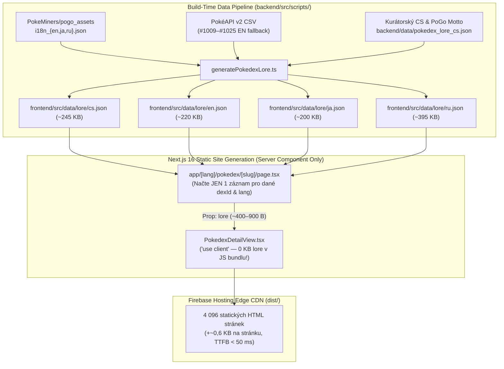

# Výzkumná zpráva: Rozšíření Pokédexu o vlastní moto / hlášku / Pokédex popis (Flavor Text) — Audit primárních zdrojů, variant a architektury

**Autor:** Antigravity Research Agent  
**Datum:** Listopad 2026  
**Status:** Výzkumná zpráva (Primary-Source Verified)  
**Cílový repozitář:** `DavidFaltus/Pokemon-GO-event-tracker`  
**Umístění dokumentu:** `docs/research/pokedex-flavor-text-and-motto-sources.md`

---

## Obsah

1. [Manažerské shrnutí & Hlavní zjištění](#1-manažerské-shrnutí--hlavní-zjištění)
2. [Audit primárních datových zdrojů](#2-audit-primárních-datových-zdrojů)
   - [2.1. Oficiální Pokédex na `pokemon.com` & `zukan.pokemon.co.jp`](#21-oficiální-pokédex-na-pokemoncom--zukanpokemoncojp)
   - [2.2. PokéAPI v2 (`pokeapi.co` & `PokeAPI/pokeapi` CSV)](#22-pokeapi-v2-pokeapico--pokeapipokeapi-csv)
   - [2.3. Oficiální herní texty Pokémon GO (`PokeMiners/pogo_assets`)](#23-oficiální-herní-texty-pokémon-go-pokeminerspogo_assets)
   - [2.4. Souhrnná srovnávací matice zdrojů](#24-souhrnná-srovnávací-matice-zdrojů)
3. [Srovnání 5 produktových variant „mota / hlášky“](#3-srovnání-5-produktových-variant-mota--hlášky)
4. [Vícejazyčnost (`cs`, `en`, `ja`, `ru`), SEO, Google AdSense & Právní aspekty](#4-vícejazyčnost-cs-en-ja-ru-seo-google-adsense--právní-aspekty)
5. [Architektura, velikost payloadu & dopad na SSG (4 096+ stránek)](#5-architektura-velikost-payloadu--dopad-na-ssg-4-096-stránek)
6. [Doporučený návrh řešení & Implementační plán](#6-doporučený-návrh-řešení--implementační-plán)

---

## 1. Manažerské shrnutí & Hlavní zjištění

Cílem tohoto výzkumu bylo ověřit primární datové zdroje, licenční/technické limity, jazykové pokrytí (`cs`, `en`, `ja`, `ru`), SEO/AdSense dopady a výkonnostní nároky pro přidání **vlastního mota / Pokédex popisu (flavor text) a kategorie druhu** ke každému Pokémonovi v Pokédexu aplikace `pogoevents.app`.

### Klíčová primární zjištění (ověřeno přímo proti API, CSV a lokalizačním souborům)

1. **Nejsilnějším primárním zdrojem pro Pokémon GO Pokédex NENÍ `pokemon.com` ani `PokéAPI`, ale oficiální lokalizační JSON soubory Pokémon GO v `PokeMiners/pogo_assets` (`Texts/Latest APK/JSON/i18n_*.json`):**
   - Pokrývají **1 008 z 1 025 druhů** (chybí pouze 17 druhů Gen 9 DLC `#1009–#1025`), **1 051 kategorií druhů** (`pokemon_category_*`, např. *Seed Pokémon*), **všech 50 Mega & Primal evolucí** (`pokemon_desc_tmpevo_*`), **všech 32+ Gigantamax forem** (`pokemon_desc_XXXX_YYYY_2`/`_3`), a **regionální, fúzní i bojové formy** (Alola, Galar, Hisui, Paldea, Dusk Mane/Dawn Wings Necrozma, Black/White Kyurem, Zacian Crowned Sword) — a to vše najednou v **oficiální angličtině (`en`), japonštině (`ja`) i ruštině (`ru`)**.
   - **Kritický bug objevený při auditu `PokeMiners/pogo_assets`:** Textové soubory `Texts/Latest APK/Russian.txt` a `Texts/Latest Remote/Russian.txt` jsou v repozitáři chybně namapované a **obsahují španělský text** (*„Este Pokémon lleva un bulbo en el lomo...“*). Naproti tomu **`Texts/Latest APK/JSON/i18n_russian.json`** obsahuje **100 % autentickou oficiální ruštinu v cyrilici** (1 219 z 1 220 popisů, 50/50 Mega popisů a oficiální ruská jména Pokémonů jako `Айвизавр`).
2. **PokéAPI v2 (`pokeapi.co`) má zásadní mezery pro naši 4jazyčnou a variantní architekturu:**
   - Obsahuje **0 záznamů pro ruštinu (`ru`)** (jazyk v `languages.csv` vůbec neexistuje) a **0 Pokédex popisů pro češtinu (`cs`)** (kód `cs` má `official=0` a obsahuje pouze 3 historické názvy schopností).
   - **Japonština (`ja` / `ja-hrkt`) v PokéAPI končí u `#898` Calyrex (Gen 8 Sword/Shield)** — pro `#899–#905` (*Legends: Arceus*) a všech 120 druhů Gen 9 (`#906–#1025`) má PokéAPI **pouze angličtinu (`en`)** (127 chybějících japonských popisů).
   - Formové popisy (`pokemon_form_flavor_text.csv`) pokrývají pouze **63 forem a výhradně anglicky** (0 Galar, 0 Hisui, 0 Paldea, 0 Gigantamax).
   - Naopak je PokéAPI nenahraditelné jako doplňkový zdroj pro **zbývajících 17 druhů `#1009–#1025`** (v EN) a pro případný **přepínač více herních verzí** (např. *Klasický* vs. *Moderní* zápis ve stylu `pokemon.com`).
3. **Přímý scraping `pokemon.com` je technicky blokovaný i právně nevhodný:**
   - Web je chráněn WAF/anti-bot vrstvou (Imperva/Incapsula, TLS/JA4 fingerprinting, JS výzvy) a podmínky užití The Pokémon Company International (`pokemon.com/us/terms-of-use`) výslovně zakazují neoprávněné automatizované těžení obsahu. Navíc `pokemon.com` **nepodporuje češtinu ani ruský Pokédex** (a `zukan.pokemon.co.jp` je výhradně japonský).
4. **Čeština (`cs`) nemá žádný oficiální herní zdroj:**
   - Ani hlavní série her, ani Pokémon GO nebyly oficiálně lokalizovány do češtiny. České texty (kategorie, překlad oficiálního popisu nebo autorské *Trenérské moto*) vyžadují build-time překladovou a kurátorskou vrstvu.
5. **Klíčové architektonické pravidlo pro Next.js SSG (0 KB dopad na klientský JS bundle):**
   - Stávající `frontend/src/data/pokedexCatalog.json` má již **1,61 MB (1 609 167 B)** a importují jej klientské komponenty (`PokedexView.tsx` i `PokedexDetailView.tsx`).
   - Přidání 4jazyčných popisů přímo do `pokedexCatalog.json` by jej nafouklo o **+0,87 až +1,13 MB** (na ~2,74 MB) pro každého návštěvníka katalogu.
   - **Správná architektura:** Uložit popisy a kategorie do samostatného souboru `frontend/src/data/pokedexLore.json` (případně děleného dle jazyka `pokedexLore.{cs,en,ja,ru}.json`), importovat jej **výhradně v Server Componentě** `frontend/src/app/[lang]/pokedex/[slug]/page.tsx` a předávat do `<PokedexDetailView />` jako prop pouze data pro **jednoho konkrétního Pokémona** (~350–900 B v HTML/RSC payloadu, **0 KB v klientském JS bundlu**).
6. **Doporučená produktová varianta (Hybridní model pro maximální UX i soulad s Google AdSense):**
   - Kombinovat **Oficiální kategorii druhu** (*„Semínkový Pokémon“ / „Seed Pokémon“*) + **Oficiální Pokédex záznam z Pokémon GO (dynamicky přepínaný pro Mega / Primal / Regionální / Gigantamax / Fúzní formy)** v citovaném bloku (`<blockquote>` s uvedením zdroje) + **krátké originální PoGo „Trenérské moto / Herní vizitka“** (1 věta specifická pro roli Pokémona v Pokémon GO — raidy, PvP, Max Battles, evoluce). Tím stránka přináší autentický Pokédex zážitek jako na `pokemon.com`, ale zároveň plní redakční přidanou hodnotu vyžadovanou zásadami Google AdSense (`answer/11190248`).

---

## 2. Audit primárních datových zdrojů

### 2.1. Oficiální Pokédex na `pokemon.com` & `zukan.pokemon.co.jp`

#### A. Struktura obsahu a UI vzor („Versions“ přepínač)
Oficiální detail Pokémona na `https://www.pokemon.com/us/pokedex/ivysaur` zobrazuje u každého Pokémona:
1. **Krátký Pokédex popis (Flavor Text)** se dvěma interaktivními tlačítky (**Versions:** — typicky ikony modrého a červeného/růžového Poké Ballu), které přepínají mezi dvěma párovými verzemi hlavní série her (např. *Pokémon Sword* vs. *Pokémon Shield* nebo *Pokémon Scarlet* vs. *Pokémon Violet*).
   - Příklad Ivysaur (`#0002`) na `pokemon.com/us/pokedex/ivysaur` (ověřeno přes vyhledávání v indexu `pokemon.com`):
     - Verze 1: *„The more sunlight Ivysaur bathes in, the more strength wells up within it, allowing the bud on its back to grow larger.“*
     - Verze 2: *„The bulb on its back grows as it absorbs nutrients. The bulb gives off a pleasant aroma when it blooms.“*
2. **Kategorii druhu (Category / Genus)** — např. *„Seed“* (*Seed Pokémon*) vedle výšky, váhy a schopností.
3. **Přepínač forem** (u druhů s Mega evolucí, regionální formou či Gigantamaxem), přičemž každá forma mění nejen obrázek a statistiky, ale i vlastní popis.

Oficiální japonská verze **Pokémon Zukan (`https://zukan.pokemon.co.jp`)** spravovaná The Pokémon Company v Japonsku funguje na stejném principu: zobrazuje jednotlivé formy (včetně regionálních forem jako *アローラのすがた* / *ガラルのすがた* / *ヒスイのすがた* / *パルデアのすがた*) s vlastními popisy podle herních verzí.

#### B. Jazykové pokrytí vs. naše 4 jazyky (`cs`, `en`, `ja`, `ru`)
| Jazyk aplikace | `pokemon.com` Pokédex | `zukan.pokemon.co.jp` | Poznámka |
|---|---|---|---|
| **`en`** (English) | Ano (`/us/pokedex/`, `/uk/pokedex/`) | Ne | Plné pokrytí |
| **`ja`** (日本語) | Ne | Ano (výhradně japonsky) | Oddělená doména a struktura TPC Japan |
| **`ru`** (Русский) | **Ne** (hlavní web má jen omezené právní/support stránky v ruštině; online Pokédex ruštinu nepodporuje) | Ne | Chybí ruský Pokédex |
| **`cs`** (Čeština) | **Ne** | Ne | Česky nikdy neexistovalo |

Mezinárodní `pokemon.com` Pokédex podporuje západní jazyky (angličtina, francouzština, němčina, španělština, italština, brazilská portugalština), nikoli češtinu či ruštinu.

#### C. Technické a právní (ToS) limity přímého scrapingu
- **Anti-bot & WAF:** Domény The Pokémon Company (`pokemon.com`, `pokemoncenter.com`) nasazují aktivní WAF ochranu (**Imperva / Incapsula**) s TLS/JA4 fingerprintingem, sledovacími cookies (`reese84`, `incap_ses`) a JS výzvami, přičemž detailní stránky jsou renderovány klientsky (React). Přímé HTTP requesty končí blokací (`403 Forbidden` / challenge page).
- **Terms of Use (`https://www.pokemon.com/us/terms-of-use`):** The Pokémon Company International výslovně deklaruje výlučná autorská a známková práva ke všem textům, datům a vizuálům na webu, neuděluje obecnou licenci třetím stranám a zakazuje automatizované vytěžování (scraping/harvesting) či obcházení technických omezení.
- **Závěr:** **`pokemon.com` nesmí být scrapován.** Lze se jím však bez problémů inspirovat po stránce UX (čisté zobrazení kategorie druhu, výrazný quote blok a případný přepínač verzí).

---

### 2.2. PokéAPI v2 (`pokeapi.co` & `PokeAPI/pokeapi` CSV)

Ověřeno přímým dotazem na produkční endpointy `https://pokeapi.co/api/v2/language/?limit=50`, `https://pokeapi.co/api/v2/pokemon-species/{2,6,26,906,1025}`, `https://pokeapi.co/api/v2/pokemon-form/*` a na zdrojové CSV tabulky v oficiálním repozitáři `https://github.com/PokeAPI/pokeapi/tree/master/data/v2/csv`.

#### A. Přesné schéma endpointu `pokemon-species/{id}`
1. `flavor_text_entries`: pole objektů `{ flavor_text: string, language: { name, url }, version: { name, url } }`.
   - *Poznámka k formátování:* Řetězce z raných her obsahují řídicí znaky zalomení stránky (`\f`), pevné konce řádků (`\n`) a měkké spojovníky, které je nutné před zobrazením normalizovat (`replace(/[\n\f\r]+/g, ' ')`).
   - Příklad pro Ivysaur (`#2`) — `pokeapi.co/api/v2/pokemon-species/2`: celkem **102 záznamů** napříč 11 jazyky a verzemi od *Red/Blue* po *Sword/Shield* (např. `shield` EN: *„Exposure to sunlight adds to its strength. Sunlight also makes the bud on its back grow larger.“*, `shield` JA: *„太陽の　光を　浴びるほど 体に　力が　わいて　背中の つぼみが　育っていく。“*).
2. `genera`: pole objektů `{ genus: string, language: { name, url } }` — oficiální kategorie druhu (např. Ivysaur: `en: "Seed Pokémon"`, `ja: "たねポケモン"`).
3. `form_descriptions` (zdroj `pokemon_species_prose.csv`, 151 řádků): **NEJSOU to Pokédex popisy forem!** Obsahují pouze technické poznámky z veekunu k mechanice změny forem u vybraných druhů (např. Spiky-eared Pichu `#172`, Unown `#201`, Castform `#351`). Pro Raichu (`#26`) i Charizarda (`#6`) vrací prázdné pole `[]`.
4. `pokemon_form_flavor_text.csv` (vystaveno na `/api/v2/pokemon-form/{id}` jako `flavor_text_entries`): obsahuje pouze **249 záznamů pro 63 unikátních forem** — a to **výhradně v angličtině (`language_id=9`)**! Pokrývá jen 32 Gen 6 Mega evolucí, 18 alolských forem, Deoxyse, Basculina, Oricoria a 3 formy Necrozmy. **Zcela chybí Galar, Hisui, Paldea i Gigantamax.**

#### B. Exaktní audit jazykového a generačního pokrytí (`data/v2/csv/`)
Přímá analýza `languages.csv`, `pokemon_species_flavor_text.csv` (199 725 řádků) a `pokemon_species_names.csv` v `PokeAPI/pokeapi`:

| Jazyk (`languages.csv`) | `id` | `official` | `flavor_text_entries` (celkem) | Pokryté druhy (z 1 025) | Gen 8 (`#810–905`, z 96) | Gen 9 (`#906–1025`, ze 120) | `genera` (z 1 025) |
|---|---:|---:|---:|---:|---:|---:|---:|
| **`en`** | 9 | 1 | **14 496** | **1 025 / 1 025** (100 %) | **96 / 96** | **120 / 120** | **1 025 / 1 025** |
| **`ja`** (kanji) | 11 | 1 | 5 818 | **898 / 1 025** (87,6 %) | 89 / 96 *(chybí Legends: Arceus #899–905)* | **0 / 120** *(0 %)* | 913 / 1 025 |
| **`ja-hrkt`** (kana) | 1 | 1 | 5 818 | **898 / 1 025** (87,6 %) | 89 / 96 | **0 / 120** *(0 %)* | 1 018 / 1 025 |
| **`cs`** (čeština) | 10 | 0 | **0** | **0 / 1 025** (0 %) | 0 | 0 | **0 / 1 025** |
| **`ru`** (ruština) | — | — | **0** *(jazyk neexistuje)* | **0 / 1 025** (0 %) | 0 | 0 | **0 / 1 025** |

*Ověřený detail k `cs` (`language_id=10`):* V celém `PokeAPI/pokeapi` má čeština 0 řádků v `pokemon_species_flavor_text.csv`, 0 v `pokemon_species_names.csv`, 0 v `type_names.csv`, 0 v `version_names.csv` a pouze 3 historické záznamy v `ability_names.csv`. (Pozn.: při naivním grepování `,10,` v `pokemon_species_flavor_text.csv` se objeví 386 řádků, jde však o `version_id=10`, tj. *Pokémon Emerald*, nikoli `language_id=10`.)

#### C. Licence a podmínky užití PokéAPI
- **Kód a databázová struktura:** BSD-3-Clause (`https://github.com/PokeAPI/pokeapi/blob/master/LICENSE.md`).
- **Fair Use Policy (`https://pokeapi.co/about`):** Vyžaduje **lokální cachování** (v našem případě ideálně jednorázové build-time stažení nebo přímé čtení CSV z GitHubu, nikoli runtime volání z prohlížeče).
- **Duševní vlastnictví dat:** `LICENSE.md` výslovně uvádí: *„Pokémon and Pokémon character names are trademarks of Nintendo. All rights reserved.“* PokéAPI **nevlastní autorská práva k textům z her** a nemůže udělit licenci na komerční přebírání celých herních textů.

---

### 2.3. Oficiální herní texty Pokémon GO (`PokeMiners/pogo_assets`)

Ověřeno přímo proti repozitáři `https://github.com/PokeMiners/pogo_assets` (poslední push k datu auditu: `2026-10-28T16:06:08Z`, větev `master`), konkrétně adresářům `Texts/Latest APK/`, `Texts/Latest APK/JSON/` a `Texts/Latest Remote/`.

#### A. Podporované jazyky & KRITICKÝ NÁLEZ (bug v `Russian.txt` vs. čistý `i18n_russian.json`)
Pokémon GO APK obsahuje **15 oficiálních lokalizací**: `BrazilianPortuguese`, `ChineseTraditional`, `English`, `French`, `German`, `Hindi`, `Indonesian`, `Italian`, `Japanese`, `Korean`, `LatinAmericanSpanish`, `Russian`, `Spanish`, `Thai`, `Turkish`. **Čeština (`Czech`) v Pokémon GO neexistuje.**

> [!WARNING]
> **Kritické zjištění auditu primárních souborů v `PokeMiners/pogo_assets`:**
> Textové dumpy `Texts/Latest APK/Russian.txt` a `Texts/Latest Remote/Russian.txt` jsou v repozitáři chybně vyexportované a **obsahují španělštinu** (např. `pokemon_category_0002 = "Pokémon Semilla"`, `pokemon_desc_0002 = "Este Pokémon lleva un bulbo en el lomo..."`).
> Naproti tomu **`Texts/Latest APK/JSON/i18n_russian.json`** (4,82 MB) obsahuje **100 % autentickou, oficiální ruskou lokalizaci od Nianticu v cyrilici**:
> - `pokemon_name_0002`: `"Айвизавр"`
> - `pokemon_category_0002`: `"Покемон-Семя"`
> - `pokemon_desc_0002`: `"На спине Айвизавра есть бутон. У этого Покемона мощные ноги и сильный торс, чтобы поддержать его вес. Если он вдруг проводит больше времени на солнце, это признак того, что бутон скоро превратится в большой цветок."`
> - `pokemon_desc_0906` (Sprigatito, Gen 9!): `"Волокна пушистой шёрстки Спригатито по структуре напоминают растительные. Чтобы мех не высыхал, этот Покемон часто умывается."`
>
> **Závěr pro implementaci:** Ingestion skript **MUSÍ** číst výhradně z `Texts/Latest APK/JSON/i18n_{english,japanese,russian}.json` (párové pole `data: [key, value, key, value, ...]`), NIKOLI ze souborů `Russian.txt`.

#### B. Struktura klíčů a přesné pokrytí (`i18n_english.json`, `i18n_japanese.json`, `i18n_russian.json`)

Všechny tři soubory (`EN`, `JA`, `RU`) mají identický rozsah 36 406 lokalizačních klíčů a shodné pokrytí Pokédexu:

| Kategorie klíčů | Vzor klíče | Počet klíčů (EN / JA / RU) | Příklady & Pokrytí |
|---|---|---:|---|
| **Základní druhy** | `pokemon_desc_XXXX` | **1 000** | `pokemon_desc_0002` (Ivysaur), `pokemon_desc_0906` (Sprigatito) |
| **Regionální, fúzní a bojové formy (číselný Form ID)** | `pokemon_desc_XXXX_YYYY` | **95** | `pokemon_desc_0026_0050` (Alolan Raichu), `pokemon_desc_0058_2792` (Hisuian Growlithe), `pokemon_desc_0144_2801` (Galarian Articuno), `pokemon_desc_0194_3009` (Paldean Wooper), `pokemon_desc_0646_0147`/`0148` (Black/White Kyurem), `pokemon_desc_0800_2718`/`2719` (Dusk Mane/Dawn Wings Necrozma), `pokemon_desc_0888_2576` (Zacian Crowned Sword), plus 7 druhů bez základního klíče (`#905` Enamorus, `#916` Oinkologne, `#925` Maushold, `#931` Squawkabilly, `#964` Palafin, `#978` Tatsugiri, `#982` Dudunsparce) |
| **Gigantamax formy** | `pokemon_desc_XXXX_YYYY_2` / `_3` | **34** | `pokemon_desc_0003_0169_2` (G-Max Venusaur), `pokemon_desc_0006_0178_2` (G-Max Charizard), `pokemon_desc_0892_2723_2` & `2724_3` (G-Max Urshifu Single/Rapid Strike) — **pokrývá všech 32 G-Max druhů!** |
| **Pojmenované speciální formy** | `pokemon_desc_XXXX_<name>` | **91** | `pokemon_desc_0144_g` (Galarian Articuno), `pokemon_desc_0745_midday`/`midnight` (Lycanroc), `pokemon_desc_0892_rs`/`ss` (Urshifu), `pokemon_desc_0898_shadow` (Shadow Rider Calyrex), Alcremie formy aj. |
| **Mega & Primal evoluce** | `pokemon_desc_tmpevo_XXXX_0001..0003` | **50** | `pokemon_desc_tmpevo_0006_0002` (Mega Charizard X), `0003` (Mega Charizard Y), `pokemon_desc_tmpevo_0382_0001` (Primal Kyogre) — **přesná shoda 50/50 s naším `pokedexCatalog.json`!** |
| **Kategorie druhu (Genus)** | `pokemon_category_XXXX` (+ formové) | **1 051** (1 001 + 50) | `Seed Pokémon` / `たねポケモン` / `Покемон-Семя` |
| **Celkem pokrytých druhů (`#1–#1025`)** | sloučením base + form | **1 008 / 1 025** (98,3 %) | Chybí pouze 17 Gen 9 DLC druhů `#1009–#1025` (*Walking Wake* až *Pecharunt*), z nichž většina ještě nebyla v Pokémon GO vydána (pouze 4 z nich — `#1011` Dipplin, `#1012` Poltchageist, `#1013` Sinistcha, `#1019` Hydrapple — figurují v našem `RELEASED_GEN_9_IDS`). |

*Dodatečný poznatek k `Latest Remote` (`English.txt` / `Japanese.txt`):* Soubory `Latest Remote` přidávají 5 novějších formových záznamů pro Sinistea (`#0854`), Polteageist (`#0855`) a Eternamax Eternatus (`#0890_2581`), které ještě nemusejí být ve starším APK JSONu (opět platí: nečíst `Latest Remote/Russian.txt`, je španělsky).

#### C. Liší se popisy v Pokémon GO od hlavních her?
Ověřením textů v `i18n_english.json` proti `PokéAPI`:
- Pokémon GO **nepíše vlastní nezávislý lore** — Niantic pro každý druh a formu přebírá **jeden vybraný oficiální záznam z hlavní série her** (u Gen 1–3 typicky *Ruby / Sapphire / Omega Ruby / Alpha Sapphire*, u novějších generací jejich debutovou hru, u Gigantamaxu *Sword / Shield*, u Hisui *Legends: Arceus*, u Paldea *Scarlet / Violet*).
- Příklad **Ivysaur (`#0002`)**:
  - **Pokémon GO (`pokemon_desc_0002`):** *„There is a bud on this Pokémon's back. To support its weight, Ivysaur's legs and trunk grow thick and strong. If it starts spending more time lying in the sunlight, it's a sign that the bud will bloom into a large flower soon.“* (doslovný text z *Pokémon Ruby / Sapphire / ORAS*).
  - **Pokémon GO Gigantamax Charizard (`pokemon_desc_0006_0178_2`):** *„This colossal, flame-winged figure of a Charizard was brought about by Gigantamax energy.“* (z *Pokémon Sword*).
  - **Pokémon GO Mega Charizard X (`pokemon_desc_tmpevo_0006_0002`):** *„The overwhelming power that fills its entire body causes it to turn black and creates intense blue flames.“* (z *Pokémon Sun*).
- **Proč se skvěle hodí pro `pogoevents.app`:** Text odpovídá **přesně tomu, co hráč vidí přímo ve svém Pokédexu v aplikaci Pokémon GO**, má jednotnou délku (~141 B v EN, ~121 B v JA, ~262 B v RU), a jako jediný zdroj pokrývá **všechny herní varianty Pokémon GO (Mega, Primal, Gigantamax, Alola, Galar, Hisui, Paldea, Fúze)** v EN, JA i RU najednou.

---

### 2.4. Souhrnná srovnávací matice zdrojů

| Kritérium | `pokemon.com` / `zukan` | PokéAPI v2 (`pokeapi.co`) | Pokémon GO (`PokeMiners/pogo_assets` JSON) |
|---|---|---|---|
| **Pokrytí druhů (`#1–#1025`)** | 1 025 / 1 025 | 1 025 / 1 025 (EN), **jen 898 / 1 025 (JA)** | **1 008 / 1 025** (EN, JA i RU shodně) |
| **Angličtina (`en`)** | Ano | Ano (100 %) | Ano (98,3 %; + 17 z PokéAPI = 100 %) |
| **Japonština (`ja`)** | Ano (jen `zukan`) | Částečně (chybí Gen 9 + Hisui = 127 druhů) | **Ano (98,3 %, včetně 95/120 Gen 9!)** |
| **Ruština (`ru`)** | **Ne** | **Ne (0 %)** | **Ano (`i18n_russian.json`, 98,3 % v cyrilici!)** |
| **Čeština (`cs`)** | **Ne** | **Ne (0 %)** | **Ne (0 %)** |
| **Mega / Primal popisy** | Ano (částečně) | 32 Gen 6 Megas (jen EN) | **50 / 50 (EN + JA + RU)** |
| **Gigantamax popisy** | Ano | **Ne (0)** | **34 / 32 druhů (EN + JA + RU)** |
| **Regionální formy (Alola/Galar/Hisui/Paldea)** | Ano | Jen 18 Alola (jen EN) | **Všechny 4 regiony (EN + JA + RU)** |
| **Kategorie druhu (Genus)** | Ano | EN 100 %, JA 89–99 %, RU 0 %, CS 0 % | **1 051 kategorií (EN + JA + RU)** |
| **Více verzí pro přepínač** | Ano (2 verze) | Ano (až 20+ verzí v EN) | Ne (1 kanonický GO záznam na formu) |
| **Technická dostupnost** | Blokováno WAF (Imperva), zákaz v ToS | Otevřené REST API + GitHub CSV (BSD kód) | Veřejný GitHub raw JSON (statický build-time fetch) |
| **Vhodnost pro `pogoevents.app`** | Pouze UX inspirace | **Sekundární zdroj** (doplnění `#1009–1025` + volitelný 2. záznam) | **Primární zdroj #1** |

---

## 3. Srovnání 5 produktových variant „mota / hlášky“

Uživatelský požadavek zmiňuje přidat každému Pokémonovi *„vlastní moto/hlášku“* po vzoru `pokemon.com/us/pokedex/ivysaur` a prozkoumat i další varianty. Níže je detailní srovnání 5 možných přístupů:

| Varianta | Jak vypadá v UI (příklad Ivysaur `#0002`) | Výhody | Nevýhody & Rizika | SEO / AdSense dopad |
|---|---|---|---|---|
| **1. Jednotný oficiální Pokédex popis (Pokémon GO kanonický záznam)** | Citovaný blok s textem přímo z Pokémon GO Pokédexu (`pokemon_desc_0002`). | 100% autenticita pro hráče Pokémon GO; okamžitě dostupné v EN, JA, RU; nejmenší datový objem (~870 KB / 4 jazyky). | Čistě doslovná citace existuje na stovkách wiki webů; nutný překlad pro `cs` a 17 DLC druhů. | **Neutrální až mírně rizikové**, pokud by stálo samostatně bez vlastní redakční vrstvy (Google AdSense `answer/11190248` — replikovaný obsah). |
| **2. Dvojverze s přepínačem (`pokemon.com`-style toggle)** | Dva malé přepínače (např. *Pokémon GO / Klasický* nebo *Verze A / Verze B* s ikonami Poké Ballu), které mění popis. | Věrně replikuje známý zážitek z `pokemon.com/us/pokedex/ivysaur`; baví fanoušky srovnáváním lore mezi generacemi. | Zdvojnásobuje velikost dat i náklady na překlad `cs`/`ru`; v PokéAPI chybí 2. verze v `ru` (0 %) a pro Gen 9 v `ja` (0 %); přidává 2. přepínač vedle už existujícího přepínače forem v `PokedexDetailView.tsx`. | Stále jde o doslovně převzatý herní text (zdvojení neřeší originalitu pro AdSense). |
| **3. Oficiální kategorie druhu (Genus) + Flavor Text** | Pod nadpisem `Ivysaur` jemný podtitul **`Semínkový Pokémon`** (`Seed Pokémon` / `たねポケモン` / `Покемон-Семя`) + pod ním samotný popis. | Extrémně vysoký poměr *vizuální přínos / datová cena* (jen ~17–35 B na Pokémona!); okamžitě dodá hero kartě v `PokedexDetailView.tsx` pocit skutečného Pokédexu; 1 051 kategorií už je v `pogo_assets` pro EN/JA/RU. | Vyžaduje jednorázový překlad ~1 025 krátkých kategorií do češtiny (~3–4 slova na druh). | Zlepšuje sémantickou strukturu (`schema.org/Thing` `alternateName` / `description`) a UX. |
| **4. Formově specifické popisy (Mega / Primal / Regionální / G-Max / Fúze)** | Při kliknutí na pilulku formy v `PokedexDetailView.tsx` (např. *Mega Charizard X*, *Gigantamax Charizard*, *Alolan Raichu*, *Galarian Articuno*, *Dusk Mane Necrozma*) se dynamicky změní i citovaný Pokédex popis! | Obrovský „wow efekt“ — v `PokedexDetailView.tsx` už přepínač `activeVariant` máme (`lines 367–393`), dnes ale mění jen sprite, typy, staty a útoky! `pogo_assets` už má 50/50 Mega/Primal, 34 G-Max a 95+ regionálních/fúzních popisů v EN/JA/RU. | Shadow a základní Dynamax nemají vlastní herní popis (čistě zdědí popis základní formy + případný krátký Shadow/Dynamax štítek). | Významně odlišuje náš Pokédex od prostých tabulek a zvyšuje dobu strávenou na stránce (engagement). |
| **5. Autorské PoGo „Trenérské moto / Lore + Herní vizitka“** | Krátká úderná 1–2větá autorská vizitka šitá na míru Pokémon GO (např. pro Ivysaura: *„Pevný most mezi startérem a Mega Venusaurem — jeho silný poupěný základ dává smysl šetřit pro Community Day útok Frenzy Plant.“* nebo u Mega Charizarda Y: *„Král ohnivého DPS, který v raidech drtí travní i ledové bossy a posiluje celé lobby o +30 %.“*). | **100 % originální, autorský obsah** (nulové autorskoprávní riziko, maximální unikátnost v indexu Google a plný soulad s Google AdSense); přirozeně srozumitelné ve všech 4 jazycích včetně češtiny; skutečná přidaná hodnota pro hráče Pokémon GO. | Vyžaduje buď pečlivý daty řízený generátor + ruční kurátorství (hlavně pro Top ~200 indexovaných meta Pokémonů dle `isTopMetaPokedexEntry()`), aby nepůsobilo genericky/šablonovitě. | **Nejvyšší pozitivní dopad na SEO i Google AdSense** (`answer/11190248` — unikátní redakční přidaná hodnota). |

### Doporučená kombinace: **Varianta 3 + 4 + 5 (Hybridní „Pokédex Lore & Trainer Motto“)**

Namísto volby „buď oficiální citace, nebo vlastní moto“ přináší nejlepší výsledek jejich čisté propojení v hero kartě `PokedexDetailView.tsx`:
1. **Oficiální kategorie druhu** (*Seed Pokémon* / *Semínkový Pokémon*) jako jemný štítek u názvu Pokémona (Varianta 3).
2. **Oficiální citace z Pokémon GO Pokédexu** s dynamickou podporou forem (Mega / Primal / Regionální / Gigantamax / Fúze) vizuálně odlišená jako krátký `<blockquote>` s jasným označením původu (`Pokédex (Pokémon GO)` / `Pokédex (Mega Evolution)` / `Pokédex (Gigantamax)`) (Varianta 1 + 4).
3. **Originální „PoGo Trenérské moto“ (1 úderná věta / tactical tagline)** — minimálně pro kurátorských Top ~200 meta Pokémonů (`isTopMetaPokedexEntry()`), postupně rozšířitelné pro celý katalog (Varianta 5).

---

## 4. Vícejazyčnost (`cs`, `en`, `ja`, `ru`), SEO, Google AdSense & Právní aspekty

### 4.1. Strategie pokrytí všech 4 jazyků (`cs`, `en`, `ja`, `ru`)

| Jazyk | Primární zdroj (98,3 % druhů + všechny formy) | Doplnění `#1009–#1025` (17 DLC druhů) | Poznámka ke kvalitě |
|---|---|---|---|
| **`en`** | `PokeMiners/pogo_assets` (`i18n_english.json`) | `PokéAPI v2` (`pokemon_species_flavor_text.csv`, `language_id=9`) | 100 % oficiální, nulový ruční překlad |
| **`ja`** | `PokeMiners/pogo_assets` (`i18n_japanese.json`) | Kurátorský překlad / oficiální japonský text pro 17 Gen 9 DLC druhů (PokéAPI má u Gen 9 `ja` = 0!) | 98,3 % oficiální Niantic japonština (mnohem kompletnější než PokéAPI) |
| **`ru`** | `PokeMiners/pogo_assets` (`i18n_russian.json` — **NE `Russian.txt`!**) | Překlad z EN pro 17 Gen 9 DLC druhů | 98,3 % oficiální Niantic ruština v cyrilici |
| **`cs`** | **Neexistuje oficiální zdroj** -> build-time překladová vrstva s uloženým statickým výstupem (`pokedexLore.cs.json`) + terminologický glosář (zachovat anglické názvy Pokémonů a pojmů jako *Mega Evoluce*, *Gigantamax*, *Poké Ball* v souladu s českou komunitou) | Stejný překladový pipeline | Jednorázově vygenerovat, zrevidovat alespoň Top ~200 meta druhů a verzovat v repozitáři |

> [!TIP]
> **Bonusový nález z našeho repozitáře (`frontend/src/data/pokedexCatalog.json`):**
> Při inspekci `pokedexCatalog.json` bylo zjištěno, že pole `names.ru` aktuálně u většiny Pokémonů obsahuje nepřeložený anglický název (např. Ivysaur má `"ru": "Ivysaur"`). Soubor `PokeMiners/pogo_assets/master/Texts/Latest APK/JSON/i18n_russian.json` přitom obsahuje kompletní oficiální ruská jména pod klíči `pokemon_name_0001..1006` (např. `pokemon_name_0002: "Айвизавр"`). Při úpravě `backend/src/scripts/generatePokedexCatalog.ts` lze jedním tahem opravit i ruskou lokalizaci jmen celého Pokédexu.

### 4.2. Soulad s Google AdSense & SEO (návaznost na audit 2026)

Podle našeho interního auditu [`docs/research/adsense-low-value-content-audit-2026.md`](file:///C:/PROJEKTY/OSOBN%C3%8D/Pokemon-GO-event-tracker/docs/research/adsense-low-value-content-audit-2026.md) a aktuální implementace [`frontend/src/utils/pokedexSeoHelper.ts`](file:///C:/PROJEKTY/OSOBN%C3%8D/Pokemon-GO-event-tracker/frontend/src/utils/pokedexSeoHelper.ts#L24-L56):
1. **Indexační politika zůstává zachována:** `frontend/src/app/[lang]/pokedex/[slug]/page.tsx` již indexuje (`index: true`) pouze kurátorských **Top ~200 meta Pokémonů** přes `isTopMetaPokedexEntry(entry)` a ostatním nastavuje `noindex, follow`, aby web nebyl nikdy označen za *Scaled Content Abuse*.
2. **Zásada proti replikovanému obsahu ([Google Publisher Policies — answer/11190248](https://support.google.com/publisherpolicies/answer/11190248?hl=cs)):**
   - Doslovně převzatý Pokédex popis je text publikovaný na desítkách jiných webů (Bulbapedia, Serebii, PokemonDB, pokemon.com).
   - **Pravidlo bezpečného začlenění:**
     - Pokédex popis **nesmí** být jediným ani dominantním textovým blokem stránky. Na naší detailní stránce `PokedexDetailView.tsx` již máme vlastní víceodstavcovou strategickou analýzu a FAQ (`generatePokedexEditorialAnalysis()`), tabulku 100% IV CP, PvP analýzu a raid countery — oficiální citace (1–3 krátké věty, ~25 slov) bude tvořit **< 5 % textového obsahu stránky**.
     - Zobrazovat jej sémanticky uvnitř `<blockquote className="pokedex-lore-quote">` s jasným `<cite>` (např. *„Oficiální záznam z Pokédexu (Pokémon GO)“*).
     - **Doplnit vlastní krátké „PoGo Trenérské moto“** (1 originální věta o identitě v Pokémon GO) u Top ~200 indexovaných stránek, čímž se ještě zvýší podíl unikátního redakčního textu nad ohybem stránky (above-the-fold).
3. **Jazyková čistota (`answer/9727`):** Nikdy nepadat tiše do anglického flavor textu na `/cs/`, `/ja/` nebo `/ru/` stránkách, pokud není přeložen! Buď mít 100% přeložený text pro všechny 4 jazyky (včetně 17 DLC druhů), nebo daný blok u chybějícího překladu vůbec nezobrazovat (žádný česko-anglický mix).
4. **JSON-LD (`page.tsx`):** V [`frontend/src/app/[lang]/pokedex/[slug]/page.tsx`](file:///C:/PROJEKTY/OSOBN%C3%8D/Pokemon-GO-event-tracker/frontend/src/app/%5Blang%5D/pokedex/%5Bslug%5D/page.tsx#L132-L148) doporučujeme ponechat unikátní lokalizovaný popis v `ItemPage.description` a nekopírovat doslovný herní flavor text do meta `description` (meta popisky by měly zůstat optimalizované pro vyhledávací záměr: *Max CP, Best Moveset, Counters, Stats*).

### 4.3. Právní a autorskoprávní rámec (Nintendo / TPCi / Niantic)
- **Autorská práva k flavor textu:** Pokédexové popisy jsou autorské texty vlastněné The Pokémon Company, Nintendo, Game Freak a Creatures Inc. Ani PokéAPI, ani `PokeMiners/pogo_assets` tato práva nevlastní a nemohou na ně udělit komerční licenci.
- **Minimalizace rizika:**
  1. **Nikdy nescrapovat `pokemon.com`** (obcházení WAF/Imperva + porušení ToS).
  2. **Omezit citovaný rozsah:** Použít pouze **1 stručný kanonický popis** (1–2 věty) jako krátkou citační referenci v rámci mnohem rozsáhlejšího informačního/analytického profilu (statistiky, výpočty CP, typová efektivita, strategický průvodce), nikoli hromadné zrcadlení celých archivů 20+ verzí na stránku.
  3. **Transparentní disclaimer:** Zachovat a odkazovat existující stránku `/[lang]/disclaimer` (neoficiální fanouškovský průvodce, ochranné známky náleží Nintendo / Creatures Inc. / GAME FREAK inc. / Niantic).
  4. **Originální vrstva:** Autorské „PoGo Trenérské moto“ a taktická analýza jsou 100 % vlastním dílem redakce `pogoevents.app`.

---

## 5. Architektura, velikost payloadu & dopad na SSG (4 096+ stránek)

### 5.1. Měření současného stavu repozitáře
Přímým měřením souborů v repozitáři (`frontend/src/data/pokedexCatalog.json`, `frontend/src/components/PokedexView.tsx`, `frontend/src/components/PokedexDetailView.tsx`, `frontend/src/app/[lang]/pokedex/[slug]/page.tsx`):

- **`frontend/src/data/pokedexCatalog.json`:** **1 609 167 bajtů (1,61 MB)** (již minifikovaný JSON), obsahuje **1 024 druhů** a **1 414 variant** (50 Mega/Primal, 32 Gigantamax, 58 regionálních, 7 fúzí + Dynamax/Shadow/Battle formy).
- **Počet staticky generovaných detailních stránek (`generateStaticParams`):** `4 jazyky × 1 024 druhů = 4 096 statických HTML stránek` (pod `out/` -> `dist/`).
- **Současný bundle bottleneck:** Jak `PokedexView.tsx`, tak `PokedexDetailView.tsx` jsou `'use client'` komponenty, které přímo importují `pokedexCatalog.ts` (a tedy celý **1,61 MB** soubor `pokedexCatalog.json` končí v klientském JS bundlu).

### 5.2. Kalkulace velikosti nových dat (podle naměřených průměrných délek v `pogo_assets`)

Z přímého měření `i18n_{english,japanese,russian}.json`:
- Průměrná délka 1 základního popisu (UTF-8): **EN = 141 B**, **JA = 121 B**, **RU = 262 B** (cyrilice = 2 B/znak), odhad **CS = ~160 B**.
- Průměrná délka 1 kategorie druhu (`genus`, UTF-8): **EN = 17 B**, **JA = 24 B**, **RU = 34 B**, odhad **CS = ~20 B**.

| Scénář datového rozsahu | EN (1 025+) | JA (1 025+) | RU (1 025+) | CS (1 025+) | Celkem 4 jazyky (Raw JSON) | Celkem (Gzip/Brotli odhad) |
|---|---:|---:|---:|---:|---:|---:|
| **A. Pouze základní popis + kategorie** (`1 025 druhů`) | ~175 KB | ~162 KB | ~318 KB | ~198 KB | **~853 KB** | ~240–270 KB |
| **B. Základní + ~250 formových popisů** (Mega, Primal, G-Max, Regional, Fúze) | ~218 KB | ~200 KB | ~395 KB | ~245 KB | **~1,06 MB** | ~290–330 KB |
| **C. Dvojverze (`pokemon.com` toggle) + formy** (`2× základní + formy`) | ~365 KB | ~325 KB | ~665 KB | ~410 KB | **~1,77 MB** | ~490–550 KB |
| **D. Varianta B + autorské PoGo moto** (`~110 B/jazyk`) | ~330 KB | ~315 KB | ~550 KB | ~360 KB | **~1,55 MB** | ~420–470 KB |

### 5.3. Doporučená architektura: Oddělený Server-Only Lore soubor (0 KB v klientském JS bundlu!)

> [!IMPORTANT]
> **Nikdy nepřidávejte Pokédex popisy přímo do `frontend/src/data/pokedexCatalog.json`!**
> Katalogová stránka `/[lang]/pokedex` (`PokedexView.tsx`) popisy vůbec nezobrazuje, ale importuje celý `pokedexCatalog.json`. Vložení 4jazyčných popisů přímo do katalogu by zvětšilo jeho bundle z 1,61 MB na **2,7–3,4 MB** a zhoršilo Core Web Vitals (INP/LCP) na mobilních zařízeních.

Místo toho využijeme fakt, že `frontend/src/app/[lang]/pokedex/[slug]/page.tsx` je **Next.js 16 Server Component** běžící při statickém buildu (`output: 'export'`):



#### Přesný dopad této architektury na výkon a build:
1. **Klientský JS bundle (`PokedexView` i `PokedexDetailView`):** **+0 KB** (soubory `frontend/src/data/lore/{lang}.json` se do klientského bundlu vůbec nedostanou, protože je importuje pouze Server Componenta `page.tsx`).
2. **Velikost 1 statické HTML stránky (`dist/[lang]/pokedex/[slug].html`):** **+350 až +900 bajtů** (pouze 1 kategorie + 1 základní popis + případné popisy variant daného Pokémona + 1 věta PoGo mota).
3. **Celkový nárůst velikosti složky `dist/` napříč všemi 4 096 stránkami:** ~2,2 až 3,0 MB celkem na disku (zanedbatelné pro Firebase Hosting Edge CDN; přenos k uživateli pro 1 stránku je pod 0,5 KB komprimovaně).
4. **Doba buildu (`npm.cmd run build:deploy`):** Prakticky nezměněna (O(1) lookup v paměti z JSON mapy dle `dexId` v průběhu `generateStaticParams`).
5. **Volitelná budoucí optimalizace:** Stejným vzorem lze později odstranit i stávající import `POKEDEX_MAP` z klientské komponenty `PokedexDetailView.tsx` (předat `prevEntry`, `nextEntry` a `familyNodes` jako lehké props z `page.tsx`), čímž by detailní stránka Pokémona zhubla o téměř celých **1,61 MB** klientského JS!

---

## 6. Doporučený návrh řešení & Implementační plán

### 6.1. Navrhované TypeScript rozhraní (`frontend/src/types/pokedexLore.ts`)

```typescript
export interface PokedexLoreEntry {
  /** Oficiální kategorie druhu (Genus), např. "Semínkový Pokémon" / "Seed Pokémon" */
  genus: string;
  /** Kanonický Pokédex popis (primárně z Pokémon GO, fallback PokéAPI pro #1009–1025) */
  flavorText: string;
  /** Označení zdroje pro <cite>, např. "Pokémon GO" nebo "Pokémon Scarlet" */
  source: string;
  /** Volitelné popisy specifické pro variantu (klíč = PokedexVariant.id, např. "CHARIZARD_MEGA_X", "CHARIZARD_GMAX", "RAICHU_ALOLA") */
  variantFlavorTexts?: Record<string, {
    flavorText: string;
    genus?: string;
    source: string;
  }>;
  /** Volitelný 2. záznam pro budoucí přepínač verzí (pokemon.com styl) */
  altFlavorText?: {
    flavorText: string;
    source: string;
  };
  /** Originální 1věté PoGo Trenérské moto / identita v Pokémon GO (SEO + AdSense unikátnost) */
  trainerMotto?: string;
}
```

### 6.2. Mapování klíčů `PokeMiners/pogo_assets` na naše `PokedexVariant.id`

V našem `backend/src/scripts/generatePokedexCatalog.ts` už máme přesně definovaná ID variant (`CHARIZARD_MEGA_X`, `CHARIZARD_GMAX`, `RAICHU_ALOLA`, `ARTICUNO_GALARIAN`, `GROWLITHE_HISUIAN`, `WOOPER_PALDEA`, `NECROZMA_DUSK_MANE`, `KYUREM_BLACK` atd.):
- **Základní druh:** `pokemon_desc_${pad4(dexId)}` (a `pokemon_category_${pad4(dexId)}`). U 7 druhů bez základního klíče (`#905, #916, #925, #931, #964, #978, #982`) vzít jejich první výchozí formový klíč (`pokemon_desc_0905_2802`, `pokemon_desc_0916_2981` atd.).
- **Mega & Primal evoluce (50/50):** `pokemon_desc_tmpevo_${pad4(dexId)}_0001` (standardní Mega / Primal), `_0002` (Mega X: Charizard X, Mewtwo X), `_0003` (Mega Y: Charizard Y, Mewtwo Y).
- **Gigantamax (32/32):** `pokemon_desc_${pad4(dexId)}_*_2` (a `_3` pro Urshifu Rapid Strike G-Max).
- **Regionální / Fúzní / Bojové formy:** Mapování přes číselný `form` enum z Game Masteru (např. `pokemon_desc_0026_0050` -> `RAICHU_ALOLA`, `pokemon_desc_0144_g` -> `ARTICUNO_GALARIAN`, `pokemon_desc_0800_2718` -> `NECROZMA_DUSK_MANE`, `pokemon_desc_0800_2719` -> `NECROZMA_DAWN_WINGS`, `pokemon_desc_0646_0147` -> `KYUREM_BLACK`, `pokemon_desc_0646_0148` -> `KYUREM_WHITE`).

### 6.3. Fázovaný plán nasazení

1. **Fáze 1 (MVP — vysoký dopad, čistá architektura):**
   - Vytvořit build skript `backend/src/scripts/generatePokedexLore.ts`, který stáhne a zcachuje `i18n_{english,japanese,russian}.json` z `PokeMiners/pogo_assets` + 17 DLC druhů (`#1009–#1025`) z `PokéAPI` CSV a vygeneruje `frontend/src/data/lore/{en,ja,ru,cs}.json` (s českou lokalizační vrstvou).
   - Přidat prop `lore?: PokedexLoreEntry` do `PokedexDetailView.tsx` a načítat jej výhradně na serveru v `frontend/src/app/[lang]/pokedex/[slug]/page.tsx`.
   - V hero kartě `PokedexDetailView.tsx` (pod `<h1>` a typovými odznaky) vykreslit:
     - jemný pilulkový štítek kategorie druhu (`Semínkový Pokémon` / `Seed Pokémon`),
     - glassmorphic `<blockquote>` s oficiálním Pokédex popisem, který se **automaticky přepíná podle zvolené varianty** (`activeVariant` — Mega, Primal, Gigantamax, Alola, Galar, Hisui, Paldea, Fúze),
     - originální „PoGo Trenérské moto“ u Top ~200 meta druhů (a postupně u zbytku).
   - *(Bonus)* Současně opravit `names.ru` v `generatePokedexCatalog.ts` pomocí `pokemon_name_XXXX` z `i18n_russian.json`.
2. **Fáze 2 (Volitelné UX vylepšení po vzoru `pokemon.com`):**
   - Pokud uživatelé ocení srovnání herních verzí, přidat kompaktní přepínač dvou verzí (`Pokémon GO` vs. `Klasický / Moderní`) u druhů, které mají dostupnou druhou verzi v příslušném jazyce (bez prázdných fallbacků do cizího jazyka).

---

## Přehled primárních zdrojů citovaných v tomto dokumentu

- **Repozitář aplikace:**
  - [`backend/src/scripts/generatePokedexCatalog.ts`](file:///C:/PROJEKTY/OSOBN%C3%8D/Pokemon-GO-event-tracker/backend/src/scripts/generatePokedexCatalog.ts)
  - [`frontend/src/data/pokedexCatalog.ts`](file:///C:/PROJEKTY/OSOBN%C3%8D/Pokemon-GO-event-tracker/frontend/src/data/pokedexCatalog.ts) & [`frontend/src/data/pokedexCatalog.json`](file:///C:/PROJEKTY/OSOBN%C3%8D/Pokemon-GO-event-tracker/frontend/src/data/pokedexCatalog.json)
  - [`frontend/src/components/PokedexDetailView.tsx`](file:///C:/PROJEKTY/OSOBN%C3%8D/Pokemon-GO-event-tracker/frontend/src/components/PokedexDetailView.tsx) & [`frontend/src/components/PokedexView.tsx`](file:///C:/PROJEKTY/OSOBN%C3%8D/Pokemon-GO-event-tracker/frontend/src/components/PokedexView.tsx)
  - [`frontend/src/app/[lang]/pokedex/[slug]/page.tsx`](file:///C:/PROJEKTY/OSOBN%C3%8D/Pokemon-GO-event-tracker/frontend/src/app/%5Blang%5D/pokedex/%5Bslug%5D/page.tsx)
  - [`frontend/src/utils/pokedexSeoHelper.ts`](file:///C:/PROJEKTY/OSOBN%C3%8D/Pokemon-GO-event-tracker/frontend/src/utils/pokedexSeoHelper.ts)
  - [`frontend/next.config.mjs`](file:///C:/PROJEKTY/OSOBN%C3%8D/Pokemon-GO-event-tracker/frontend/next.config.mjs)
  - [`docs/research/comprehensive-pokedex-architecture-and-variants.md`](file:///C:/PROJEKTY/OSOBN%C3%8D/Pokemon-GO-event-tracker/docs/research/comprehensive-pokedex-architecture-and-variants.md)
  - [`docs/research/adsense-low-value-content-audit-2026.md`](file:///C:/PROJEKTY/OSOBN%C3%8D/Pokemon-GO-event-tracker/docs/research/adsense-low-value-content-audit-2026.md)
- **Pokémon GO lokalizační zdroje (`PokeMiners/pogo_assets`):**
  - `https://github.com/PokeMiners/pogo_assets/tree/master/Texts/Latest%20APK/JSON` (`i18n_english.json`, `i18n_japanese.json`, `i18n_russian.json`)
  - `https://github.com/PokeMiners/pogo_assets/tree/master/Texts/Latest%20APK` (`English.txt`, `Japanese.txt`, a ověřeně chybný `Russian.txt`)
  - `https://github.com/PokeMiners/pogo_assets/tree/master/Texts/Latest%20Remote`
- **PokéAPI v2 (`PokeAPI/pokeapi`):**
  - `https://pokeapi.co/docs/v2` & `https://pokeapi.co/about` (Fair Use Policy)
  - `https://pokeapi.co/api/v2/language/?limit=50` & `https://pokeapi.co/api/v2/pokemon-species/2`
  - `https://github.com/PokeAPI/pokeapi/blob/master/LICENSE.md`
  - `https://raw.githubusercontent.com/PokeAPI/pokeapi/master/data/v2/csv/languages.csv`
  - `https://raw.githubusercontent.com/PokeAPI/pokeapi/master/data/v2/csv/pokemon_species_flavor_text.csv`
  - `https://raw.githubusercontent.com/PokeAPI/pokeapi/master/data/v2/csv/pokemon_species_names.csv`
  - `https://raw.githubusercontent.com/PokeAPI/pokeapi/master/data/v2/csv/pokemon_form_flavor_text.csv`
  - `https://raw.githubusercontent.com/PokeAPI/pokeapi/master/data/v2/csv/pokemon_species_prose.csv`
- **Oficiální web Pokémon & Zásady Google:**
  - `https://www.pokemon.com/us/pokedex/ivysaur` & `https://www.pokemon.com/us/terms-of-use`
  - `https://zukan.pokemon.co.jp`
  - `https://support.google.com/publisherpolicies/answer/11190248` (Google AdSense — Replicated Content Policy)
  - `https://support.google.com/adsense/answer/10502938` (Google Publisher Policies)
