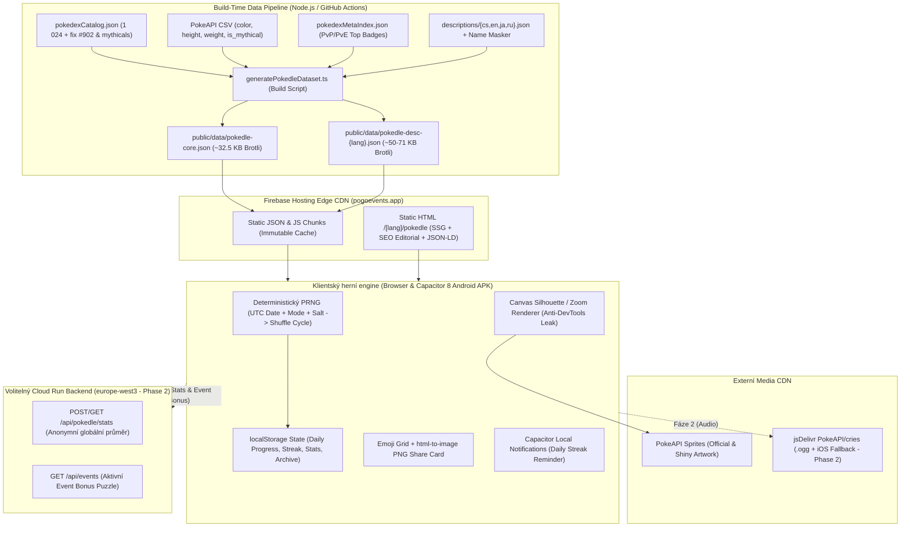

# Hloubková studie: Denní hádací hra ve stylu Pokédle pro `pogoevents.app` — analýza konkurence, produktová inovace, datová připravenost a technická architektura

**Datum výzkumu:** 19. listopadu 2026  
**Cílový produkt:** `https://pogoevents.app/[lang]/pokedle` (4 jazyky: `cs`, `en`, `ja`, `ru`)  
**Stack:** Next.js 16 (`output: 'export'` SSG), React 19, TypeScript, Firebase Hosting Edge CDN, Capacitor 8 Android APK, volitelně Cloud Run backend (`europe-west3`)  
**Metodologie:** Ověření proti primárním zdrojům (živé produkční domény a sitemapy konkurence, zdrojové kódy `Fireblend/squirdle`, primární datasety `PokeAPI/pokeapi` a `PokeAPI/cries`, WebKit/Safari 18.4 release notes, zásady Google AdSense a kvantitativní audit reálných datových souborů v tomto repozitáři).

---

## 1. Manažerské shrnutí (Executive Summary)

Denní hádací hry inspirované *Wordlem* (v Pokémon ekosystému především `pokedle.com`, `pokedle.net`, `squirdle.fireblend.com` a `pokedoku.com`) patří mezi nejefektivnější organické retenční mechanismy na webu: kombinují **nulové tření** (hratelné okamžitě bez registrace), **umělý nedostatek** (jedna hlavní výzva denně v 00:00 UTC buduje každodenní návyk a sérii — *streak*) a **virální bezspoilerové sdílení** emoji mřížek na Discordu, Redditu, TikToku a Instagramu.

Náš primární audit konkurence i vlastního repozitáře odhalil **4 zásadní strategické příležitosti a 3 kritická technická úskalí**, na kterých může `pogoevents.app` vybudovat reálnou, obtížně kopírovatelnou konkurenční výhodu (*moat*):

1. **Absolutní prázdnota v češtině (`cs`), ruštině (`ru`) a v doméně Pokémon GO:**
   - Z primární sitemapy `https://pokedle.com/sitemap.xml` (74 URL) vyplývá, že `pokedle.com` podporuje 10 jazyků (`en, de, fr, it, ja, ko, es, pt, he`), ale **vůbec nepodporuje češtinu ani ruštinu**.
   - **Ani jeden** z hlavních konkurentů (`pokedle.com`, `pokedle.net`, `squirdle.fireblend.com`, `pokedoku.com`) není zaměřen na **Pokémon GO mechaniky** (Max CP Lv50, Mega/Dynamax/Gigantamax dostupnost, PvP/PvE žebříčky, aktivní raid bossové, Team GO Rocket).
2. **Ekosystémový „flywheel“ místo slepé uličky:**
   - Samostatné weby jako `pokedle.net` nebo `squirdle.fireblend.com` jsou jednoúčelové: hráč za 90 sekund dohraje a zavře záložku.
   - Na `pogoevents.app` může výhra v denní hře jedním kliknutím převést uživatele do **detailu dnešního Pokémona v Pokédexu** (`/[lang]/pokedex/[slug]`), na **jeho Raid Countery** (`/[lang]/raids/[slug]`), **PvP/PvE žebříček** (`/[lang]/rankings`) i na **aktuální události dne** (`/[lang]`) — a díky **Capacitor 8 Android aplikaci** (`@capacitor/local-notifications`) umíme jako jediní posílat volitelnou lokální notifikaci na udržení denní série (*streak*).
3. **Kvantitativně ověřená připravenost dat — ale s nutností 4 konkrétních datových oprav před spuštěním:**
   - Vlastní `frontend/src/data/pokedexCatalog.json` (1 024 záznamů) je příliš velký pro přímý klientský import (**1 571,5 KB**), ale zredukovaný `pokedleDataset.json` má pro všech 1 025 Pokémonů pouhých **251,4 KB raw / 43,5 KB gzip / 32,5 KB Brotli**.
   - Audit odhalil **4 reálné datové vady**, které by jinak rozbily herní logiku: (a) chybí `#902` Basculegion; (b) `hasShadow` je kvůli chybě v `generatePokedexCatalog.ts:795` nastaveno `true` u **943 z 944** vydaných Pokémonů; (c) `rarityClass: 'mythical'` má **0 záznamů** (Mew, Celebi, Jirachi, Deoxys, Darkrai i Arceus mají `'standard'`); (d) **únik jmen v popiscích Pokédexu** (`descriptions/{cs,en,ja,ru}.json`): **50,8 %** v `en`, **48,7 %** v `cs` (plus skloňování typu *Ivysaura/Venusaura* a 36 odkazů na evoluční řadu) a **kriticky v `ru`**, kde popisky obsahují skloňovaná **azbuková jména** (*Бульбазавра, Пикачу*), zatímco `pokedexCatalog.json` ukládá v `names.ru` latinku!
4. **Kritický rozdíl v AdSense strategii:**
   - Jak ukázal náš audit v [`adsense-complete-overhaul-strategy-2026.md`](file:///C:/PROJEKTY/OSOBNÍ/Pokemon-GO-event-tracker/docs/research/adsense-complete-overhaul-strategy-2026.md), čisté klientské SPA herní obrazovky bez redakčního textu (např. `pokedle.net` s 2,7 KB HTML schránkou — proto používá herní síť Venatus místo AdSense) porušují zásadu Google AdSense [answer/11112688](https://support.google.com/adsense/answer/11112688). Stránka `/[lang]/pokedle` proto **musí** kombinovat herní plochu nad ohybem s bohatým SSG redakčním obsahem pod hrou (pravidla, strategie pro Pokémon GO, FAQ, strukturovaná data `VideoGame` + `FAQPage`) a respektovat selektivní nasazení reklam.

---

## 2. Primární analýza konkurence (ověřeno přímo na živých zdrojích)

Všechny níže uvedené weby byly ověřeny přímým dotazem na jejich produkční HTML, `sitemap.xml`, `robots.txt` nebo veřejný GitHub repozitář (bez obcházení jakýchkoli ochranných bran — u `whosthatpokemon.net` došlo k vypršení časového limitu `timeout`, proto u formátu *Who's That Pokémon?* vycházíme z obecně zdokumentovaného vzoru a porovnání).

### 2.1. Detailní srovnávací matice konkurentů

| Platforma | Primární ověřený zdroj | Herní režimy (ověřené routy / moduly) | Sloupce / logika Classic režimu | Rozsah generací & datový zdroj | Jazyky | Monetizace & technická architektura | Klíčové slabiny |
|---|---|---|---|---|---|---|---|
| **Pokedle.com** | `https://pokedle.com/` `https://pokedle.com/sitemap.xml` (HTTP 200, 74 URL) | `/classic`, `/flavortext`, `/silhouette`, `/image-zoom`, `/blurred-card`, `/versus-classic` (1v1 real-time + chat), `/leagues`, `/leaderboard`, `/infinite` | Typ 1/2, Generace, Evoluce, Statistiky/Výška/Váha (barevná zpětná vazba 🟩🟧🟥 + šipky ↑↓ + progresivní nápovědy) | Gen 1–9 (výchozí i filtrované režimy), obrázky na DigitalOcean Spaces CDN | **10 jazyků:** `en, de, fr, it, ja, ko, es, pt, he` (**chybí `cs` i `ru`**) | Klientská SPA (11 KB HTML shell, JSON-LD `WebSite`, autor Gabriel Haugbøl); backend nutný pro 1v1 versus, ligy a žebříčky | Žádná vazba na Pokémon GO; chybí čeština a ruština; chybí zvukový (Cry) režim; po dohrání žádný obsahový ekosystém |
| **Pokedle.net** | `https://pokedle.net/` `https://pokedle.net/robots.txt` (HTTP 200) | Classic, Card (rozmazaná TCG karta), Description (flavor text), Silhouette | Typ 1, Typ 2, Barva, Habitat, Fáze evoluce, Výška, Váha (původně od autora *LoLdle*) | Původně **Gen 1 (151)** právě kvůli sloupci `Habitat`, postupně rozšiřováno | Omezená lokalizace (HTML má prázdné `<html lang="">`) | Čistá Vue SPA (`chunk-vendors.*.js`, HTML jen 2,7 KB, bez `sitemap.xml`); monetizace přes herní header-bidding **Venatus v4** (`hb.vntsm.com/v4/.../pokedle.net/index.js`) | Slabé SEO (prázdný HTML shell, neexistující `sitemap.xml`); agresivnější herní reklamy; sloupec `Habitat` nefunguje pro Gen 4–9 |
| **Squirdle** | `https://squirdle.fireblend.com/` [`Fireblend/squirdle`](https://github.com/Fireblend/squirdle) (`daily.html`, `scripts/game.js`) | Daily (max 8–9 pokusů), Free Play, Gen 1 Only, Stats Edition, pokročilé filtry v autocomplete (`filters.html`) | Přesně **5 sloupců**: `Gen`, `Type 1`, `Type 2`, `Height`, `Weight` (emoji klíč: 🟩🟥🟨🔼🔽 + anti-spoiler 🟦 pro Gen při sdílení!) | Statický CSV/JS dataset z Kaggle (Mario Tormo Romero), reset v **00:00 lokálního času** | Převážně `en` (+ částečný `i18n.js` překlad jmen) | 100% statický HTML/CSS/jQuery/ES modules na AWS S3, stav v cookies | Zastaralé UI (2022), žádná vizuální/audio variabilita (jen textová tabulka), žádná vazba na Pokémon GO, chybí lokální jazykové mutace |
| **PokeDoku** | `https://pokedoku.com/` `https://pokedoku.com/sitemap.xml` (HTTP 200, 5 URL) | Denní 3×3 mřížka (`/`), `/unlimited`, `/tictactoe`, `/tiers` | Průnik řádkových a sloupcových kritérií (Typy, Regiony, Legendary/Mythical/Mega/Single-type); 9 unikátních Pokémonů, skóre unikátnosti (*Uniqueness %*) | Gen 1–9 vč. regionálních, Mega a G-Max forem | Pouze `en` | Next.js SSR (108 KB HTML), globální backend pro výpočet rarity tipů ostatních hráčů | Úplně jiná mechanika (sudoku mřížka), ale skvělá inspirace pro budoucí „GO-Doku“ režim ve Fázi 3; vyžaduje globální agregaci pro „uniqueness“ |
| **Who's That Pokémon? (žánr)** | `whosthatpokemon.net` (timeout při testu); obecný webový formát | Černá silueta (volitelně s časovačem), často doplněná o audio výkřik (*Cry*) nebo pixelizaci | Přímé rozpoznání tvaru/zvuku (často multiple-choice nebo volný vstup bez tabulky atributů) | Volitelný rozsah generací | Zpravidla `en` | Statické JS miniaplikace, nízká hloubka znovuhratelnosti bez denního streaku | Chybí dedukční hloubka Classic režimu; bez denního cyklu rychle omrzí |

### 2.2. Klíčový technický poznatek z primárních dat: Proč sloupec „Habitat“ rozbíjí Gen 4–9

Přímá kontrola primárního souboru [`pokemon_species.csv`](https://raw.githubusercontent.com/PokeAPI/pokeapi/master/data/v2/csv/pokemon_species.csv) z repozitáře `PokeAPI/pokeapi` (1 025 druhů) potvrzuje zásadní omezení, na které naráží většina klonů *Pokedle*:

- **`color_id`** (10 barev v `pokemon_colors.csv`): vyplněno u **1 025 / 1 025 (100 %)** druhů napříč Gen 1–9.
- **`height` & `weight`** (`pokemon.csv`): vyplněno u **1 025 / 1 025 (100 %)** výchozích forem.
- **`habitat_id`** (9 biotopů v `pokemon_habitats.csv`): vyplněno **pouze u 386 / 1 025 (37,7 %)** druhů — konkrétně **151 v Gen 1, 100 v Gen 2 a 135 v Gen 3**, zatímco v **Gen 4 až Gen 9 je pokrytí přesně 0 %** (protože hlavní hry od Pokémon Diamond/Pearl přestaly biotop v Pokédexu evidovat).

**Důsledek pro návrh:** Kopírovat sloupec `Habitat` z `pokedle.net` pro hru napříč všemi generacemi by znamenalo 62 % prázdných hodnot (`Unknown`). Místo `Habitat` použijeme buď **univerzální atributy se 100% pokrytím** (`Barva`, `Fáze evoluce`), nebo — ještě lépe — **unikátní Pokémon GO sloupce** (`Max CP Lv50`, `Vzácnost`, `GO Mechanika: Mega / Dynamax / G-Max / Regional`).

---

## 3. Jak formát vylepšit a inovovat (návrh herních režimů: MVP vs. Fáze 2/3)

Konkurenční klony trpí třemi opakujícími se bolestmi: (1) opakují tytéž 4 okoukané režimy bez kontextu Pokémon GO, (2) u hádání podle popisku občas „prokecávají“ jméno nebo název evoluce, (3) na mobilech mají nepřehledné široké tabulky (8+ sloupců vyžadujících horizontální scrollování) a chudé sdílení výsledků.

### 3.1. Navrhované herní režimy — rozdělení do fází

#### Fáze 1 (MVP — 100% statické, 0 Kč backend náklady, připraveno k okamžitému nasazení)

1. **GO Classic (Vlajkový režim — „Wordle pro Pokémon GO trenéry“)**
   - **Sloupce (přesně 7 kompaktních sloupců — čitelné bez bolestného scrollu i na mobilu):**
     1. **Pokémon** (miniatura + jméno)
     2. **Typ 1** (🟩 přesná shoda / 🟨 správný typ v pozici Typ 2 / 🟥 špatně)
     3. **Typ 2** (🟩 přesná shoda včetně „Jednotypový“ / 🟨 správný typ v pozici Typ 1 / 🟥 špatně)
     4. **Generace** (`Gen 1`–`Gen 9`, 🟩 shoda / 🟥 + šipka ↑↓)
     5. **Fáze evoluce** (`1 / 2 / 3` + indikátor, zda se může dál vyvíjet; 🟩 přesně / 🟧 stejná fáze ale jiný status finální evoluce / 🟥 špatně)
     6. **Max CP (Lv50)** (číselná hodnota typická pro Pokémon GO! 🟩 přesná shoda nebo ±50 CP / 🟧 blízko v toleranci ±300 CP s šipkou ↑↓ / 🟥 + šipka ↑↓)
     7. **GO Status / Vzácnost** (kombinovaný čip: např. `Starter`, `Legendary`, `Mythical`, `Ultra Beast`, `Paradox`, `Baby`, `Standard` + ikony `Mega` / `D-Max` / `G-Max` / `Regional` — 🟩 plná shoda, 🟧 částečná shoda traitů, 🟥 bez shody)
   - **Volitelné přepínače obtížnosti / filtru (v režimu Unlimited):**
     - *Pouze vydaní v Pokémon GO* (`944` Pokémonů — výchozí pro Daily, aby trenéři GO nehádali nevydané Gen 9 druhy!) vs. *Kompletní Národní Pokédex* (`1 025`) vs. *Kanto Classic (Gen 1 — 151)*.
   - **Progresivní nápovědy (odemykání po chybných pokusech):**
     - Po 4. pokusu: **Barva** (z PokéAPI) nebo **Primární role v GO** (např. *Top 50 Great League* / *Top 20 Fire Raid Attacker* z `pokedexMetaIndex.json`).
     - Po 6. pokusu: **Silueta** nebo **Zamaskovaný Pokédex popisek** ve zvoleném jazyce.
     - Po 8. pokusu: **1 rychlý nebo nabitý útok** z `quickMoves` / `cinematicMoves`.
   - **Chytrý anti-spoiler při sdílení** (inspirováno `Fireblend/squirdle/scripts/game.js:21-24`): při kopírování emoji mřížky nahradit šipky u Generace neutrálním 🟦, aby sdílený výsledek na Discordu neprozradil ostatním, zda je dnešní Pokémon z vyšší či nižší generace.

2. **Silueta + Zoom („Who's That Pokémon?“) — 2v1 vizuální režim**
   - Výchozí zobrazení: **čistá černá silueta** vykreslená přes HTML5 `<canvas>` (ne pouhé CSS `filter: brightness(0)` na ``, které by kdokoli odhalil během sekundy přes DevTools nebo „Uložit obrázek“!).
   - **Progresivní odhalování:** Každý chybný pokus mírně zmenší přiblížení / pootočení (v podrežimu *Zoom*) nebo odhalí nápovědu (po 2. pokusu: Generace; po 4. pokusu: Typy; po 5. pokusu: barevný obrys/rozmazaný obrázek).
   - **Bonusový „Shiny Reveal“:** Po uhodnutí se zobrazí oficiální artwork a 10% šance (nebo volitelný přepínač) na lesklou **Shiny** animaci s hvězdičkami — silný mikro-dopamin typický pro Pokémon GO.

3. **Pokédex Popisek (Flavor Text Mode — ve všech 4 jazycích `cs / en / ja / ru`!)**
   - Zobrazí autentický popisek Pokémona z `frontend/src/data/descriptions/{lang}.json` s **deterministicky zamaskovaným jménem Pokémona i celé jeho evoluční řady** (`[███]`).
   - Po chybných pokusech odemkne: (2. pokus) Generace, (4. pokus) Typy, (5. pokus) Max CP Lv50 & jeden charakteristický útok.
   - *Podmínka spuštění:* Nasazení build-time maskovacího slovníku včetně českého skloňování a azbukové tabulky pro `ru` (viz sekce 5.2).

4. **Denní „GO Meta“ výzva (4. rychlý denní režim — unikátní pro `pogoevents.app`)**
   - **„Poznej podle útoků & CP“ (*Moveset & CP Mode*):** Hráč vidí pouze:
     - **Max CP Lv50** + **3 základní GO statistiky** (ATK / DEF / STA jako vizuální pruhy)
     - **2 Fast Moves + 3 Charged Moves** (včetně zlatého odznaku *Elite TM*, pokud má `isElite: true`!)
     - **PvP / PvE umístění** z `pokedexMetaIndex.json` (např. *„#12 v Great League“* nebo *„Top 5 Dragon PvE Attacker“*).
   - Tuto výzvu **nemá žádný z konkurentů** (`pokedle.com`, `pokedle.net`, `squirdle`, `pokedoku`). Pro aktivní hráče Pokémon GO (kteří znají *Counter + Dynamic Punch*, *Mud Shot + Hydro Cannon*, *Shadow Claw + Frenzy Plant*) je to extrémně návykový kvíz přesně na míru naší cílové skupině!

#### Fáze 2 (Rozšíření po validaci retence — 2 až 4 týdny po MVP)

5. **Zvukový režim (*Audio / Cry Mode*)**
   - Využívá primární repozitář [`PokeAPI/cries`](https://github.com/PokeAPI/cries) servírovaný přes `https://cdn.jsdelivr.net/gh/PokeAPI/cries@main/cries/pokemon/latest/{id}.ogg` (**1 025 / 1 025 = 100% pokrytí**, průměrná velikost **17,0 KB** / soubor; navíc **673** retro `legacy` výkřiků pro nostalgický režim Gen 1–5!).
   - **Ověřené omezení iOS / Safari:** Podle oficiálních poznámek k vydání WebKit/Apple ([Safari 18.4 Release Notes](https://webkit.org/)) získalo Safari / iOS WebKit nativní podporu Ogg kontejneru (Vorbis i Opus) **od verze Safari 18.4 / iOS 18.4** (jaro 2025). Na zařízeních se starším iOS `<= 18.3` nativní `<audio src="...ogg">` selže. Řešení: detekce `audio.canPlayType('audio/ogg; codecs="vorbis"')` a pro starší iOS buď lazy-load lehkého JS/WASM dekodéru (`@wasm-audio-decoders/ogg-vorbis`), nebo generování fallback hlášky / krátkého backend proxy transkódování.
   - Zobrazit interaktivní **Web Audio API waveform vizualizaci** během přehrávání + přepínač *Moderní (Latest)* vs. *Retro Game Boy (Legacy)*.

6. **Team GO Rocket Quote Mode („Kdo tě čeká za touhle hláškou?“)**
   - Hráč dostane ikonickou hlášku Team GO Rocket Grunta (např. *„Víš, jak horký může být pokémoní dech?“*) a musí poznat **typ Grunta + odměnového Shadow Pokémona** (případně nejlepšího Countera).
   - *Blokující předpoklad z našeho auditu:* V `backend/rocket_lineups_cache.json` má všech 22 gruntů unikátní `phraseCs` (18 odlišných českých hlášek), ale **všech 22 má rozbitý identický `phraseEn`** (`"Don't bother, I've already won!"`). Před spuštěním režimu je nutné opravit extrakci `phraseEn` ve scraperu a doplnit oficiální `ja` a `ru` hlášky.

7. **„Dnešní Event / Raid Bonus“ + Globální statistiky (volitelný Cloud Run endpoint)**
   - Propojení na `backend/events_list_cache.json` (32 aktivních/nadcházejících událostí): během **Community Day**, **Raid Hour** nebo **GO Festu** se na stránce hry odemkne **tematická 5. bonusová hádanka dne** (např. vybraná ze spawn poolu aktuální události nebo rotujících 5★ Raid Bossů).
   - Lehký anonymní endpoint na stávajícím Cloud Run backendu (`/api/pokedle/stats`) sbírající pouze `{ date, mode, attempts, won }` bez osobních dat (GDPR-clean) -> po výhře hráč uvidí: *„Dnes uhodlo 842 trenérů | Průměr: 4,1 pokusu | Jsi v top 18 %!“*.

8. **Vizuální sdílecí karta (PNG Export přes existující `html-to-image`)**
   - Repozitář již obsahuje závislost [`html-to-image` `^1.11.13`](file:///C:/PROJEKTY/OSOBNÍ/Pokemon-GO-event-tracker/frontend/package.json#L24)! Kromě klasického textového emoji sdílení (pro Discord/WhatsApp) můžeme jedním kliknutím vygenerovat **čtvercovou / 9:16 kartu pro Instagram Stories a TikTok** s logem `pogoevents.app`, aktuálním streakem a bezspoilerovou mřížkou.

#### Fáze 3 (Dlouhodobý rozvoj — pokud hra překročí 1 000+ DAU)

- **GO-Doku (3×3 mřížka ve stylu PokeDoku)** s kategoriemi specifickými pro Pokémon GO (např. *Má Mega Evoluci × Typ Dragon*, *Max CP > 4000 × Gen 4*, *Dynamax × Kanto*).
- **1v1 Výzva přátelům přes URL seed (bez WebSocket serveru!)**: Generování sdíleného odkazu `/[lang]/pokedle?challenge=BASE64_SEED` — oba přátelé hádají přesně stejnou sérii 5 Pokémonů a na konci porovnají skóre. Nulová zátěž serveru, maximální virální efekt v komunitách.

---

## 4. Konkrétní konkurenční výhody `pogoevents.app` (Produkt, SEO, Retence, AdSense)

### 4.1. Produktový a tržní „Moat“

| Dimenze | Typický konkurent (`pokedle.com` / `.net` / `squirdle`) | `pogoevents.app` s modulem Pokédle | Konkrétní dopad |
|---|---|---|---|
| **Lokalizace `cs` a `ru`** | `pokedle.com`: **0 %** (`cs` ani `ru` neexistuje); `pokedoku`: jen `en`; `squirdle`: jen `en` | **100 % nativní UI + 100 % 4jazyčné Pokédex popisky** (`cs, en, ja, ru`) | Prakticky nulová konkurence pro dotazy *„pokedle česky“*, *„hádej pokémona denní hra“*, *„покедл на русском“* |
| **Pokémon GO DNA** | Hlavní konzolové hry (Výška, Váha, Habitat z Gen 1–3) | **Max CP Lv50, GO Stats, Elite TM útoky, Mega/D-Max/G-Max, PvP/PvE Meta** | Vysoká relevance pro přesnou cílovku našeho webu (aktivní hráči Pokémon GO) |
| **Post-game ekosystém** | Konec hry = odchod z webu (bounce po 1–2 min) | **1-klik most na Pokédex kartu, Raid Countery, PvP žebříček a dnešní eventy** | Růst stránek na relaci (*Pages/Session*) z 1,0 na 2,5–3,5+ a hlubší interní prolinkování |
| **Mobilní distribuce** | Pouze mobilní prohlížeč | **PWA + Nativní Android APK (Capacitor 8 + lokální notifikace)** | Denní připomínka série (*streak*) přímo v notifikační liště Androidu bez nákladů na push infrastrukturu (FCM) |
| **Rychlost & dostupnost** | SPA bez SSR (`pokedle.net`), externí backend nutný pro hru | **Firebase Hosting Edge CDN (TTFB < 50 ms) + 100 % offline hratelnost** | Okamžitý start hry v metru/terénu při hraní Pokémon GO |

### 4.2. SEO a GEO (AI vyhledávání) přínos

- **Nový organický vstupní trychtýř s vysokou záměrovostí:** Klíčová slova kolem *„pokedle“*, *„pokemon guessing game“*, *„who's that pokemon daily“*, *„pokemon go quiz“*, *„hádej pokémona“* generují celoroční stabilní vyhledávací objem nezávislý na tom, zda zrovna v Pokémon GO probíhá atraktivní event.
- **Signály uživatelské angažovanosti a přímé návštěvnosti (*Direct / Returning Traffic*):** Opakované denní návraty za sérií výrazně zlepšují podíl přímé návštěvnosti, průměrnou dobu strávenou na webu (*Engagement Time*) a značková vyhledávání (`pogoevents pokedle`), což jsou dlouhodobě nejsilnější nepřímé signály důvěryhodnosti domény.
- **Čisté 4jazyčné URL a `hreflang`:** Přidáním pouhých **4 vysoce hodnotných URL** (`/{cs,en,ja,ru}/pokedle`) do `sitemap-core.xml` nezatěžujeme crawl budget (na rozdíl od 4 096 šablonových karet Pokédexu kritizovaných v auditu).

### 4.3. Dopad na Google AdSense a nezbytné compliance pojistky

Podle našeho předchozího auditu [`adsense-complete-overhaul-strategy-2026.md`](file:///C:/PROJEKTY/OSOBNÍ/Pokemon-GO-event-tracker/docs/research/adsense-complete-overhaul-strategy-2026.md) a primárních zásad Google ([answer/11112688](https://support.google.com/adsense/answer/11112688), [answer/10015918](https://support.google.com/adsense/answer/10015918)) je nutné rozlišit **dvě fáze**:

1. **Proč čistá hra škodí schválení, ale hybridní obsahová stránka pomáhá:**
   - Google výslovně zakazuje reklamy na *„obrazovkách bez obsahu vydavatele nebo čistě behaviorálních/nástrojových obrazovkách“* (`answer/11112688`). Přesně proto `pokedle.net` (2,7 KB HTML bez textu) nepoužívá AdSense, ale specializovanou herní síť Venatus.
   - Pokud však `/[lang]/pokedle` postavíme podle stejného vzoru jako naše schvalování-připravené interaktivní průvodce (viz `AGENTS.md` sekce 5 — model *Galarian Birds*):
     - **Nad ohybem (Above the fold):** Plnohodnotná interaktivní hra (Classic / Silueta / Popisek / GO Meta).
     - **Pod hrou (Below the fold, SSG-renderované v čistém HTML ve všech 4 jazycích):** 600–900 slov originální redakční prózy — *Jak hrát PoGo Pokédle*, *Dedukční strategie pro Pokémon GO (jak z Max CP a typů zúžit 944 Pokémonů na 3 pokusy)*, *Vysvětlení GO mechanik (Mega, Dynamax, Gigantamax)*, *FAQ (5–6 otázek se strukturovanými daty `FAQPage`)* a prokliky na související průvodce (`/guides`).
2. **Pravidla zobrazování reklam na `/[lang]/pokedle`:**
   - **Během schvalovacího procesu AdSense:** Ponechat `ENABLE_ADS = false` v [`AdContainer.tsx`](file:///C:/PROJEKTY/OSOBNÍ/Pokemon-GO-event-tracker/frontend/src/components/AdContainer.tsx#L10) a nespouštět Auto Ads na herní ploše.
   - **Po schválení AdSense:** Použít výhradně **1 nevtíravý display slot pod herní plochou / mezi hrou a průvodcem** (a na desktopu `>= 1280px` volitelný sticky sidebar 300×600 mimo herní grid). Nikdy neumisťovat reklamy těsně pod tlačítko „Hádat“ (riziko nechtěných kliků — *accidental clicks policy*) ani pop-upy/vignette uprostřed série.
   - **Byznysový efekt po schválení:** Denní vracející se hráč znamená 15–30 zobrazení měsíčně od jediné osoby (místo 1–2 zobrazení z organického vyhledávání eventu) + sekundární zobrazení při prokliku do Pokédexu/Raidů, což při zachování čistého UX násobí celkové měsíční RPM domény.

---

## 5. Matice datové připravenosti (audit reálných souborů v repozitáři)

Každý níže uvedený údaj byl změřen přímo na souborech repozitáře `C:\PROJEKTY\OSOBNÍ\Pokemon-GO-event-tracker` a primárních zdrojích PokéAPI.

### 5.1. Přehled zdrojů a zjištěné mezery

| Datový zdroj (soubor / repozitář) | Měřený objem & pokrytí | Připravenost pro Pokédle | Konkrétní zjištěné vady / nutná úprava |
|---|---|---|---|
| [`frontend/src/data/pokedexCatalog.json`](file:///C:/PROJEKTY/OSOBNÍ/Pokemon-GO-event-tracker/frontend/src/data/pokedexCatalog.json) | **1 024 záznamů** (`1 571,5 KB` raw); `944` vydaných v GO, `80` nevydaných; `1 023` má útoky | **Střední → Vysoká po opravách** | 1. **Chybí `#902` Basculegion** (1 024 místo 1 025). 2. **`hasShadow` chyba** ([`generatePokedexCatalog.ts:795`](file:///C:/PROJEKTY/OSOBNÍ/Pokemon-GO-event-tracker/backend/src/scripts/generatePokedexCatalog.ts#L795)): `true` u **943/944** vydaných Pokémonů (všichni kromě Eternatuse) → **NEPOUŽÍVAT** jako herní sloupec, dokud nebude napojeno na reálný seznam Shadow vydání! 3. **`rarityClass` chyba** ([`generatePokedexCatalog.ts:624-627`](file:///C:/PROJEKTY/OSOBNÍ/Pokemon-GO-event-tracker/backend/src/scripts/generatePokedexCatalog.ts#L624-L627)): **0 záznamů `'mythical'`** — Mew (`#151`), Celebi (`#251`), Jirachi (`#385`), Deoxys (`#386`), Darkrai (`#491`) i Arceus (`#493`) mají `'standard'`. Opravit z PokéAPI `pokemon_species.csv` (`is_mythical = 1`, přesně 23 druhů)! 4. **`canBeShinyInGo` heuristika** (`generatePokedexCatalog.ts:1101`): jen `isReleased && dexId <= 800` (nepřesné pro Gen 8/9 shiny i shiny-locked legendárky) → nepoužívat jako striktní sloupec Classic módu. 5. **Evoluční fáze (`1/2/3`)**: Lze čistě dopočítat z grafu `evolutions` pro všech 1 024 záznamů (**556** fáze 1, **349** fáze 2, **119** fáze 3, `0` chyb). |
| [`frontend/src/data/descriptions/{cs,en,ja,ru}.json`](file:///C:/PROJEKTY/OSOBNÍ/Pokemon-GO-event-tracker/frontend/src/data/pokedexDescriptions.ts) | **1 024 / 1 024** ve všech 4 jazycích. Brotli: `cs` 64,9 KB, `en` 57,4 KB, `ja` 49,7 KB, `ru` 71,0 KB | **Vysoká po vybudování maskovací vrstvy** | **Masivní únik jmen v textu** (viz podrobný rozbor v sekci 5.2 níže): 50,8 % EN, 48,7 % CS + skloňování, 10,9 % JA a **kritický únik ruských azbukových jmen**, která v `pokedexCatalog.json` chybí! |
| [`frontend/src/data/pokedexMetaIndex.json`](file:///C:/PROJEKTY/OSOBNÍ/Pokemon-GO-event-tracker/frontend/src/data/pokedexMetaIndex.json) | **1 022 záznamů**, `437,3 KB` raw | **Vysoká** | Obsahuje přesné `pvp.{great,ultra,master,little}.{rank,score,moveset}` a `pve.{overallRank,typeRank}`. Do slim datasetu pro hru extrahovat jen kompaktní meta tagy (např. nejlepší PvP liga + top PvE typ) → téměř nulový nárůst velikosti. |
| [`frontend/src/data/pokemonRankings.json`](file:///C:/PROJEKTY/OSOBNÍ/Pokemon-GO-event-tracker/frontend/src/data/pokemonRankings.json) | `7 451,4 KB` (7,45 MB raw) | **Nevhodné přímo pro klienta** | Nikdy neimportovat do klientského bundlu hry; veškerá potřebná meta data už jsou v `pokedexMetaIndex.json`. |
| **PokéAPI CSV** (`PokeAPI/pokeapi` `data/v2/csv/`) | `pokemon.csv` (1 351 řádků), `pokemon_species.csv` (1 025 řádků) | **Vysoká (build-time obohacení)** | Poskytuje 100% pokrytí pro **`color_id`** (1 025/1 025), **`height`**, **`weight`**, **`is_legendary`** (71), **`is_mythical`** (23), **`is_baby`** (19). **`habitat_id` NEPOUŽÍVAT** (jen 386/1 025 = Gen 1–3). |
| **PokeAPI Artwork CDN** (`raw.githubusercontent.com/PokeAPI/sprites`) | 100% pokrytí `#1–#1025` (normal + shiny) | **Připraveno ihned** | Doména `raw.githubusercontent.com` je již povolená v [`frontend/next.config.mjs:13`](file:///C:/PROJEKTY/OSOBNÍ/Pokemon-GO-event-tracker/frontend/next.config.mjs#L13). Pro siluety nutné vykreslit na `<canvas>` s `crossOrigin="anonymous"`. |
| **PokeAPI Cries** (`github.com/PokeAPI/cries`) | `latest`: **1 025 / 1 025** (`missing: 0`, průměr `17,0 KB` `.ogg`); `legacy`: **673** `.ogg` | **Fáze 2** | Použít jsDelivr CDN (`cdn.jsdelivr.net/gh/PokeAPI/cries@main/...`). Pozor na iOS `<= 18.3` (Ogg nativně až od Safari/iOS 18.4). |
| [`backend/rocket_lineups_cache.json`](file:///C:/PROJEKTY/OSOBNÍ/Pokemon-GO-event-tracker/backend/rocket_lineups_cache.json) | 4 lídři + 22 gruntů (`19,3 KB`) | **Fáze 2 (vyžaduje opravu)** | `phraseCs` má 18 unikátních hlášek, ale **`phraseEn` má jen 1 duplicitní hlášku u všech 22 gruntů**; chybí `ja` a `ru`. |
| [`backend/events_list_cache.json`](file:///C:/PROJEKTY/OSOBNÍ/Pokemon-GO-event-tracker/backend/events_list_cache.json) | 32 aktivních/plánovaných eventů (`20,5 KB`) | **Fáze 2** | Skvělé pro sezonní / Community Day bonusovou hádanku napojenou na živý kalendář. |

### 5.2. Hloubkový audit úniku jmen v Pokédex popiscích (`descriptions/{cs,en,ja,ru}.json`)

Tento test je naprosto zásadní pro režim **Pokédex Popisek (Flavor Text)**:

| Jazyk | Záznamů | Přímý výskyt vlastního jména v textu | Další specifické úniky zjištěné auditem | Doporučené technické řešení maskování |
|---|---:|---:|---|---|
| **`en`** | 1 024 | **520 (50,8 %)** | **28** zmínek jiné fáze téže evoluční řady (`evolutionChainIds`), přivlastňovací `'s` (*Ivysaur's*) | Case-insensitive regex pro jméno + všechny členy `evolutionChainIds` (vč. `\bName(?:'s)?\b`) → nahradit `[████]`. |
| **`cs`** | 1 024 | **499 (48,7 %)** | **20** dalších případů českého skloňování se změnou koncovky (*Chikority*, *Rattaty*) + **36** zmínek evoluční řady (*Ivysaura*, *Venusaura*) | Maskovat **kmen jména** (pro jména délky ≥ 5 odebrat poslední samohlásku `-a/-e/-o/-y` a matchovat `\b{stem}[a-záčďéěíňóřšťúůýž]{0,4}\b`) napříč celou `evolutionChainIds` + build-time validační test (`vitest`), který ověří `0` úniků. |
| **`ja`** | 1 024 | **112 (10,9 %)** | Japonština neskloňuje podstatná jména — ale nutné maskovat i katakanová jména všech členů `evolutionChainIds` | Přesná náhrada řetězce pro `names.ja` všech ID v `evolutionChainIds` → `『？？？？』`. |
| **`ru`** | 1 024 | **0 (v latince)** — ale **~450–500 v azbuce!** | **KRITICKÁ ZÁVADA:** `pokedexCatalog.json` má v `names.ru` latinku (`"Bulbasaur"`), zatímco `descriptions/ru.json` používá skloňovanou azbuku (*„Бульбазавра“*, *„Айвизавра“*, *„Венузавра“*, *„Чармандера“*, *„Пикачу“*)! | Do build skriptu generátoru přidat **mapu ruských jmen v azbuce** (1 025 záznamů — z `ru.json` / transliteračního slovníku + ruční kontrola nepravidelných jako *Сквиртл, Мьюту*) a maskovat ruský kmen vč. pádových koncovek (`-а/-у/-ом/-е/-ы/-ов`) pro celou evoluční řadu. |

---

## 6. Technická architektura pro Next.js 16 Static Export + Firebase Hosting

### 6.1. Architektonický diagram

### 6.2. Klíčová technická rozhodnutí pro náš stack

1. **100% deterministický bezserverový výběr denního Pokémona (žádný server pro MVP):**
   - `frontend/next.config.mjs` používá `output: 'export'` pro nasazení na Firebase Hosting (`out/` → `dist/`). Hra proto **nesmí** vyžadovat SSR při každém požadavku.
   - Denní cíl pro každý režim (`classic`, `silhouette`, `description`, `meta`) se spočítá čistě na klientovi z aktuálního **UTC data (`YYYY-MM-DD`)**:
     - Místo naivního `hash(date) % N` (který může statisticky vybrat téhož Pokémona dvakrát během týdne) použijeme **deterministickou Fisher-Yates permutaci celého poolu podle roku/cyklu** (seed = `cycleIndex + mode + salt` přes rychlý 32bitový PRNG `Mulberry32`), z níž den v cyklu vybere index `permutedPool[dayOffset]`.
     - **Výhoda:** Garantovaně **0 opakování** po dobu celých 944 dní (přes 2,5 roku!), 100% globální shoda všech hráčů na světě ve stejný UTC den, 100% offline funkčnost (vč. Android APK) a 0 Kč provozních nákladů.
     - *Volitelná poznámka k anti-cheatingu:* V klient-only hře může zvědavý vývojář v DevTools zrekonstruovat seed — stejně jako u původního *Wordlu* nebo *Squirdlu*. Pro běžné hráče je klíčové nezobrazovat cílové `dexId` v DOMu (kreslení siluety na `<canvas>`, maskovaný text předpřipravený v build-time souboru). Pokud ve Fázi 2 přidáme soutěžní žebříček, může denní ID pro režim *Ranked* vracet Cloud Run endpoint `/api/pokedle/daily-check`.

2. **Rozpočet velikosti bundlu a výkon (Core Web Vitals):**
   - **Nikdy** neimportovat `pokedexCatalog.json` (1 571,5 KB) ani `pokedexDescriptions.ts` (server-only modul — jak výslovně varuje komentář v [`pokedexDescriptions.ts:4-6`](file:///C:/PROJEKTY/OSOBNÍ/Pokemon-GO-event-tracker/frontend/src/data/pokedexDescriptions.ts#L4-L6)) přímo do klientských komponent!
   - Místo toho build skript vygeneruje do `frontend/public/data/` (nebo jako dynamicky importovaný JSON chunk):
     - `pokedle-core.json`: **251,4 KB raw → 43,5 KB gzip → 32,5 KB Brotli** (úspora **84 %** oproti `pokedexCatalog.json`), cachovatelný přes Firebase Hosting (`max-age=86400, stale-while-revalidate=604800`).
     - `pokedle-desc-{lang}.json` (již předmaskované popisky bez jmen!): **49,7–71,0 KB Brotli** — stáhne se přes `fetch()` **teprve tehdy**, když uživatel přepne na záložku *Popisek* a **pouze pro jeho aktivní jazyk**.
   - **Dopad na zbytek webu:** **0 KB** navíc na hlavní stránce `/`, událostech, raidech i průvodcích!

3. **Anti-leak vykreslování siluety a přiblížení (`<canvas>`):**
   - Naivní `` prozradí odpověď při najetí myší, kliknutí pravým tlačítkem nebo otevření záložky Elements.
   - Řešení: Načíst obrázek přes `fetch()` → `createImageBitmap()` → vykreslit do `<canvas>` s `globalCompositeOperation = 'source-in'` a černou výplní (`#0f172a` v light mode / `#e2e8f0` nebo čistá silueta s jemným fialovým glow v dark mode). V DOMu existuje pouze anonymní `<canvas>`.

4. **Integrace do routování, navigace a design systému (`AGENTS.md`):**
   - **Routa:** `frontend/src/app/[lang]/pokedle/page.tsx` (SSG pro `cs`, `en`, `ja`, `ru` přes `generateStaticParams`).
   - **Sitemap:** Přidat `{ path: '/pokedle', priority: 0.92, changeFrequency: 'daily' }` do [`frontend/src/data/sitemapConstants.ts`](file:///C:/PROJEKTY/OSOBNÍ/Pokemon-GO-event-tracker/frontend/src/data/sitemapConstants.ts) (4 nové URL s obousměrnými `hreflang` odkazy).
   - **Navigace (`AppShell.tsx`):** Přidat položku `pokedle` do `TabType` ([`AppShell.tsx:14`](file:///C:/PROJEKTY/OSOBNÍ/Pokemon-GO-event-tracker/frontend/src/components/AppShell.tsx#L14)) s ikonou `Gamepad2` nebo `HelpCircle` z `lucide-react` a jemným pulzujícím odznakem „Denní výzva neodehrána“ (čteným z `localStorage`, zmizí po dnešní výhře — silný retenční trigger přímo v hlavičce webu!).
   - **Vizuální styl:** Striktně dodržet Dark Glassmorphic standard z `AGENTS.md` (`--bg-card: #171921`, `--border-color: #242836`, `--accent-gradient` pro aktivní režim, `--green-status` `#22c55e`, `--gold-hundo` `#facc15` pro částečnou shodu a streak trofeje, `--red-status` `#ef4444`, plná podpora `body.light-mode` a obal `.app-page-content-wrapper`).

5. **Persistence stavu a mobilní retence:**
   - `localStorage` pod klíčem `pogo_pokedle_v1`: ukládá `dailyState[YYYY-MM-DD][mode]`, `streaks[mode]` (`current`, `best`, `lastSolvedDate`), `historyHistogram` (`1..6+` pokusů) a odemčené úspěchy.
   - V Android APK (Capacitor 8): volitelný přepínač *„Denní připomínka Pokédle (např. v 09:00)“* napojený na stávající `@capacitor/local-notifications`.

---

## 7. Doporučený implementační plán (Roadmap)

| Fáze | Rozsah prací | Odhadovaná náročnost | Měřitelný výstup / KPI |
|---|---|---|---|
| **Fáze 0: Datová hygiena (předpoklad)** | Opravit v `generatePokedexCatalog.ts`: doplnit `#902` Basculegion, opravit `rarityClass: 'mythical'` z PokéAPI `pokemon_species.csv`, stáhnout `color / height / weight`, vybudovat build skript `generatePokedleDataset.ts` + 4jazyčný **name masker** (vč. azbukové mapy pro `ru`) s Vitest regresními testy na `0` úniků jmen. | 1–2 dny | `pokedle-core.json` (< 35 KB Brotli), 4 maskované `pokedle-desc-{lang}.json`, 100 % průchodnost Vitest |
| **Fáze 1: MVP spuštění** | Routa `/[lang]/pokedle`, 4 denní režimy (**GO Classic**, **Silueta/Zoom**, **Popisek**, **GO Meta: Útoky & CP**), režim **Unlimited**, autocomplete ve 4 jazycích (vyhledávání i podle `#dexId` a českých/japonských jmen), anti-spoiler emoji sdílení + PNG karta (`html-to-image`), post-game CTA most do Pokédexu/Raidů, 600–900 slov lokalizovaného redakčního obsahu + `VideoGame` & `FAQPage` JSON-LD, `AppShell` odznak + `sitemapConstants.ts`. | 4–6 dní | Plně statický SSG build (`npm.cmd run build:deploy`), Lighthouse Performance ≥ 95, AdSense-safe HTML |
| **Fáze 2: Zvuk, Rocket & Živé propojení** | **Cry / Audio Mode** (`PokeAPI/cries` přes jsDelivr + iOS < 18.4 fallback + Web Audio waveform), oprava `phraseEn` + JA/RU pro **Rocket Grunt Quote Mode**, anonymní Cloud Run endpoint `/api/pokedle/stats` (denní globální průměr), **Event Bonus Puzzle** napojený na `events_list_cache.json`, Android denní streak notifikace. | 3–5 dní | Růst D7 retence, vyšší počet zobrazení/uživatele, virální sdílení během Community Days |
| **Fáze 3: Komunitní růst** | URL-seed **1v1 Výzva přátelům** (bez serveru), případně **GO-Doku (3×3 mřížka)** pro Pokémon GO kategorie. | 4–6 dní | Organická akvizice přes sdílené challenge odkazy v Discord/Facebook GO komunitách |

---

## 8. Citované primární zdroje a analyzované soubory

### Externí primární zdroje
1. **Pokedle.com (produkční HTML, JSON-LD & Sitemap — 74 URL, 10 jazyků):**  
   `https://pokedle.com/` a `https://pokedle.com/sitemap.xml` (ověřeno HTTP 200 dne 19. 11. 2026)
2. **Pokedle.net (produkční HTML & `robots.txt` — Vue SPA, Venatus v4 header bidding):**  
   `https://pokedle.net/` a `https://pokedle.net/robots.txt` (ověřeno HTTP 200 dne 19. 11. 2026)
3. **Squirdle — živý web a oficiální open-source repozitář (Fireblend):**  
   `https://squirdle.fireblend.com/`  
   `https://github.com/Fireblend/squirdle` (`README.md`, `daily.html`, `scripts/game.js`)
4. **PokeDoku (produkční HTML & Sitemap — 5 URL):**  
   `https://pokedoku.com/` a `https://pokedoku.com/sitemap.xml` (ověřeno HTTP 200 dne 19. 11. 2026)
5. **PokeAPI — oficiální databáze druhů a vlastností (`PokeAPI/pokeapi`):**  
   `https://raw.githubusercontent.com/PokeAPI/pokeapi/master/data/v2/csv/pokemon.csv`  
   `https://raw.githubusercontent.com/PokeAPI/pokeapi/master/data/v2/csv/pokemon_species.csv` (ověřeno: 1 025 druhů, 1 025 barev, 386 biotopů jen v Gen 1–3, 71 Legendary, 23 Mythical, 19 Baby)  
   `https://raw.githubusercontent.com/PokeAPI/pokeapi/master/data/v2/csv/pokemon_colors.csv`  
   `https://raw.githubusercontent.com/PokeAPI/pokeapi/master/data/v2/csv/pokemon_habitats.csv`
6. **PokeAPI — oficiální repozitář zvukových výkřiků (`PokeAPI/cries`):**  
   `https://github.com/PokeAPI/cries` (ověřeno přes GitHub API: 1 351 `latest` `.ogg` vč. 1 025/1 025 pro `#1–#1025`, 673 `legacy` `.ogg`, průměr 17 033 B/soubor, poslední aktualizace 2026-10-12)
7. **WebKit / Apple — Safari 18.4 Release Notes (nativní podpora Ogg Vorbis & Opus od Safari/iOS 18.4):**  
   `https://webkit.org/` a `https://developer.apple.com/` (Safari 18.4 / iOS 18.4 release notes)
8. **Google AdSense & Publisher Policies (zásady pro obsah a nástrojové/herní obrazovky):**  
   `https://support.google.com/adsense/answer/11112688` (*Google-served ads on screens without publisher-content*)  
   `https://support.google.com/adsense/answer/10015918` (*Ensure your site is ready for AdSense*)

### Interní primární zdroje v repozitáři (`C:\PROJEKTY\OSOBNÍ\Pokemon-GO-event-tracker`)
- [`frontend/src/data/pokedexCatalog.json`](file:///C:/PROJEKTY/OSOBNÍ/Pokemon-GO-event-tracker/frontend/src/data/pokedexCatalog.json) a [`frontend/src/data/pokedexCatalog.ts`](file:///C:/PROJEKTY/OSOBNÍ/Pokemon-GO-event-tracker/frontend/src/data/pokedexCatalog.ts)
- [`backend/src/scripts/generatePokedexCatalog.ts`](file:///C:/PROJEKTY/OSOBNÍ/Pokemon-GO-event-tracker/backend/src/scripts/generatePokedexCatalog.ts) (zejm. řádky 624–640 `getRarityClass`, 795 `hasShadow`, 1101 `canBeShinyInGo`)
- [`frontend/src/data/pokedexDescriptions.ts`](file:///C:/PROJEKTY/OSOBNÍ/Pokemon-GO-event-tracker/frontend/src/data/pokedexDescriptions.ts) a `frontend/src/data/descriptions/{cs,en,ja,ru}.json`
- [`frontend/src/data/pokedexMetaIndex.json`](file:///C:/PROJEKTY/OSOBNÍ/Pokemon-GO-event-tracker/frontend/src/data/pokedexMetaIndex.json) a [`frontend/src/data/pokemonRankings.json`](file:///C:/PROJEKTY/OSOBNÍ/Pokemon-GO-event-tracker/frontend/src/data/pokemonRankings.json)
- [`frontend/src/utils/pokemonTranslator.ts`](file:///C:/PROJEKTY/OSOBNÍ/Pokemon-GO-event-tracker/frontend/src/utils/pokemonTranslator.ts)
- [`backend/rocket_lineups_cache.json`](file:///C:/PROJEKTY/OSOBNÍ/Pokemon-GO-event-tracker/backend/rocket_lineups_cache.json) a [`backend/events_list_cache.json`](file:///C:/PROJEKTY/OSOBNÍ/Pokemon-GO-event-tracker/backend/events_list_cache.json)
- [`frontend/next.config.mjs`](file:///C:/PROJEKTY/OSOBNÍ/Pokemon-GO-event-tracker/frontend/next.config.mjs), [`frontend/package.json`](file:///C:/PROJEKTY/OSOBNÍ/Pokemon-GO-event-tracker/frontend/package.json), [`frontend/firebase.json`](file:///C:/PROJEKTY/OSOBNÍ/Pokemon-GO-event-tracker/frontend/firebase.json)
- [`frontend/src/components/AppShell.tsx`](file:///C:/PROJEKTY/OSOBNÍ/Pokemon-GO-event-tracker/frontend/src/components/AppShell.tsx), [`frontend/src/components/AdContainer.tsx`](file:///C:/PROJEKTY/OSOBNÍ/Pokemon-GO-event-tracker/frontend/src/components/AdContainer.tsx), [`frontend/src/data/sitemapConstants.ts`](file:///C:/PROJEKTY/OSOBNÍ/Pokemon-GO-event-tracker/frontend/src/data/sitemapConstants.ts)
- [`docs/research/adsense-complete-overhaul-strategy-2026.md`](file:///C:/PROJEKTY/OSOBNÍ/Pokemon-GO-event-tracker/docs/research/adsense-complete-overhaul-strategy-2026.md) a [`prehled-infrastruktury-a-funkci.md`](file:///C:/PROJEKTY/OSOBNÍ/Pokemon-GO-event-tracker/prehled-infrastruktury-a-funkci.md)
