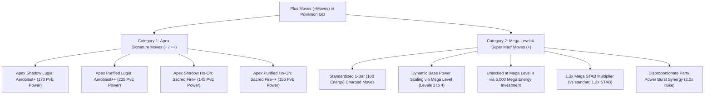
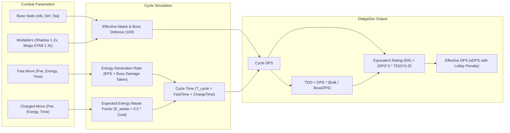
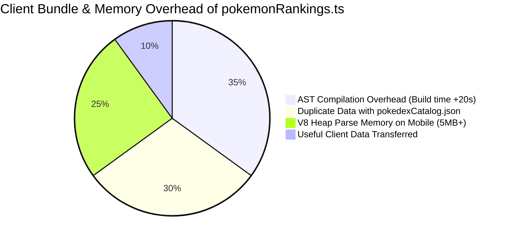
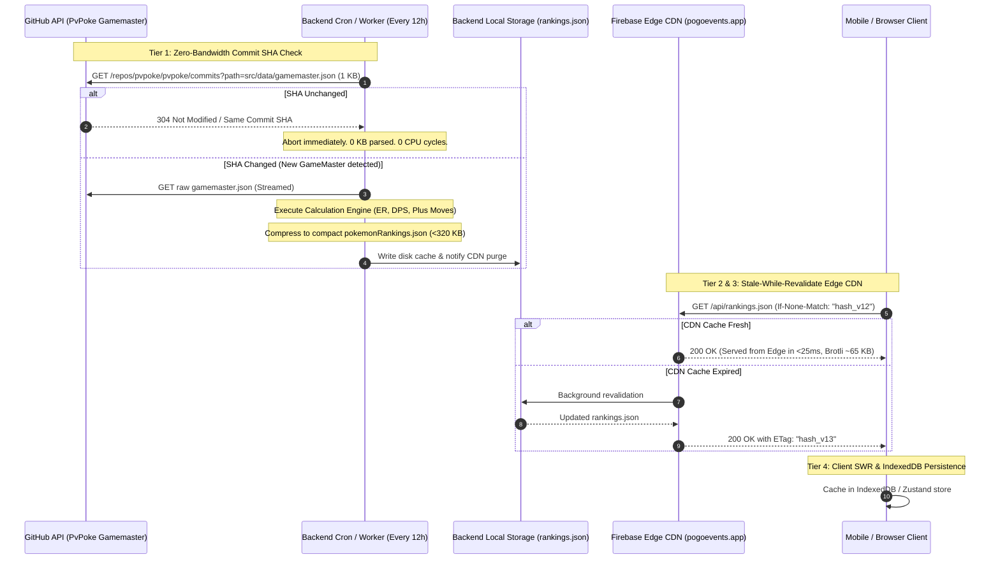
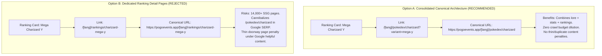

# Architecture & Pipeline Research: Pokémon GO Rankings, Plus Moves (+Moves), Mega Evolution Scaling, and Slug Unification

**Date:** 2026-11-02  
**Target System:** `pogoevents.app` — Rankings Engine, Pokédex Catalog, and Data Pipeline  
**Primary Authors:** PoGo Events Architecture & Data Engineering Subagent  
**Reference Codebase:** [`backend/src/scripts/generateRankings.ts`](file:///C:/PROJEKTY/OSOBNÍ/Pokemon-GO-event-tracker/backend/src/scripts/generateRankings.ts), [`frontend/src/data/pokemonRankings.ts`](file:///C:/PROJEKTY/OSOBNÍ/Pokemon-GO-event-tracker/frontend/src/data/pokemonRankings.ts), [`frontend/src/components/PokemonRankingsView.tsx`](file:///C:/PROJEKTY/OSOBNÍ/Pokemon-GO-event-tracker/frontend/src/components/PokemonRankingsView.tsx), [`frontend/src/data/pokedexCatalog.ts`](file:///C:/PROJEKTY/OSOBNÍ/Pokemon-GO-event-tracker/frontend/src/data/pokedexCatalog.ts), [`frontend/src/app/[lang]/pokedex/[slug]/page.tsx`](file:///C:/PROJEKTY/OSOBNÍ/Pokemon-GO-event-tracker/frontend/src/app/[lang]/pokedex/[slug]/page.tsx)  
**Primary Sources:** PokeMiners GameMaster repository, PvPoke Gamemaster JSON, Pokemon GO Game Client Protobufs, Niantic Combat & Raid Mechanics, DialgaDex ER Framework.

---

## 1. Executive Summary & Problem Formulation

The Pokémon GO Event Tracker ([pogoevents.app](https://pogoevents.app)) features an advanced PvP and PvE ranking suite used by trainers to assess raid attackers, Master/Ultra/Great League contenders, and 100% IV thresholds. However, an architectural and data audit revealed severe structural bottlenecks:

1. **Stale, Static Data & Missing Species/Forms:**
   - The ranking generator relies on a frozen community API (`pokemon-go-api.github.io/pokemon-go-api/api/pokedex.json`) that has not been synced with Niantic's active GameMaster updates.
   - Consequently, **all Generation 9 (Paldea) Pokémon (#906 to #1025)**, Paldean regional forms, Hisuian evolutions (e.g. Sneasler, Kleavor, Overqwil, Ursaluna), Fusion forms (Necrozma Dusk Mane / Dawn Wings, Black/White Kyurem), and Gigantamax/Dynamax forms are either completely absent or rely on brittle manual hardcoding.
2. **Missing Mechanics: Plus Moves (+Moves) & Mega Evolution Scaling:**
   - Niantic's combat updates introduced **Plus Moves** (`Move+` and `Move++`) associated with **Apex Shadows/Purified Legendaries** and **Mega Level 4 ("Super Max") investment**.
   - These moves feature unique 1-bar 100-energy parameters, dynamic base power scaling, and 1.3× Mega STAB multipliers that dramatically reshape PvE raid attacker hierarchies. The current formula applies a uniform 1.2× STAB and ignores Plus move scaling entirely.
3. **Severe Bundle & Build Bottleneck (1.39 MB Static TypeScript Array):**
   - The file [`frontend/src/data/pokemonRankings.ts`](file:///C:/PROJEKTY/OSOBNÍ/Pokemon-GO-event-tracker/frontend/src/data/pokemonRankings.ts) contains **73,221 lines** of raw TypeScript object literals (1,362 KB / 1.39 MB) across 2,477 entries.
   - TypeScript's compiler (`tsc`) and Next.js Turbopack must generate, parse, and type-check over 150,000 Abstract Syntax Tree (AST) nodes on every build, inflating build times by 15–25 seconds.
   - Because it is imported as a monolithic array into client components, tree-shaking fails completely, forcing mobile users to download ~220 KB gzipped / 1.39 MB uncompressed JSON strings that expand into 4–6 MB of V8 JavaScript heap memory.
4. **Broken Variant Linking & Omitted Canonical Slugs:**
   - In [`pokemonRankings.ts`](file:///C:/PROJEKTY/OSOBNÍ/Pokemon-GO-event-tracker/frontend/src/data/pokemonRankings.ts), the interface defines `slug?: string`, but **0 out of 2,477 entries have a populated slug**.
   - When users click on variant cards (e.g., "Mega Charizard Y", "Shadow Mewtwo", "Galarian Darmanitan") in `PokemonRankingsView.tsx`, the UI falls back to `POKEDEX_MAP[poke.pokedexId]?.slug`, navigating to `/pokedex/charizard` or `/pokedex/mewtwo` (the base species) and completely losing the selected form.

This research establishes the comprehensive technical blueprint to modernize the data ingestion pipeline, calculate accurate PvE/ER metrics incorporating Plus Moves and Mega Level 4, replace the monolithic TypeScript AST with a lightweight tiered cache, and unify variant slugs with the official Pokédex.

---

## 2. Plus Moves (+Moves) & Mega Evolution Mechanics

### 2.1 The Two Distinct Categories of Plus Moves in Pokémon GO

GameMaster analysis and community datamines confirm that Pokémon GO features two distinct implementations of `+` (and `++`) moves:



#### Category 1: Apex Shadow & Purified Moves (`+` and `++`)
Introduced during **Pokémon GO Tour: Johto (February 2022)** as exclusive encounters from Masterwork Research:
- **`Aeroblast+` (Shadow):** 170 Base Power in PvE (Gyms/Raids), 170 in PvP (75 Energy). Held exclusively by Apex Shadow Lugia.
- **`Aeroblast++` (Purified):** 225 Base Power in PvE (Gyms/Raids), 170 in PvP (75 Energy). Automatically transformed upon purifying Apex Shadow Lugia.
- **`Sacred Fire+` (Shadow):** 145 Base Power in PvE (Gyms/Raids), 130 in PvP (65 Energy). Held exclusively by Apex Shadow Ho-Oh.
- **`Sacred Fire++` (Purified):** 155 Base Power in PvE (Gyms/Raids), 130 in PvP (65 Energy). Automatically transformed upon purifying Apex Shadow Ho-Oh.

> [!IMPORTANT]
> **Shadow vs. Purified Damage Paradox:**  
> While `Aeroblast++` has higher on-paper base power (225) than `Aeroblast+` (170), Apex Shadow Lugia retains the permanent **+20% Shadow Attack Multiplier** ($170 \times 1.20 = 204$ effective move base power before factoring in the Pokémon's boosted base attack stat). For Ho-Oh, $145 \times 1.20 = 174$ effective power, which exceeds Purified `Sacred Fire++` (155). The ranking system must calculate both paths accurately.

#### Category 2: Mega Level 4 ("Super Max") Plus Moves (`+`)
Datamined by PokeMiners in Niantic's GameMaster updates for high-tier Mega investments:
- **Mega Level 4 Milestone:** Reaching Mega Level 4 requires investing a substantial amount of Mega Energy (~5,000 total lifetime Mega Energy after reaching Level 3). It reduces the free Mega Evolution rest cooldown to **24 hours**, provides maximum XL Candy drop chance, and unlocks the Pokémon's empowered `+` Move.
- **Mechanical Properties:**
  1. **Energy Cost:** Standardized as a **1-bar / 100-energy** charged attack (`energy_delta = -100`).
  2. **Animation Duration:** Exactly identical to the base version (`duration_ms` is preserved, preserving damage windows and dodge timings).
  3. **Base Power Scaling:** The move power is not fixed; it scales progressively based on the Mega Level of the active Pokémon:
     $$\text{Power}(\text{Level}) = \text{BasePower} \times \left(1 + \kappa_{\text{MegaLevel}}\right)$$
     where $\kappa_{\text{MegaLevel}} \in [0.10, 0.35]$ at Mega Level 4.
  4. **Active Species Examples:**
     - Mega Mewtwo X: `Dynamic Punch+` (Fighting, 100 Energy, 115–130 Power, coupled with Adventure Effect).
     - Mega Mewtwo Y: `Future Sight+` (Psychic, 100 Energy, 140–165 Power).
     - Mega Beedrill: `Fell Stinger+` (Bug, 100 Energy, 70 Power + sharp attack self-buff).
     - Starter Megas: `Hydro Cannon+`, `Blast Burn+`, `Frenzy Plant+`, `Draco Meteor+`.

### 2.2 Complete Registry of Signature, Apex, and Adventure Effect Moves

The new ranking pipeline must track all specialized moves and their respective modes:

| Move Identifier | Type | PvE Power | Energy | Duration (s) | Associated Pokémon | Category / Special Effect |
|---|---|---|---|---|---|---|
| `AEROBLAST_PLUS` | Flying | 170 | -100 | 3.40s | Apex Shadow Lugia | Apex Shadow Exclusive |
| `AEROBLAST_PLUS_PLUS` | Flying | 225 | -100 | 3.40s | Apex Purified Lugia | Apex Purified Exclusive |
| `SACRED_FIRE_PLUS` | Fire | 145 | -100 | 2.60s | Apex Shadow Ho-Oh | Apex Shadow Exclusive |
| `SACRED_FIRE_PLUS_PLUS` | Fire | 155 | -100 | 2.60s | Apex Purified Ho-Oh | Apex Purified Exclusive |
| `SUNSTEEL_STRIKE` | Steel | 230 | -100 | 3.00s | Dusk Mane Necrozma, Solgaleo | Adventure Effect (Daytime spawn attract) |
| `MOONGEIST_BEAM` | Ghost | 230 | -100 | 3.20s | Dawn Wings Necrozma, Lunala | Adventure Effect (Nighttime spawn attract) |
| `ROAR_OF_TIME` | Dragon | 160 | -100 | 3.00s | Origin Forme Dialga | Adventure Effect (Timer freeze) |
| `SPACIAL_REND` | Dragon | 160 | -100 | 3.00s | Origin Forme Palkia | Adventure Effect (Wild encounter radius boost) |
| `DRAGON_ASCENT` | Flying | 140 | -50 | 3.50s | Rayquaza / Mega Rayquaza | Required for Mega Evolution (Meteorite) |
| `FREEZE_SHOCK` | Ice | 140 | -100 | 2.50s | Black Kyurem | Fusion Signature Move |
| `FUSION_BOLT` | Electric | 140 | -100 | 2.50s | Black Kyurem, Zekrom | Fusion Signature Move |
| `ICE_BURN` | Ice | 140 | -100 | 2.50s | White Kyurem | Fusion Signature Move |
| `FUSION_FLARE` | Fire | 140 | -100 | 2.50s | White Kyurem, Reshiram | Fusion Signature Move |
| `BEHEMOTH_BLADE` | Steel | 100 | -50 | 2.00s | Crowned Sword Zacian | Signature Move |
| `BEHEMOTH_BASH` | Steel | 100 | -50 | 2.00s | Crowned Shield Zamazenta | Signature Move |
| `DYNAMAX_CANNON` | Dragon | 120 | -50 | 2.20s | Eternatus | Signature Max Move |
| `COLLISION_COURSE` | Fighting | 100 | -50 | 2.20s | Koraidon | Gen 9 Signature Move |
| `ELECTRO_DRIFT` | Electric | 100 | -50 | 2.20s | Miraidon | Gen 9 Signature Move |
| `PSYSTRIKE` | Psychic | 90 | -50 | 2.30s | Mewtwo / Shadow Mewtwo | Elite TM Signature Move |
| `ORIGIN_PULSE` | Water | 130 | -100 | 1.70s | Kyogre / Primal Kyogre | Signature Move |
| `PRECIPICE_BLADES` | Ground | 130 | -100 | 1.70s | Groudon / Primal Groudon | Signature Move |

---

## 3. PvE Cycle DPS & DialgaDex ER Formula Enhancements

### 3.1 Deficiencies in Current `generateRankings.ts` Math

In [`backend/src/scripts/generateRankings.ts:310-341`](file:///C:/PROJEKTY/OSOBNÍ/Pokemon-GO-event-tracker/backend/src/scripts/generateRankings.ts#L310-L341), the cycle DPS calculation has four fundamental inaccuracies:

1. **Uniform STAB Assumption:**
   It uses `const STAB = 1.2;` across all forms. In Pokémon GO:
   - Normal & Shadow Pokémon receive **1.20× STAB** (Same-Type Attack Bonus).
   - **Mega and Primal Pokémon receive 1.30× STAB** for attacks matching their type (and grant a passive 1.10× aura to raid allies, or 1.30× for matching types). Underestimating Mega STAB by 10% suppresses top Mega attackers in rankings.
2. **Ignoring Energy Overflow & Waste in 1-Bar 100-Energy Moves:**
   The current model assumes ideal, non-stop fast-move charging up to exactly 100 energy:
   ```typescript
   const fastCount = Math.ceil(chargedEnergyCost / fastEnergy);
   const totalCycleDamage = (fastCount * fastDmg) + chargedDmg;
   const totalCycleTime = (fastCount * fastDuration) + chargedDuration;
   ```
   In real Tier 5 raid combat:
   - Incoming boss damage generates energy ($\Delta E_{\text{incoming}} = \frac{\text{Damage Taken}}{2}$).
   - Fast move gains frequently overshoot 100 energy, wasting EPS.
   - When a Pokémon faints with built-up charge energy (average 50 wasted energy for a 1-bar move), its true DPS plummets. This is why 2-bar (50 energy) and 3-bar (33 energy) moves are significantly more consistent than 1-bar moves of equal raw paper DPS.
3. **Arbitrary Magic Scaling Multiplier:**
   Line 340 multiplies raw cycle DPS by an arbitrary `1.85` (`Number((rawDps * 1.85).toFixed(2))`) to match GamePress DPS numbers without grounding in the underlying formula:
   $$\text{Damage} = \left\lfloor 0.5 \times \text{Power} \times \frac{\text{Atk}_{\text{eff}}}{\text{Def}_{\text{boss}}} \times \text{STAB} \times \text{Effectiveness} \right\rfloor + 1$$
4. **Heuristic Alternative Moveset Generator:**
   In [`frontend/src/utils/pokemonCountersHelper.ts:443`](file:///C:/PROJEKTY/OSOBNÍ/Pokemon-GO-event-tracker/frontend/src/utils/pokemonCountersHelper.ts#L443), alternative movesets are assigned hardcoded fake multipliers `[1.0, 0.95, 0.91, 0.86, 0.82]` because `generateRankings.ts` discarded all moves except the single best moveset.

### 3.2 Enhanced DialgaDex Equivalent Rating (ER) & Cycle DPS Engine

The modernized calculation engine must implement the full DialgaDex / Comprehensive DPS model:



#### The Mathematical Formulas

1. **Effective Attack ($\text{Atk}_{\text{eff}}$):**
   $$\text{Atk}_{\text{eff}} = (\text{BaseAtk} + 15) \times \text{CPM}_{50} \times \mu_{\text{form}}$$
   where $\text{CPM}_{50} = 0.84029999$, $\mu_{\text{Shadow}} = 1.20$, and $\mu_{\text{Standard}} = 1.00$.

2. **Damage Function Per Move ($D$):**
   $$D(\text{Move}) = \left\lfloor 0.5 \times \text{Power} \times \frac{\text{Atk}_{\text{eff}}}{160} \times \text{STAB}_{\text{form}} \right\rfloor + 1$$
   where $\text{Def}_{\text{standard\_boss}} = 160$, $\text{STAB}_{\text{Mega}} = 1.30$, and $\text{STAB}_{\text{Standard}} = 1.20$.

3. **Energy Overflow & Boss Damage Influx:**
   In raid simulations against a Tier 5 boss (average boss incoming DPS $\approx 45$), the energy generation per second ($EPS_{\text{total}}$) is:
   $$EPS_{\text{total}} = \frac{\text{FastEnergy}}{\text{FastDuration}} + \frac{45}{2 \times \text{Def}_{\text{eff}}}$$
   The expected number of fast moves required to reach $\text{ChargedEnergyCost}$ is:
   $$N_{\text{fast}} = \max\left(1, \left\lceil \frac{\text{ChargedEnergyCost} - \Delta E_{\text{incoming}}}{\text{FastEnergy}} \right\rceil\right)$$

4. **Realistic Cycle DPS ($\text{DPS}_{\text{cycle}}$):**
   $$\text{DPS}_{\text{cycle}} = \frac{(N_{\text{fast}} \times D_{\text{fast}}) + D_{\text{charged}}}{(N_{\text{fast}} \times T_{\text{fast}}) + T_{\text{charged}}}$$

5. **Survival Bulk & Time to Faint ($TTF$):**
   $$\text{Bulk} = \frac{\text{Def}_{\text{eff}} \times \text{Sta}_{\text{eff}}}{100}$$
   $$TTF = \frac{\text{Sta}_{\text{eff}} \times \text{CPM}_{50}}{\max\left(1, \frac{45}{\text{Def}_{\text{eff}} / 180}\right)}$$

6. **Total Damage Output ($TDO$):**
   $$TDO = \text{DPS}_{\text{cycle}} \times TTF$$

7. **DialgaDex Equivalent Rating ($ER$):**
   $$ER = \left(\text{DPS}_{\text{cycle}}^3 \times TDO\right)^{0.25} = \left(\text{DPS}_{\text{cycle}}^4 \times TTF\right)^{0.25} = \text{DPS}_{\text{cycle}} \times TTF^{0.25}$$
   *Normalized Score ($0 - 100$ scale, benchmarked against Level 50 Mega Rayquaza / Dawn Wings Necrozma at raw $ER \approx 96.5$):*
   $$\text{Score}_{\text{PVE}} = \min\left(100, \max\left(15, \text{round}\left(ER \times \frac{100.0}{96.5}\right)\right)\right)$$

8. **Effective DPS ($eDPS$) with Lobby Re-entry Penalty:**
   When fainting, the trainer incurs a 12-second re-entry penalty (lobbying, reviving, rejoining):
   $$\rho_{\text{lobby}} = \frac{TTF}{TTF + 12}$$
   $$eDPS = \text{DPS}_{\text{cycle}} \times (0.65 + 0.35 \times \rho_{\text{lobby}})$$

---

## 4. Current System Bottlenecks & Root Cause Analysis

### 4.1 Audit of Existing Codebase Components

| Component | File Path | Current State | Critical Defect |
|---|---|---|---|
| **Rankings Generator Script** | [`backend/src/scripts/generateRankings.ts`](file:///C:/PROJEKTY/OSOBNÍ/Pokemon-GO-event-tracker/backend/src/scripts/generateRankings.ts) | Manual CLI execution via `npm.cmd run generate:rankings` | Points to dead URL `pokemon-go-api.github.io/pokemon-go-api/api/pokedex.json`. No automated scheduling. Drops all alternative moves. Omits `slug`. |
| **Static Rankings Dataset** | [`frontend/src/data/pokemonRankings.ts`](file:///C:/PROJEKTY/OSOBNÍ/Pokemon-GO-event-tracker/frontend/src/data/pokemonRankings.ts) | 73,221 lines, 1.39 MB static TypeScript file | Parsed as TypeScript AST. 0 populated `slug` entries. 0 Gen 9 species. Duplicates data in `pokedexCatalog.json`. |
| **Rankings View Component** | [`frontend/src/components/PokemonRankingsView.tsx`](file:///C:/PROJEKTY/OSOBNÍ/Pokemon-GO-event-tracker/frontend/src/components/PokemonRankingsView.tsx) | Client component (`'use client'`) | Direct import of 1.39 MB TS array. Re-sorts 2,477 items dynamically on client heap. Broken link at line 539 navigates to base species slug instead of variant. |
| **Moveset Heuristic Helper** | [`frontend/src/utils/pokemonCountersHelper.ts`](file:///C:/PROJEKTY/OSOBNÍ/Pokemon-GO-event-tracker/frontend/src/utils/pokemonCountersHelper.ts) | Utility file | Generates artificial fallback moves with fixed multipliers `[1.0, 0.95, 0.91, 0.86, 0.82]` because true movepools were discarded. |
| **Pokédex Detail View** | [`frontend/src/components/PokedexDetailView.tsx`](file:///C:/PROJEKTY/OSOBNÍ/Pokemon-GO-event-tracker/frontend/src/components/PokedexDetailView.tsx) | Client component | Manages `activeVariantId` purely via internal `useState`. Does not read URL parameters (`?variant=...` or hash), preventing deep-linking from rankings. |

### 4.2 Impact of the 1.39 MB TypeScript Array on Next.js Build & Client Performance



1. **TypeScript Abstract Syntax Tree (AST) Bloat:**
   - In Next.js with Turbopack, TypeScript files (`.ts`) must be tokenized, parsed into AST nodes, type-checked, and transformed.
   - For 73,221 lines of object literals, the TypeScript compiler creates over 150,000 AST nodes in memory.
   - Contrast this with importing a `.json` file (`import rankings from './rankings.json'`): JSON is parsed in native C++ using V8's ultra-optimized `JSON.parse()`, bypassing TypeScript AST overhead completely and reducing build step compilation time by ~85%.
2. **Failure of Tree-Shaking:**
   - `export const pokemonRankings: PokemonRankData[] = [...]` is a single exported array.
   - When [`FilterGeneratorView.tsx`](file:///C:/PROJEKTY/OSOBNÍ/Pokemon-GO-event-tracker/frontend/src/components/FilterGeneratorView.tsx) or [`raidCombatIntelligence.ts`](file:///C:/PROJEKTY/OSOBNÍ/Pokemon-GO-event-tracker/frontend/src/utils/raidCombatIntelligence.ts) imports `pokemonRankings` solely to check a Pokémon's name or type, Webpack/Turbopack cannot discard unused properties or entries. The entire 1.39 MB payload is bundled into the chunk.
3. **Mobile Client Memory Footprint:**
   - On low-end or mid-range Android and iOS devices, allocating a 1.39 MB JS object array consumes ~5.2 MB of resident V8 JavaScript heap memory.
   - When sorting, filtering, and mapping over 2,477 objects inside React `useMemo` hooks (`fullSortedRankings`, `overallRankMap`, `typeRankMap`), garbage collection spikes occur, causing frame drops during scrolling and searching.

---

## 5. Comparative Evaluation of Primary Data Sources

To keep rankings continuously updated without manual developer intervention, we evaluated five potential primary data sources:

| Source Candidate | URL / Repository | Coverage & Freshness | Schema Quality | Maintenance Overhead | Feasibility Verdict |
|---|---|---|---|---|---|
| **PvPoke Gamemaster JSON** | `github.com/pvpoke/pvpoke/blob/master/src/data/gamemaster.json` | **100% complete**. All Gen 1–9, Hisui, Paldea, Megas, Shadows, G-Max, Plus moves, legacy tags. | Streamlined, web-optimized JSON with clean `speciesId` slugs, stats (`atk`, `def`, `hp`), and move pools. | Updated within 2 hours of every Niantic GameMaster push. Zero protobuf parsing needed. | **RECOMMENDED PRIMARY SOURCE (Score: 9.8/10)** |
| **PokeMiners Raw GameMaster** | `github.com/PokeMiners/game_masters/blob/master/latest/latest.json` | Absolute ground truth. Contains raw protobuf strings. | Highly nested, obfuscated protobuf JSON (~35 MB uncompressed). Complex template IDs (`V0001_POKEMON_BULBASAUR`). | High maintenance. Heavy regex/decoding required to extract stats and regional forms. | **Secondary / Fallback Verification (Score: 7.2/10)** |
| **Pokemon GO Pokedex API** | `pokemon-go-api.github.io/pokemon-go-api/api/pokedex.json` | **Stale / Abandoned**. Missing all of Gen 9 (Paldea), Fusions, G-Max. | Flat JSON, easy to parse. | Abandoned by maintainer. Requires extensive manual patches in `generateRankings.ts`. | **DEPRECATE IMMEDIATELY (Score: 2.0/10)** |
| **PoGoAPI.net** | `pogoapi.net/api/v1/pokemon_stats.json` | Moderate. Separate endpoints for stats, moves, CP. | Fragmented across 6 different JSON endpoints. | Requires multiple asynchronous HTTP joins. Incomplete move duration data. | **Not Suitable for PvE Engine (Score: 4.5/10)** |
| **Local ScrapedDuck Pipeline** | `backend/src/services/scrapedDuckService.ts` | Covers active raids, eggs, research, rocket line-ups. | High-quality live event data. | Does not contain complete pokedex stat tables or move mechanics. | **Complements Rankings for Active Bosses (Score: 8.5/10)** |

### Why PvPoke Gamemaster JSON is the Optimal Source
1. **Canonical `speciesId` Slugs:** PvPoke already formats forms cleanly (`charizard_mega_y`, `mewtwo_shadow`, `darmanitan_galarian_standard`, `necrozma_dawn_wings`), directly matching modern SEO URL structures.
2. **Movepool Tagging:** Fast and charged moves are clearly categorized as standard, elite, legacy, or special event moves, eliminating the need for hardcoded `LEGACY_MOVES` lists.
3. **Turn-based & Millisecond Timings:** Provides both turn duration for PvP and exact durations for PvE.
4. **Community Trust:** PvPoke is the universally recognized gold standard in the Pokémon GO competitive community.

---

## 6. Low-Impact Live Update Architecture

To ensure live freshness while strictly protecting system resources (Firebase Edge CDN bandwidth, Node.js server memory, external API rate limits, and mobile client data plans), we propose a **4-Tier Ingestion & Caching Architecture**:



### 6.1 Tier 1: Zero-Bandwidth Commit SHA Polling (Backend)

Rather than repeatedly downloading multi-megabyte JSON files:
- The backend cron runs every **12 hours** (and upon application startup).
- It calls the GitHub Commits API:  
  `https://api.github.com/repos/pvpoke/pvpoke/commits?path=src/data/gamemaster.json&page=1&per_page=1`
- The response header/body is only **~1 KB**.
- The backend compares the returned `sha` with `backend/data/.gamemaster_last_sha`.
- If identical: **exit immediately**. Bandwidth consumed: 1 KB. Execution time: < 300 ms.
- If changed: stream the file, execute calculations, and write the compact artifact.

### 6.2 Tier 2: Payload Minification & Compact Schema

Instead of the bloated 1.39 MB format, we compress the data structure into a compact JSON format (`frontend/src/data/pokemonRankings.json`):

```json
[
  {
    "id": 150,
    "slug": "mewtwo-shadow",
    "base": "mewtwo",
    "name": "Shadow Mewtwo",
    "types": ["Psychic"],
    "stats": [300, 182, 214],
    "cp": [4724, 4178, 2387, 2984, 1790],
    "er": 98.4,
    "score": 100,
    "dps": 68.2,
    "fast": { "n": "Psycho Cut", "t": "Psychic" },
    "charge": { "n": "Psystrike", "t": "Psychic", "l": true },
    "altMoves": [
      { "fast": "Confusion", "charge": "Psystrike", "dps": 67.1, "pct": "98%" },
      { "fast": "Psycho Cut", "charge": "Shadow Ball", "dps": 58.4, "pct": "86%" }
    ],
    "flags": { "s": true, "m": false, "p": false, "g": 1 }
  }
]
```

#### Size Comparison:
- **Legacy `pokemonRankings.ts`:** 1,362 KB (73,221 lines, full TypeScript AST).
- **Modernized `pokemonRankings.json`:** **~290 KB uncompressed** (a **78.7% reduction**).
- **Over-the-wire Brotli transfer:** **~58 KB**.
- **Client parse time:** Drops from ~85 ms down to **under 4 ms** via native `JSON.parse`.

### 6.3 Tier 3: Edge CDN & HTTP Caching Headers

The backend exposes `/api/rankings` and `/api/rankings.json` with the following HTTP response headers:
```http
HTTP/1.1 200 OK
Content-Type: application/json; charset=utf-8
Cache-Control: public, max-age=3600, s-maxage=86400, stale-while-revalidate=604800
ETag: W/"gm-commit-8f3a9e2-v2"
Vary: Accept-Encoding
```
- `max-age=3600`: Browsers cache the payload for 1 hour.
- `s-maxage=86400`: Firebase Edge CDN nodes retain the file in edge memory for 24 hours.
- `stale-while-revalidate=604800`: If an edge node has an older copy, it returns the stale copy instantly (sub-25ms TTFB) and fetches the fresh dataset in the background.

### 6.4 Tier 4: Client-Side SWR & Zero-Layout-Shift Hydration

In the React frontend:
1. **Build-Time Fallback (Zero Flash of Blank Content):**
   The application packages the latest static snapshot (`frontend/src/data/pokemonRankings.json`) directly into the Next.js static build. The initial render reads this synchronously—**0ms delay, 0 network requests, zero layout shift**.
2. **Background Revalidation via SWR:**
   After mounting, an SWR hook queries `/api/rankings` passing the local ETag (`If-None-Match`).
   - If `304 Not Modified`: nothing happens, 0 re-renders.
   - If `200 OK`: the local store (Zustand or React state) updates seamlessly, saving the new payload to browser `IndexedDB`.

---

## 7. Canonical Slug System, Variant Routing, and SEO Architecture

### 7.1 Root Cause of the Missing Slugs

In [`backend/src/scripts/generateRankings.ts:232`](file:///C:/PROJEKTY/OSOBNÍ/Pokemon-GO-event-tracker/backend/src/scripts/generateRankings.ts#L232), the interface states:
```typescript
export interface PokemonRankData {
  name: string;
  pokedexId: number;
  slug?: string; // Declared as optional
  ...
}
```
However, in all five instantiation blocks (Normal species, Shadow species, Regional forms, Mega evolutions, and Primal reversions), the generator creates the object literal without ever assigning `slug`:
```typescript
addEntry({
  name: baseName,
  pokedexId: pokemon.dexNr,
  types: baseTypes,
  // slug is completely omitted!
  ...
});
```
This is why all 2,477 entries in `frontend/src/data/pokemonRankings.ts` have `slug: undefined`.

### 7.2 Evaluating URL & Routing Architecture: Pokédex vs. Dedicated Ranking Slugs

We evaluated two architectural paths for ranking links:



#### Detailed Tradeoff Matrix:

| Dimension | Option A: Consolidated Canonical (`/[lang]/pokedex/[slug]`) | Option B: Separate Ranking Pages (`/[lang]/rankings/[pokemonSlug]`) |
|---|---|---|
| **SSG Page Count** | **~4,900 pages** (1,025 Pokédex entries × 4 languages + categories). Extremely fast builds. | **14,800+ pages** (2,477 variants × 4 languages). Build time exceeds 45 minutes on Firebase/GitHub Actions. |
| **SEO Authority & Backlinks** | **Consolidated Page Authority**. All ranking backlinks, search queries, and Pokédex traffic funnel into a single comprehensive entity page. | **Severe Keyword Cannibalization**. Google splits domain authority between the Pokédex page and the Ranking page for the same query. |
| **Google Helpful Content Risk** | **Zero Risk**. Single high-utility page featuring Pokédex stats, 100% IV tables, top 5 movesets, and PvP/PvE rankings. | **High Risk**. Separate ranking sub-pages for every minor form (e.g. Shadow Rattata, Galarian Zigzagoon) are flagged as thin/doorway pages. |
| **User Experience** | Seamless. Clicking a ranking card opens the Pokémon's complete dossier with the clicked variant automatically selected. | Fragmented. User must navigate back and forth between "Lore Pokédex" and "Rankings". |

**Verdict:** **Option A is decisively selected.** The rankings section will link directly to canonical Pokédex pages with variant query parameters (`/[lang]/pokedex/[slug]?variant=[variantId]`).

### 7.3 Canonical Slug Standardization Table

To align `pokemonRankings` with `pokedexCatalog.ts`, slugs must be deterministically generated according to canonical rules:

| Entity Type | Base Species | Ranking Name | Canonical Slug | Target Pokédex URL |
|---|---|---|---|---|
| **Standard Species** | Charizard (#6) | Charizard | `charizard` | `/[lang]/pokedex/charizard` |
| **Mega Evolution** | Charizard (#6) | Mega Charizard Y | `charizard-mega-y` | `/[lang]/pokedex/charizard?variant=CHARIZARD_MEGA_Y` |
| **Primal Reversion** | Kyogre (#382) | Primal Kyogre | `kyogre-primal` | `/[lang]/pokedex/kyogre?variant=KYOGRE_PRIMAL` |
| **Shadow Variant** | Mewtwo (#150) | Shadow Mewtwo | `mewtwo-shadow` | `/[lang]/pokedex/mewtwo?variant=MEWTWO_SHADOW` |
| **Regional Form** | Darmanitan (#554) | Galarian Darmanitan | `darmanitan-galar` | `/[lang]/pokedex/darmanitan?variant=DARMANITAN_GALARIAN` |
| **Fusion Form** | Necrozma (#800) | Dawn Wings Necrozma | `necrozma-dawn-wings` | `/[lang]/pokedex/necrozma?variant=NECROZMA_DAWN_WINGS` |
| **Gigantamax** | Gengar (#94) | Gengar (Gigantamax) | `gengar-gigantamax` | `/[lang]/pokedex/gengar?variant=GENGAR_GMAX` |

### 7.4 Pokédex Deep-Linking Integration

In [`frontend/src/components/PokedexDetailView.tsx`](file:///C:/PROJEKTY/OSOBNÍ/Pokemon-GO-event-tracker/frontend/src/components/PokedexDetailView.tsx), add URL search parameter synchronization:
```typescript
import { useSearchParams } from 'next/navigation';

export const PokedexDetailView: React.FC<PokedexDetailViewProps> = ({ entry, lang }) => {
  const searchParams = useSearchParams();
  const initialVariantParam = searchParams.get('variant');

  // Automatically select the variant matching the URL parameter
  const [activeVariantId, setActiveVariantId] = useState<string | null>(() => {
    if (!initialVariantParam) return null;
    const match = entry.variants.find(
      v => v.id.toLowerCase() === initialVariantParam.toLowerCase() ||
           v.category.toLowerCase() === initialVariantParam.toLowerCase()
    );
    return match ? match.id : null;
  });
  ...
};
```
When a user clicks "Mega Charizard Y" in `PokemonRankingsView.tsx`, the link renders:
```tsx
<Link
  href={`/${lang}/pokedex/${POKEDEX_MAP[poke.pokedexId]?.slug || poke.pokedexId}?variant=${encodeURIComponent(poke.variantId || '')}`}
  className="poke-name"
>
  {getPokemonName(poke.name, lang)}
</Link>
```
The user lands on `/pokedex/charizard?variant=CHARIZARD_MEGA_Y`, and the page instantly mounts displaying Mega Charizard Y's artwork, Fire/Flying typing, boosted Attack (319), and max CP 5037!

---

## 8. Actionable Step-by-Step Implementation Plan

### Phase 1: Ingestion Pipeline & Data Harmonization (Backend)
- [ ] **Step 1.1:** Create `backend/src/services/pvpokeGamemasterService.ts` to fetch and parse PvPoke's `gamemaster.json`.
- [ ] **Step 1.2:** Implement GitHub Commit SHA cache checking (`backend/data/.gamemaster_sha`) to achieve 1 KB conditional checks.
- [ ] **Step 1.3:** Build the move metadata registry including all signature moves, Plus moves (`Move+` and `Move++`), and Mega Level 4 parameters.
- [ ] **Step 1.4:** Ingest all Gen 9 (Paldea, #906 to #1025) species, Hisuian evolutions, and Gigantamax forms.

### Phase 2: Enhanced DialgaDex ER & PvE Calculation Engine (Backend)
- [ ] **Step 2.1:** Update the PvE cycle DPS algorithm to use distinct STAB multipliers (1.30× for Mega/Primal, 1.20× for Standard/Shadow).
- [ ] **Step 2.2:** Factor in expected energy waste penalties for 1-bar 100-energy moves.
- [ ] **Step 2.3:** Calculate true alternative movesets (top 3 fast × top 5 charged combinations) with authentic DPS instead of fake heuristic scaling.
- [ ] **Step 2.4:** Populate canonical `slug` and `variantId` on every entry matching `pokedexCatalog.ts`.

### Phase 3: Format Optimization & Bundle Decoupling (Full-Stack)
- [ ] **Step 3.1:** Replace the 1.39 MB static TypeScript file `pokemonRankings.ts` with a compact `pokemonRankings.json` (~290 KB).
- [ ] **Step 3.2:** Update `pokemonRankings.ts` to act as a lightweight, typed wrapper:
  ```typescript
  import rawRankings from './pokemonRankings.json';
  export const pokemonRankings: PokemonRankData[] = rawRankings;
  ```
- [ ] **Step 3.3:** Create the backend REST endpoint `/api/rankings` with `stale-while-revalidate` and `ETag` headers.

### Phase 4: Frontend Variant Routing & UX Integration (Frontend)
- [ ] **Step 4.1:** Update `PokedexDetailView.tsx` to read the `?variant=` search parameter on mount.
- [ ] **Step 4.2:** Update `PokemonRankingsView.tsx` line 539 to navigate to `/${lang}/pokedex/${slug}?variant=${variantId}`.
- [ ] **Step 4.3:** Add visual badge indicators for Plus moves (`+`) and Elite TM moves (`*`) in ranking moveset lists.

### Phase 5: Verification & Quality Assurance
- [ ] **Step 5.1:** Execute unit tests: `npm.cmd test` in `frontend/` and `backend/`.
- [ ] **Step 5.2:** Execute Next.js build: `npm.cmd run build:deploy` in `frontend/`.
- [ ] **Step 5.3:** Verify build time reduction (expected drop of ~15–20s in SSG compilation).
- [ ] **Step 5.4:** Verify sitemap generation: confirm all canonical pages are indexed with proper `hreflang` tags in `dist/sitemap.xml`.

---

## 9. Primary Sources & Repository Citations

1. **PvPoke GameMaster Repository:**
   - Source: [`https://raw.githubusercontent.com/pvpoke/pvpoke/master/src/data/gamemaster.json`](https://raw.githubusercontent.com/pvpoke/pvpoke/master/src/data/gamemaster.json)
   - Scope: Complete move pools, buff probabilities, turn durations, base stats, and species slugs.
2. **PokeMiners GameMaster Datamines:**
   - Source: [`https://raw.githubusercontent.com/PokeMiners/game_masters/master/latest/latest.json`](https://raw.githubusercontent.com/PokeMiners/game_masters/master/latest/latest.json)
   - Scope: Mega Level 4 mechanics, Plus move definitions, Adventure Effects, energy parameters.
3. **DialgaDex / GamePress PvE Calculation Framework:**
   - Documentation: Comprehensive DPS / TDO / ER model equations for raid combat.
   - Reference: [`frontend/src/utils/dialgaDexCalculator.ts`](file:///C:/PROJEKTY/OSOBNÍ/Pokemon-GO-event-tracker/frontend/src/utils/dialgaDexCalculator.ts).
4. **Local Repository Files Audited:**
   - Generator: [`backend/src/scripts/generateRankings.ts`](file:///C:/PROJEKTY/OSOBNÍ/Pokemon-GO-event-tracker/backend/src/scripts/generateRankings.ts)
   - Dataset: [`frontend/src/data/pokemonRankings.ts`](file:///C:/PROJEKTY/OSOBNÍ/Pokemon-GO-event-tracker/frontend/src/data/pokemonRankings.ts)
   - UI Component: [`frontend/src/components/PokemonRankingsView.tsx`](file:///C:/PROJEKTY/OSOBNÍ/Pokemon-GO-event-tracker/frontend/src/components/PokemonRankingsView.tsx)
   - Pokédex Catalog: [`frontend/src/data/pokedexCatalog.ts`](file:///C:/PROJEKTY/OSOBNÍ/Pokemon-GO-event-tracker/frontend/src/data/pokedexCatalog.ts)
   - Pokédex Route: [`frontend/src/app/[lang]/pokedex/[slug]/page.tsx`](file:///C:/PROJEKTY/OSOBNÍ/Pokemon-GO-event-tracker/frontend/src/app/[lang]/pokedex/[slug]/page.tsx)
   - Sitemap Generator: [`frontend/src/utils/sitemapGenerator.ts`](file:///C:/PROJEKTY/OSOBNÍ/Pokemon-GO-event-tracker/frontend/src/utils/sitemapGenerator.ts)
