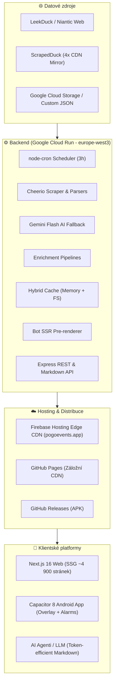

# 🎮 Pokémon GO Event Tracker — Přehled infrastruktury, technologií a funkcionality

Komplexní technický soupis architektury, použitého technologického stacku, klíčových pilířů a implementovaných funkcionalit aplikace **[pogoevents.app](https://pogoevents.app)**.

---

## 1. 🛠️ Komplexní soupis infrastruktury a použitých technologií

Aplikace funguje jako hybridní ekosystém zahrnující statický web, cloudový backend na Google Cloud Run, nativní mobilní aplikaci pro Android a rozhraní pro AI agenty.

### A. Cloud & Hostingová infrastruktura
* **[Firebase Hosting](file:///C:/PROJEKTY/OSOBNÍ/Pokemon-GO-event-tracker/frontend/firebase.json)**: Globální Edge CDN distribuce statického frontendu s garantovanou odezvou TTFB pod 50 ms, aktivním HTTP/2, SSL certifikací a nastavenou cache politikou (`max-age=1800, stale-while-revalidate=86400`).
* **[Google Cloud Run](file:///C:/PROJEKTY/OSOBNÍ/Pokemon-GO-event-tracker/.github/workflows/deploy-backend.yml)**: Běhové prostředí backendu v regionu `europe-west3` (Frankfurt) — bezserverové kontejnerizované prostředí s automatickým škálováním a nízkou latencí vůči evropským uživatelům.
* **[Google Cloud Storage (GCS)](file:///C:/PROJEKTY/OSOBNÍ/Pokemon-GO-event-tracker/backend/src/storage.ts)**: Persistentní cloudové úložiště pro custom události, cache přepisy a perzistenci stavu mezi restarty Cloud Run kontejneru.
* **GitHub Pages**: Sekundární zrcadlová statická distribuce frontendu pro zálohu a testovací prostředí.

### B. Backendový stack
| Technologie | Verze | Účel a využití v projektu |
|---|---|---|
| **Node.js & Express** | Express 4.19 | Jádro REST API serveru ([`index.ts`](file:///C:/PROJEKTY/OSOBNÍ/Pokemon-GO-event-tracker/backend/src/index.ts)) |
| **TypeScript** | 5.5 | Typová bezpečnost napříč backendovými moduly a rozhraními ([`types.ts`](file:///C:/PROJEKTY/OSOBNÍ/Pokemon-GO-event-tracker/backend/src/types.ts)) |
| **Cheerio** | 1.0.0-rc.12 | Rychlý serverový DOM parser pro extrakci dat z HTML stránek ([`scraper.ts`](file:///C:/PROJEKTY/OSOBNÍ/Pokemon-GO-event-tracker/backend/src/scraper.ts)) |
| **Axios** | 1.7.2 | HTTP klient s retry logikou, rotačními user-agenty a time-outy |
| **node-cron** | 4.6.0 | Plánovač automatického scrapingu (perioda 3 hodiny) |
| **@google-cloud/storage** | 7.21 | Oficiální SDK pro perzistenci dat do GCP bucketu |
| **Hybrid Cache Engine** | Vlastní | Dvouúrovňová cache (rychlá RAM `Map` + záloha v JSON souborech) se Stale-While-Revalidate strategií |
| **Bot SSR Handler** | Vlastní | Dynamický HTML pre-renderer ([`ssr.ts`](file:///C:/PROJEKTY/OSOBNÍ/Pokemon-GO-event-tracker/backend/src/ssr.ts)) pro vyhledávací roboty s podporou 4 jazyků |

### C. Frontendový stack
| Technologie | Verze | Účel a využití v projektu |
|---|---|---|
| **Next.js (App Router)** | 16.2.11 | Generování statického exportu (**SSG**) pro více než 4 900 URL adres |
| **React** | 19.2.6 | Komponentové rozhraní aplikace |
| **TypeScript** | ~6.0 | Typování celého klientského stavu a komponent |
| **Vanilla CSS / CSS Modules** | Modern CSS | Dark Glassmorphic design systém, plynulé animace, plná podpora `light-mode` a mobilních safe-areas |
| **Lucide React** | 1.20 | Ikony rozhraní |
| **html-to-image** | 1.11 | Převod DOM stromu infografik do grafických rastrových plakátů ve vysokém rozlišení (PNG export) |

### D. Mobilní platforma (Android)
| Nástroj | Verze | Účel |
|---|---|---|
| **Capacitor Core / CLI** | 8.4.0 | Nativní bridge propojující Next.js SSG build s Android platformou ([`capacitor.config.ts`](file:///C:/PROJEKTY/OSOBNÍ/Pokemon-GO-event-tracker/frontend/capacitor.config.ts)) |
| **Capacitor Android** | 8.4.0 | Android projekt se systémovým WebView |
| **@capacitor/local-notifications** | 8.2.0 | Přesné lokální notifikace odolné vůči Doze módu baterie (`allowWhileIdle`) |
| **Custom Overlay Service** | Java/TS | Most ([`overlayPlugin.ts`](file:///C:/PROJEKTY/OSOBNÍ/Pokemon-GO-event-tracker/frontend/src/utils/overlayPlugin.ts)) pro zobrazení plovoucího okna přes systémové rozhraní Androidu |
| **Java JDK & Gradle** | JDK 21 | Sestavovací řetězec nativního APK balíčku |

### E. Automatizace, CI/CD a Testování
* **GitHub Actions Workflows**:
  1. [`deploy-firebase.yml`](file:///C:/PROJEKTY/OSOBNÍ/Pokemon-GO-event-tracker/.github/workflows/deploy-firebase.yml) — Build frontendu a nasazení na Firebase Hosting Live kanál.
  2. [`deploy-backend.yml`](file:///C:/PROJEKTY/OSOBNÍ/Pokemon-GO-event-tracker/.github/workflows/deploy-backend.yml) — Nasazení Node.js backendu do Google Cloud Run.
  3. [`release-apk.yml`](file:///C:/PROJEKTY/OSOBNÍ/Pokemon-GO-event-tracker/.github/workflows/release-apk.yml) — Automatický build Android APK (JDK 21, Gradle) a vytvoření GitHub Release při pushnutí tagu `v*`.
  4. [`deploy.yml`](file:///C:/PROJEKTY/OSOBNÍ/Pokemon-GO-event-tracker/.github/workflows/deploy.yml) — Záložní nasazení na GitHub Pages.
* **Vitest (4.1.10) & Testing Library**: Unit testy scraperu, normalizátorů, pipeline dat, formátovačů a UI komponent.

---

## 2. 🏛️ Hlavní pilíře aplikace

Architektura projektu stojí na čtyřech základních pilířích:

### 1. Odolná datová pipeline s více zdroji a AI záchrannou sítí (Resilient Ingestion)
Data nevznikají ručně, ale jsou neustále stahována z webu. Systém počítá s výpadky:
* **Multi-CDN Failover**: Modul [`scrapedDuckIngest.ts`](file:///C:/PROJEKTY/OSOBNÍ/Pokemon-GO-event-tracker/backend/src/ingest/scrapedDuckIngest.ts) rotuje 4 nezávislé CDN mirrory (`jsdelivr`, `fastly`, `gcore`, `GitHub raw`), pokud má hlavní zdroj výpadek nebo rate-limit.
* **Sémantický pravidlový parsing**: DOM klasifikátor ([`semanticClassifier.ts`](file:///C:/PROJEKTY/OSOBNÍ/Pokemon-GO-event-tracker/backend/src/parsers/semanticClassifier.ts)) rozděluje HTML sekce podle kontextu nadpisů (Spawns, Eggs, Raids, Bonuses, Research).
* **AI Fallback & Confidence Scoring**: Modul [`aiFallbackIngest.ts`](file:///C:/PROJEKTY/OSOBNÍ/Pokemon-GO-event-tracker/backend/src/ai/aiFallbackIngest.ts) vyhodnocuje kvalitu extrakce. Klesne-li spolehlivost pod 75 % nebo narazí-li na neznámou herní mechaniku (Max Battles, Fusion), aktivuje se LLM fallback (Google Gemini Flash) s vyčištěným vstupem pro redukci tokenů.

### 2. Extrémní škálovatelnost pomocí Static Site Generation (SSG)
Aplikace generuje při buildu více než **4 900 statických HTML stránek**:
* Každá stránka existuje ve 4 jazycích (`cs`, `en`, `ja`, `ru`).
* Obsahuje 1 025 detailních stránek Pokédexu, raid bosse, kategorie žebříčků, typové matchup stránky a detaily všech událostí.
* Výsledek leží na CDN — server nezatěžují tisíce uživatelů přistupujících najednou během velkých akcí (např. Community Day).
* Pro boty a webové prohledávače, které nezpracovávají JS, je na backendu připraven specializovaný modul [`ssr.ts`](file:///C:/PROJEKTY/OSOBNÍ/Pokemon-GO-event-tracker/backend/src/ssr.ts) pro dynamický pre-rendering.

### 3. Omni-channel distribuce ze společného kódu
Z jedné kódové báze fungují 3 zcela odlišné výstupy:
1. **Desktop & Mobile Web** — Responzivní PWA webová aplikace.
2. **Nativní Android aplikace** — Zabalená přes Capacitor 8 s přístupem k systémovým funkcím (budíky pro notifikace a plovoucí okno nad hrou).
3. **AI/LLM Agent API** — Tokenově efektivní Markdown výstupy na cestách `/api/agent/*.md` ([`markdownGenerator.ts`](file:///C:/PROJEKTY/OSOBNÍ/Pokemon-GO-event-tracker/backend/src/agent/markdownGenerator.ts)), které mohou AI chatboti a asistenti číst bez zbytečného JSON balastu.

### 4. Doménová herní inteligence (Meta Intelligence)
Aplikace není pouhým pasivním kalendářem, ale počítá souvislosti:
* Automaticky vyhodnocuje užitečnost Pokémonů pro PvE raidy a PvP ligy (Great, Ultra, Master).
* Podle lokace a časové zóny uživatele ([`regionHelper.ts`](file:///C:/PROJEKTY/OSOBNÍ/Pokemon-GO-event-tracker/frontend/src/utils/regionHelper.ts)) detekuje regionální bosse (např. v Evropě ukazuje *Mespita* a skrývá amerického *Azelfa*).
* Algoritmus [`raidCombatIntelligence.ts`](file:///C:/PROJEKTY/OSOBNÍ/Pokemon-GO-event-tracker/frontend/src/utils/raidCombatIntelligence.ts) sestavuje doporučené týmy a kalkuluje obtížnost raidu.

---

## 3. 📱 Co aplikace za momentálního stavu umí

Níže je přehled všech reálně nasazených funkcionalit rozdělených podle oblastí:

### 📅 1. Herní události & Časová osa (Events)
* **Živé odpočty**: Sekundové odpočty do začátku a do konce probíhajících i budoucích akcí.
* **Rozcestník událostí**: Filtrování na Community Days, Raid Hours, Spotlight Hours, Max Mondays, Rocket Takeovers a vícedenní festivaly.
* **Detaily akcí**: Rozpad bonusů (např. 2× Candy, 1/2 Hatch Distance), seznam volně se líhnoucích Pokémonů (Spawns), útoků a placených vstupenek.
* **Kalendářní pohled**: Zobrazení akcí v časové ose i v měsíčním kalendáři.

### ⚔️ 2. Raidy & Bojový asistent (Raid Bosses)
* **Kompletní tiers**: 1-star, 3-star, 5-star Legendary, Mega, Shadow i Max Battles (Dynamax/Gigantamax).
* **100% IV Kalkulačka CP**: Minimální a maximální hodnoty CP pro chyceného bosse na 20. úrovni i při posílení počasím na 25. úrovni (Weather Boost).
* **PoGO Hub Rating**: Zobrazení meta skóre relevance v raid metě.
* **Doporučené týmy útočníků (Counters)**:
  * *Mega Counters* (nejlepší Mega evoluce s damage bonusem)
  * *Advanced Counters* (stínoví a legendární útočníci)
  * *Budget Counters* (běžně dostupní a levní Pokémoni)
* **Rychlé vyhledávací řetězce (Direct Search Strings)**: Možnost jedním kliknutím zkopírovat herní filtr do Pokémon GO pro okamžité sestavení raidového týmu.

### 🚀 3. Team GO Rocket Guide
* **Průvodce lídry a šéfem**: Aktuální sestavy Giovanniho a lídrů Cliffa, Sierry a Arla.
* **Rakeťáčtí poskoci (Grunts)**: Seznam hlášek Gruntů, podle kterých hráč pozná typ týmu (např. *"Normal does not mean weak"*), včetně pravděpodobností dropu jednotlivých Shadow Pokémonů.
* **Doporučené counters**: Přesné slabosti a nejvhodnější Pokémoni k rychlému zničení štítů a porážce.

### 🥚 4. Výzkum & Líhnutí vajec (Research & Eggs)
* **Field Research Tasks**: Aktuální úkoly z PokéStopů, vyhledávání podle odměny, automatický překlad úkolů do češtiny.
* **Ditto převleky**: Neustále aktualizovaný seznam běžných Pokémonů, za kterými se v daném měsíci maskuje Ditto.
* **Egg Pooly**: Přehled všech Pokémonů líhnoucích se z 2 km, 5 km, 7 km, 10 km, 12 km (Strange) a Adventure Sync vajec, včetně indikace možné Shiny verze.

### 🏅 5. Žebříčky & Meta Explorer (Rankings)
* **PVP Tierlisty**: Žebříčky pro Great League (CP 1500), Ultra League (CP 2500) i Master League (neomezené CP).
* **PVE Tierlisty**: Nejlepší útočníci rozdělení podle jednotlivých 18 elementárních typů.
* **Optimální movesety**: Zobrazení ideální kombinace Fast Move a Charged Move (včetně Legacy útoků).

### 🔍 6. Generátor herních filtrů (Filter Generator)
* Interaktivní tvorba vyhledávacích řetězců přímo pro herní schránku.
* Možnost kombinovat filtry pro IV (0*, 1*, 4* / Hundo), PvP ideální IV statistiky, Mega energii, konkrétní generace, barvy a typy.

### 🎨 7. Infographic Studio (Tvorba a export grafiky)
* Vizuální generátory komunitních plakátů:
  * *Community Day Infographic*
  * *Spotlight Hour Infographic*
  * *Raid Rotation & Raid Hour Infographic*
  * *Rocket Takeover Infographic*
  * *Měsíční a sezónní přehledy*
* Možnost živé editace dat a přímý export do PNG ve vysokém rozlišení ([`exportPoster.ts`](file:///C:/PROJEKTY/OSOBNÍ/Pokemon-GO-event-tracker/frontend/src/utils/exportPoster.ts)) pro sdílení na Discordu, Facebooku nebo Instagramu.

### 📖 8. Pokédex (#1–#1025) & Speciální registry
* Všech 1 025 Pokémonů od Kanto po Paldea s typovými slabostmi a odolnostmi.
* **PokéLids & Special Backgrounds**: Unikátní databáze japonských poklopů kanálů (PokéLids), prefektur a speciálních lokalitních pozadí.
* **Adventure Effects**: Průvodce speciálními schopnostmi Pokémonů mimo boj (např. *Roar of Time*, *Spacial Rend*).

### 👥 9. Friend Finder (Vivillon Matchmaker)
* Komunitní burza herních kódů přátel.
* Filtrování podle motivů motýla **Vivillona** (18 regionálních vzorů z celého světa), herního týmu (Mystic, Valor, Instinct) a herního cíle (EXP grind, denní dárky, remote raidy).

### 🤖 10. AI Agenti & Token-Efficient Endpoints
* Speciální odlehčené textové endpointy navržené tak, aby minimalizovaly spotřebu tokenů pro jazykové modely:
  * `/api/agent/events.md`
  * `/api/agent/raids.md`
  * `/api/agent/research.md`
  * `/api/agent/summary.md`

### 📲 11. Android Nativní funkce (při běhu jako mobilní aplikace)
* **Budíky a notifikace**: Nativní plánování upozornění na blížící se akce i v době, kdy telefon spí (Doze mode ochrana přes `allowWhileIdle`).
* **Plovoucí widget (Overlay Widget)**: Možnost aktivovat plovoucí bublinu, která zůstává nad spuštěnou hrou Pokémon GO a umožňuje nahlížet do slabostí raid bossů bez přepínání aplikací.

### 🔒 12. Správa a Administrace (Admin Panel)
* Zabezpečené rozhraní s HMAC autentizací pro:
  * Ruční spuštění a diagnostiku scraperu.
  * Zobrazení statistik a stavu cache paměti.
  * Zadávání vlastních událostí a přepisování chybných údajů z automatického scrapingu.
